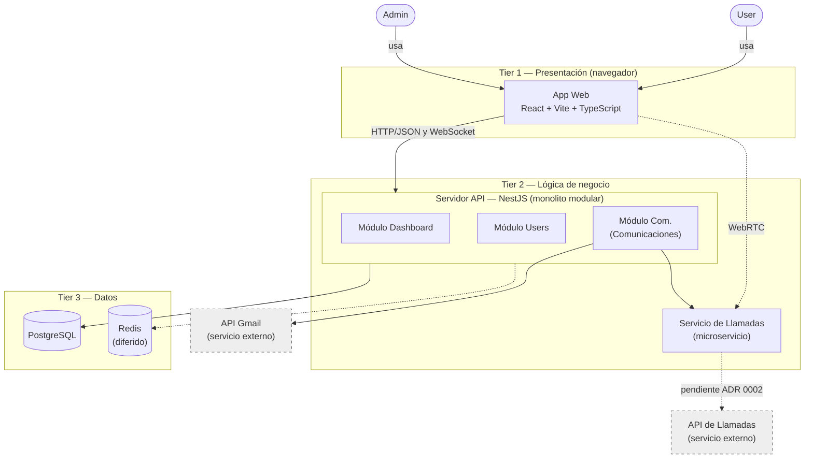
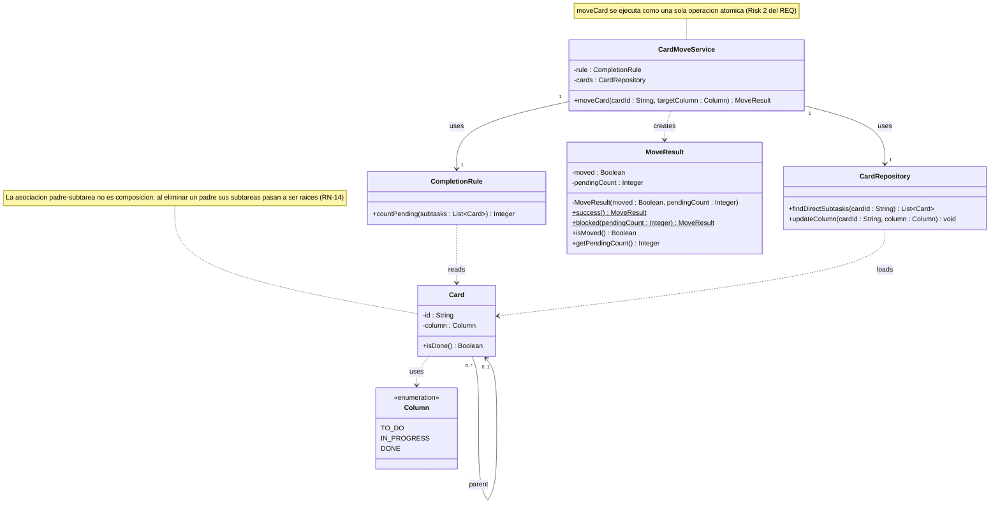

<!--
HOW TO USE THIS TEMPLATE
------------------------
1. Copy this file to docs/design/01_Architectural_and_Detailed_Design.md in your team repository.
2. This is v1.0 of work you already started: your Class 11 "Architectural Hypothesis v0.1"
   and your Class 12 "Detailed Design v0.1". Extend them to your whole system. Do not restart.
3. Use YOUR project. Generic examples (e-commerce, food delivery, banking, library) are
   only reference material and cannot be submitted as project artifacts.
4. Fill in every section. If something genuinely does not apply, write "N/A: reason".
   Never invent content to fill a blank.
5. Every diagram needs the table or argument that explains it. A diagram records design
   decisions. It does not create them.
6. Diagrams: Mermaid is preferred because it renders on GitHub. PlantUML or another tool is
   accepted if the exported image is committed and embedded in this file.
   Optionally, also add a JPG of each diagram in docs/design/diagrams/ (the Markdown prevails if they differ).
7. Read Design_Deliverable_1_Example.md for the expected level of detail. Do not copy it.
-->

# Slackless — Architectural & Detailed Design v1.0

| | |
|---|---|
| **Team** | Grupo 2 |
| **Members** | David Esteban Raigosa Socha, Deisy Viviana Lara Sisa, Hare Zeiyiukuin Atehortua Rincon, Fredy Humberto Garzon Salgado, Silvana Ramirez Ardila |
| **Status** | Ready for review |
| **Date** | 2026-10-19 |
| **Inputs** | `docs/requerimientos/` (REQ de RF-ARB-07, SRS, casos de uso), Architectural Hypothesis v0.1 (`docs/design/01-arquitectura-tres-capas.mmd`), ADR 0001 (`docs/adr/0001_Eleccion_Stack.md`), ADR 0003 (`docs/adr/0003_Validacion_Cierre_En_Servidor.md`), Detailed Design v0.1 (Class 12) |

---

## 1. System Overview & Design Drivers

**System purpose** 
> Slackless es una aplicación web para equipos de 3 a 8 personas que reúne en un solo lugar el chat por canales, un tablero kanban con árbol de tareas, roles según habilidades declaradas, notificaciones configurables y votaciones dentro del chat (SRS §1.2). Su usuario objetivo necesita arrancar en minutos sin saturarse de funciones, y su líder necesita que el tablero no mienta sobre el avance real (SRS §2.3).

**Requirements that shape the structure** *(the ones that most influence the design, not all of them)*

| Requirement / Use Case ID | Why it shapes the structure | Quality attribute, constraint or business rule involved |
|---|---|---|
| RF-ARB-07 / CU-19 "Mover una tarea con subtareas a *Hecho*" | La regla debe aplicarse en el servidor, antes de guardar el movimiento; una validación solo en la interfaz se puede saltar (Risk 1 del REQ, AC-ARB-07.4). | RN-12, RNF-SEG-02, RNF-SEG-03 |
| RF-KAN-04 / CU-26 "Mover una tarjeta entre columnas" | El sistema debe procesar el movimiento de una tarjeta entre las tres columnas fijas y actualizar el tablero. | RF-KAN-01, RNF-REN-01, RNF-REN-02 |
| RF-CHA-04, RF-KAN-05 / Actualización en tiempo real | Mensajes y cambios del tablero deben llegar a los demás clientes sin recargar, en máximo 1 s: hace falta un canal de eventos en tiempo real entre el servidor y la aplicación web. | RNF-REN-01, RNF-REN-02; ADR 0001 (Socket.IO) |
| RN-01 / Membresía del equipo | Cada operación sobre recursos de equipo comprueba en el servidor que el usuario pertenece al equipo propietario del recurso. | RN-01, RNF-SEG-02; ADR 0001 (guards de NestJS) |
| Todos los RF / Organización modular | Servidor organizado en módulos por área funcional (monolito modular), separando la información estructurada (usuarios, tableros, tareas, mensajes) de los datos efímeros (presencia, "escribiendo", caché; diferido). | RNF-MAN-04, RNF-CON-02, RES-01; ADR 0001 (React, NestJS, PostgreSQL, Redis) |

---

## 2. Architectural Design

*(Outward-facing: what are the major parts, what is each responsible for, how do they interact?)*

### 2.1 System Context & Boundary

| Outside the system | Type (actor / external system / hardware) | How the system interacts with it |
|---|---|---|
| Admin | Actor (persona) | Usa la aplicación web para administrar su equipo (rol con permisos de administración, RN-04). |
| User | Actor (persona) | Usa la aplicación web para chatear, gestionar tareas y votar. |
| API Gmail | External system | El módulo Com. se apoya en ella para enviar correo (notificación por correo, RF-NOT-06, *Should*). |
| API de Llamadas | External system | El Servicio de Llamadas se apoyaría en ella; la decisión está pendiente del ADR 0002. |

*Dentro de la frontera quedan la aplicación web, el servidor API con sus módulos, el Servicio de Llamadas y los dos almacenes de datos, porque el equipo los construye, despliega y controla.*

### 2.2 Components, Responsibilities & Capabilities

Cover the principal functional scope of your whole system.



| Component | Main responsibility | Requirements / use cases supported | Provided capabilities | Required capabilities | Main dependencies |
|---|---|---|---|---|---|
| Aplicación web (`App Web`) | Presentar la interfaz, enviar las solicitudes del usuario y mostrar sus resultados (por ejemplo, revertir un arrastre rechazado). | Requerimientos de interfaz (`RNF-USA-*`) y todos los casos de uso del usuario (`CU-01` a `CU-40`) | Interfaz de usuario para miembros y administradores | Datos y eventos en tiempo real del Servidor API (HTTP/JSON y WebSocket); llamadas de voz del Servicio de Llamadas (WebRTC) | Servidor API, Servicio de Llamadas |
| Módulo Dashboard | Gestionar el tablero kanban, el árbol de tareas (incluidas las reglas de cierre y de jerarquía) y los labels y habilidades. | `RF-KAN-*` (`CU-25` a `CU-29`), `RF-ARB-*` (`CU-17` a `CU-24`, entre ellos `RF-ARB-07`), `RF-LAB-*` (`CU-30` a `CU-33`) | Operaciones del tablero, árbol de tareas y habilidades a la aplicación web | Persistencia de datos estructurados | Persistencia de datos estructurados |
| Módulo Users | Gestionar cuentas, sesiones y equipos (membresías y códigos de invitación). | `RF-CUE-*` (`CU-01` a `CU-09`) | Operaciones de cuentas y equipos a la aplicación web | Persistencia de datos estructurados | Persistencia de datos estructurados |
| Módulo Com. (Comunicaciones) | Gestionar las comunicaciones del equipo: chat por canales y mensajes directos, votaciones, notificaciones, llamadas y envío de correo. | `RF-CHA-*` (`CU-10` a `CU-16`), `RF-NOT-*` (`CU-34` a `CU-36`), `RF-VOT-*` (`CU-37` a `CU-40`) | Operaciones de comunicación, encuestas y notificaciones a la aplicación web | Servicio de Llamadas; envío de correo (`API Gmail`); persistencia y estado efímero | Servicio de Llamadas, API Gmail, Persistencia de datos estructurados, Estado efímero |
| Servicio de Llamadas | Gestionar las llamadas de voz entre miembros (propuesta futura, pendiente de ADR 0002). | N/A: propuesta en evaluación fuera del SRS actual (ADR 0002) | Llamadas de voz a la aplicación web (WebRTC) y al módulo Com. | Proveedor externo de llamadas (pendiente ADR 0002) | API de Llamadas |
| Persistencia de datos estructurados (`PostgreSQL`) | Guardar usuarios, equipos, tableros, tareas, encuestas y mensajes con integridad relacional (PostgreSQL, ADR 0001). | `RNF-CON-02` | Almacenamiento y consulta de datos estructurados | — | — |
| Estado efímero (`Redis`, diferido) | Guardar presencia, "escribiendo" y caché (Redis, ADR 0001). | `RNF-REN-01`, `RNF-REN-02` (soporte para eventos efímeros y presencia) | Almacenamiento de datos efímeros | — | — |

---

## 3. Detailed Design

### 3.1 Components selected (at least two)

| Component | Why it was selected (risk, complexity, centrality to the drivers) |
|---|---|
| Módulo Dashboard | Contiene el requerimiento final, RF-ARB-07, que el equipo documentó como el más importante y complejo: cruza el movimiento de tarjetas (RF-KAN-04), la jerarquía de subtareas (RF-ARB-01, RF-ARB-02) y la propagación en tiempo real (RF-KAN-05), y protege la regla RN-12, que RNF-MAN-02 exige cubrir con pruebas automatizadas. |

> El diseño detallado de esta entrega se concentra en RF-ARB-07. La arquitectura general representa el alcance principal de Slackless; el análisis interno de clases y comportamiento se desarrolla aquí para el componente Dashboard, responsable de esta regla.

### 3.2 Class Diagram(s)


*`CardRepository` es el uso que hace Dashboard de la persistencia de datos estructurados (tier 3). `Card` muestra solo los atributos que intervienen en este requerimiento; una tarjeta también tiene título, labels, responsable, fecha límite y color (RF-ARB-01, RF-ARB-13), que se omiten a propósito. Las firmas son independientes del lenguaje: en TypeScript las operaciones que tocan la base de datos serían asíncronas.*

**Por qué la relación padre-subtarea es una asociación y no una composición:** al eliminar una tarjeta con subtareas, estas se conservan y pasan a ser tareas raíz (RN-14, RF-ARB-12). Una subtarea no pierde su existencia con su padre, así que no cumple la condición de la composición. La multiplicidad refleja que una tarjeta tiene como máximo un padre (RN-11, sin ciclos) y puede tener cero o más subtareas directas.

### Relaciones y su justificación

| Relación | Tipo | Dirección (quién conoce a quién) | Por qué |
|---|---|---|---|
| `CardMoveService` → `CompletionRule` | Asociación (atributo `rule`) | El servicio conoce a la regla; la regla no conoce al servicio | El servicio mantiene la regla como colaborador durante toda su vida (inyección de dependencias de NestJS, ADR 0001). |
| `CardMoveService` → `CardRepository` | Asociación (atributo `cards`) | El servicio conoce al repositorio; el repositorio no conoce al servicio | Igual que la anterior: el repositorio es la única vía a la persistencia. |
| `CardMoveService` ⇢ `MoveResult` | Dependencia | Solo el servicio lo crea y lo devuelve | No lo guarda como atributo; existe solo durante la llamada. |
| `CompletionRule` ⇢ `Card` | Dependencia | La regla lee tarjetas; `Card` no conoce la regla | Recibe las subtareas como parámetro y solo pregunta `isDone()`. |
| `CardRepository` ⇢ `Card` | Dependencia | El repositorio construye y devuelve tarjetas; `Card` no conoce al repositorio | Evita que el dominio dependa de la persistencia. |
| `Card` → `Card` (`parent`, 0..* a 0..1) | Asociación reflexiva | La subtarea conoce a su padre | **No es composición**: al eliminar una tarjeta sus subtareas pasan a ser raíces (RN-14, RF-ARB-12), así que no mueren con el padre. Una tarjeta tiene como máximo un padre y puede tener cero o más subtareas (RN-11, sin ciclos). |
| `Card` ⇢ `Column` | Dependencia | `Card` usa la enumeración como tipo de su atributo | `Column` es un valor fijo (RF-KAN-01), no una entidad con vida propia. |

No se usa generalización: una subtarea es una `Card` completa (RF-ARB-01), no un subtipo con comportamiento distinto. Todas las flechas apuntan en un solo sentido y ninguna regresa a `CardMoveService`, de modo que el grafo de dependencias no tiene ciclos.

### 3.3 Class Responsibilities

| Clase | Responsabilidad | Conoce a | Es conocida por | Requisitos |
|---|---|---|---|---|
| `CardMoveService` | Atender la solicitud explícita de un miembro de mover una tarjeta; aplicar la regla de cierre cuando el destino es *Hecho* y guardar el movimiento solo si se cumple. | `CompletionRule`, `CardRepository`, `MoveResult` (la crea) | Quien invoca el servicio (controlador/gateway, fuera de este diagrama) | RF-ARB-07, RF-ARB-08, RF-KAN-04, RN-13 |
| `CompletionRule` | Decidir cuántas subtareas directas impiden cerrar una tarjeta. No consulta la base de datos: recibe las subtareas y devuelve un número. | `Card` | `CardMoveService` | RN-12, RNF-MAN-02 |
| `CardRepository` | Único acceso del módulo a la persistencia de tarjetas: leer las subtareas directas y cambiar la columna. | `Card` | `CardMoveService` | RNF-CON-02 |
| `Card` | Representar una tarjeta del tablero y responder si está terminada, sin exponer cómo se representa *Hecho*. | `Column`, `Card` (su padre) | `CompletionRule`, `CardRepository` | RF-KAN-01, RN-11, RN-14 |
| `Column` | Enumerar las tres columnas fijas del tablero. | — | `Card` | RF-KAN-01 |
| `MoveResult` | Informar el resultado: si se movió y cuántas subtareas están pendientes. Solo se crea con `success()` o `blocked(n)`, para que no exista un resultado contradictorio. El texto del mensaje lo arma la interfaz. | — | `CardMoveService` (la crea) y quien lo recibe | RF-ARB-07, RNF-USA-04 |

### 3.4 Behavior of one key operation

`CardMoveService.moveCard(cardId, targetColumn)`: caso de uso "Mover una tarea a *Hecho*".

```text
moveCard(cardId, targetColumn) -> MoveResult
 1  IF targetColumn IS NOT DONE
 2      cards.updateColumn(cardId, targetColumn)           # RF-KAN-04: the rule applies only to DONE
 3      RETURN MoveResult.success()
 4  # steps 5-9 must run as one atomic operation (Risk 2 of the REQ)
 5  subtasks = cards.findDirectSubtasks(cardId)
 6  pending  = rule.countPending(subtasks)                 # 0 if the card has no subtasks
 7  IF pending > 0                                         # non-happy path (RN-12)
 8      RETURN MoveResult.blocked(pending)                 # nothing is saved
 9  cards.updateColumn(cardId, DONE)
10  RETURN MoveResult.success()
```

*Supuestos: (1) la verificación de membresía (RN-01, RNF-SEG-02) la hace un guard de NestJS antes de llegar a este servicio, como indica el ADR 0001; (2) quien invoca el servicio avisa a los demás clientes por WebSocket cuando `isMoved() = true` (RF-KAN-05, RNF-REN-02). La operación solo se ejecuta cuando un miembro la solicita; ningún cambio en las subtareas dispara el movimiento del padre (RF-ARB-08, RN-13).*

---

## 4. Design Quality — Cohesion, Coupling, Information Hiding
 
| Question | Your answer, with evidence from your design |
|---|---|
| **Cohesion:** do the responsibilities inside each class or component belong together? | Sí, cada clase hace una sola cosa. `CompletionRule` solo decide cuántas subtareas faltan por terminar (RN-12). Si cambia qué cuenta como "pendiente" (Open Question 3 del REQ), solo hay que tocar esta clase. `CardRepository` solo lee y guarda tarjetas. `CardMoveService` solo decide si la tarjeta se mueve o no; no tiene la regla ni el acceso a los datos. |
| **Coupling:** how far does a change in one element spread? Where are the strongest dependencies? | La clase que más depende de otras es `CardMoveService`, porque usa a `CompletionRule` y a `CardRepository`. `CompletionRule` solo conoce a `Card`, así que un cambio en cómo se guardan los datos no la afecta. Ese cambio se queda dentro de `CardRepository`. Además, todas las flechas van en un solo sentido y ninguna regresa a `CardMoveService`, así que no hay dependencias en círculo. |
| **Information hiding:** what did you keep private or internal, and why? | Los atributos de `Card` y `MoveResult` son privados, y también las clases que usa `CardMoveService`. El constructor de `MoveResult` también es privado: solo se puede crear con `success()` o `blocked(n)`, así que no puede existir un resultado contradictorio (por ejemplo, "movido" y con subtareas pendientes). `Card.isDone()` esconde cómo se representa *Hecho* (RF-KAN-01), así que `CompletionRule` no tiene que comparar columnas. `CardRepository` esconde cómo se guardan los datos. `MoveResult` solo entrega números (si se movió y cuántas subtareas faltan); el texto del mensaje lo arma la interfaz (RNF-USA-02, RNF-USA-04). |
 
**At least one real finding** (a problem you found in your own design) **and what you changed or would change:**
> **Hallazgo 1 (cambiado).** La idea inicial era tener una clase que moviera la tarjeta padre según el resultado de sus hijas. Al revisarla frente a RF-ARB-08 y RN-13 (el padre nunca se mueve solo) se vio que, planteada así, invitaba a un movimiento automático cuando la última hija terminara. Se cambió: la clase que mueve (`CardMoveService`) solo actúa ante la solicitud explícita de un miembro, y la comprobación de las hijas quedó separada en `CompletionRule`.
> **Hallazgo 2 (pendiente de resolver).** Todavía no está definido cómo se asegura que leer las subtareas y guardar el movimiento pasen "de una sola vez", sin que otro miembro cambie algo en medio (Risk 2 del REQ). Por ejemplo, si alguien devuelve una subtarea a *En progreso* justo mientras se mueve el padre a *Hecho*, el padre podría quedar en *Hecho* con una hija abierta. En el diagrama solo lo dejamos anotado en una nota sobre `CardMoveService`. Lo que cambiaríamos es que `CardRepository` haga la lectura y el guardado dentro de una sola transacción de PostgreSQL (registrado como riesgo de atomicidad en el ADR 0003).
 
---
 
## 5. Design Decisions & Decision Record
 
### Decision A — Architectural
 
| | |
|---|---|
| **Context** (requirement, constraint or problem that motivated it) | RF-ARB-07 y RN-12 dicen que una tarjeta con subtareas pendientes no puede quedar en *Hecho*. El Risk 1 del REQ y el escenario AC-ARB-07.4 muestran que, si la regla solo está en la interfaz, alguien puede saltarla enviando la petición directo al servidor. RNF-SEG-02 pide revisar todo en el servidor. |
| **Decision** | La regla de cierre se aplica en el servidor, en el módulo Dashboard, antes de guardar el movimiento. La interfaz solo pide el movimiento y muestra lo que responde el servidor. |
| **Rationale** (why it is reasonable here) | Si la regla estuviera solo en el cliente, una petición enviada sin pasar por la interfaz dejaría el tablero con un padre en *Hecho* y subtareas abiertas, que es justo lo que RF-ARB-07 quiere evitar. En el servidor, todas las peticiones pasan por la misma revisión. Además, el ADR 0001 eligió NestJS justamente para manejar permisos con *guards* y validar los datos que llegan con *DTOs*, o sea, para revisar las peticiones en el servidor. |
| **Trade-off accepted** | La interfaz no sabe si el movimiento es válido hasta que el servidor responde, así que tiene que devolver la tarjeta a su columna si lo rechaza. Eso puede verse como un "salto" y choca con el objetivo del ADR 0001 de actualizar el tablero sin parpadeos de pantalla (la estimación del REQ ya lo marca como una razón para la confianza *Medium*). |
 
### Decision B — Detailed design
 
| | |
|---|---|
| **Context** | RNF-MAN-02 exige pruebas automáticas para RN-12. RF-ARB-08 y RN-13 dicen que el padre nunca se mueve solo. Las Open Questions 1 y 2 del REQ muestran que otros casos (crear una subtarea, cambiar el padre, reabrir una hija) podrían necesitar esta misma regla más adelante. |
| **Decision** | Separar la regla de cierre en una clase propia, `CompletionRule`, que solo recibe una lista de subtareas y devuelve cuántas están pendientes. La clase `CardMoveService` solo atiende la petición de mover una tarjeta. |
| **Rationale** | `CompletionRule` se puede probar sin base de datos, que es lo que pide RNF-MAN-02. Qué cuenta como "pendiente" queda en un solo lugar (Open Question 3). Y `CardMoveService` solo se ejecuta cuando un miembro lo pide, sin ningún camino automático (RN-13). |
| **Trade-off accepted** | Se agrega una clase más, y `CardMoveService` depende de ella, para una regla que hoy se usa en una sola operación. Pensamos dejar la regla dentro de `CardMoveService` (menos clases), pero entonces para probar RN-12 habría que simular la base de datos. |
 
### ADR
 
**ADR file:** `docs/adr/0003_Validacion_Cierre_En_Servidor.md` — records Decision A. *(Se numera 0003 porque el diagrama de tres capas reserva el ADR 0002 para el proveedor de llamadas. Sigue la estructura del ADR 0001.)*
 
---

## 6. Traceability

| Requirement ID | Use Case | Component(s) | Class(es) |
|---|---|---|---|
| RF-ARB-07, RN-12 | CU-19 — Mover una tarjeta con subtareas a *Hecho* | Módulo Dashboard, Aplicación web, Persistencia de datos estructurados | `CardMoveService`, `CompletionRule`, `CardRepository`, `Card`, `Column`, `MoveResult` |
| RF-KAN-04, RF-KAN-01 | CU-26 — Mover una tarjeta entre columnas | Módulo Dashboard, Aplicación web, Persistencia de datos estructurados | `CardMoveService`, `CardRepository`, `Card`, `Column`, `MoveResult` |
| RF-KAN-05, RNF-REN-01, RNF-REN-02 | CU-19, CU-26 — Actualización del tablero en tiempo real | Módulo Dashboard, Aplicación web, Estado efímero | `CardMoveService`, `MoveResult` (quien invoca el servicio emite el evento por WebSocket) |
| RN-01, RNF-SEG-02 | Todos los casos de uso sobre recursos de equipo | Módulo Dashboard, Módulo Users, Módulo Com. | Guard de membresía de NestJS (previo a `CardMoveService`) |
| RNF-CON-02, RNF-SEG-03 | CU-19, CU-26 — Persistencia e integridad del movimiento | Módulo Dashboard, Persistencia de datos estructurados | `CardRepository` (guarda solo un movimiento válido) |
| RNF-MAN-02 | CU-19 — Prueba automatizada de RN-12 | Módulo Dashboard | `CompletionRule`, `Card` |
| RF-CUE-* | CU-01 a CU-09 — Cuentas y equipos | Módulo Users, Aplicación web, Persistencia de datos estructurados | N/A: no se detalla en esta entrega |
| RF-CHA-*, RF-NOT-*, RF-VOT-* | CU-10 a CU-16, CU-34 a CU-40 — Chat, notificaciones y votaciones | Módulo Com., Aplicación web, Persistencia de datos estructurados, Estado efímero | N/A: no se detalla en esta entrega |
| Propuesta de llamadas (pendiente ADR 0004) | Llamadas de voz entre miembros | Servicio de Llamadas, Módulo Com., Aplicación web | N/A: pendiente de ADR 0004 |

---

## 7. Optional — AI-Assisted Design Reflection

> Aceptamos la sugerencia de la IA de incluir la clase `MoveResult` en el diagrama de clases con constructor privado y métodos de fábrica (`success()` y `blocked(pendingCount)`). En nuestra idea inicial pensábamos devolver solo un estado simple o manejar el aviso por separado, pero `MoveResult` nos permitió empaquetar tanto si la tarjeta se movió (`moved`) como la cantidad exacta de subtareas pendientes (`pendingCount`) que exige mostrar RF-ARB-07, evitando estados contradictorios y dejando que la interfaz arme el mensaje para el usuario.

---

## 8. Consistency Checklist

- [x] Every component in the diagram appears in the responsibilities table, and the other way around.
- [x] Every class belongs to an identifiable component. *(Todas las clases de la sección 3 pertenecen al Módulo Dashboard).*
- [x] Components are named by responsibility, not technology. *(En la tabla 2.2 se nombran por su responsabilidad y se aclara su correspondencia con el ADR 0001).*
- [x] Nothing inside the system boundary is something you do not control. *(API Gmail y API de Llamadas quedan fuera de la frontera).*
- [x] Provided and required capabilities match across components (what one requires, another provides).
- [x] Both decisions name a real cost or limitation, and at least one has an ADR. *(Decision A registrada en `docs/adr/0003_Validacion_Cierre_En_Servidor.md`).*
- [x] The traceability table has no empty rows and no orphan components or classes.
- [x] Diagrams render correctly on GitHub (or the exported images are embedded).
