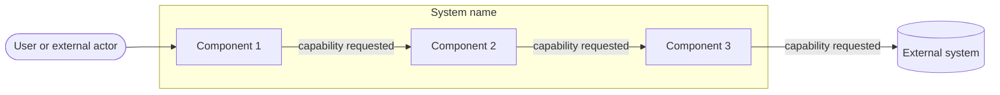
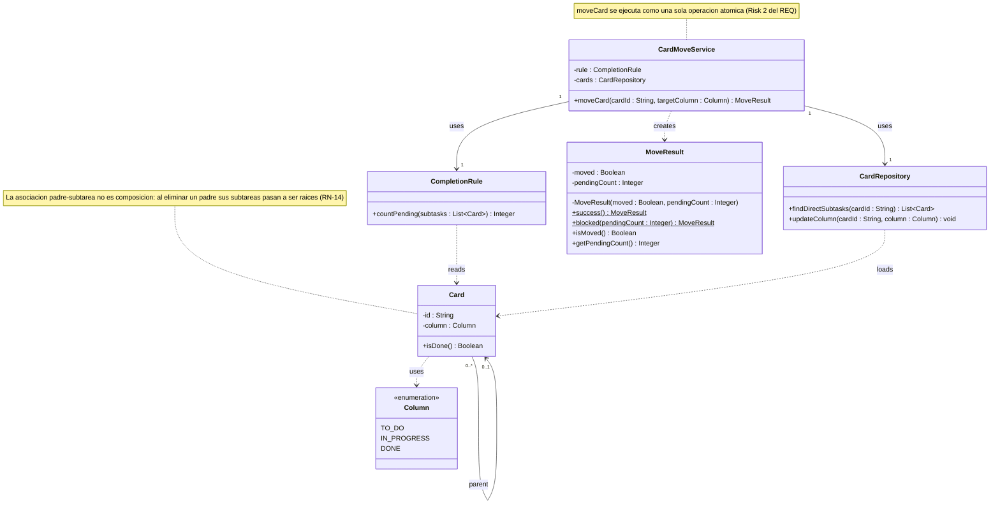

<!--
HOW TO USE THIS TEMPLATE
------------------------
1. Copy this file to docs/design/01_Architectural_and_Detailed_Design.md in your team repository.
2. This is v1.0 of work you already started: your Class 11 "Architectural Hypothesis v0.1"
   and your Class 12 "Detailed Design v0.1". Extend them to your whole system. Do not restart.
3. Use YOUR project. Generic examples (e-commerce, food delivery, banking, library) are
   only reference material and cannot be submitted as project artifacts.
4. Fill in every section. If something genuinely does not apply, write "N/A: reason".
   Never invent content to fill a blank.
5. Every diagram needs the table or argument that explains it. A diagram records design
   decisions. It does not create them.
6. Diagrams: Mermaid is preferred because it renders on GitHub. PlantUML or another tool is
   accepted if the exported image is committed and embedded in this file.
   Optionally, also add a JPG of each diagram in docs/design/diagrams/ (the Markdown prevails if they differ).
7. Read Design_Deliverable_1_Example.md for the expected level of detail. Do not copy it.
-->

# [Project Name] — Architectural & Detailed Design v1.0

| | |
|---|---|
| **Team** | |
| **Members** | |
| **Status** | Draft / Ready for review |
| **Date** | |
| **Inputs** | `docs/requirements/`, Architectural Hypothesis v0.1 (Class 11), Detailed Design v0.1 (Class 12) |

---

## 1. System Overview & Design Drivers

**System purpose** (2–3 sentences, in terms of the need it satisfies)
>

**Requirements that shape the structure** *(the ones that most influence the design, not all of them)*

| Requirement / Use Case ID | Why it shapes the structure | Quality attribute, constraint or business rule involved |
|---|---|---|
| | | |

---

## 2. Architectural Design

*(Outward-facing: what are the major parts, what is each responsible for, how do they interact?)*

### 2.1 System Context & Boundary

| Outside the system | Type (actor / external system / hardware) | How the system interacts with it |
|---|---|---|
| | | |

### 2.2 Components, Responsibilities & Capabilities

Cover the principal functional scope of your whole system.



*(Everything inside `SYS` is what you build and control. Everything outside is what you only interact with. Label each arrow with the capability being requested.)*

| Component | Main responsibility | Requirements / use cases supported | Provided capabilities | Required capabilities | Main dependencies |
|---|---|---|---|---|---|
| | | | | | |

*Checks: is every component named by responsibility, not technology ("the component that persists orders", not "the database")? Does any component exist only to make the diagram look more complex?*

---

## 3. Detailed Design

*(Inward-facing: how is each selected component designed internally?)*

### 3.1 Components selected (at least two)

| Component | Why it was selected (risk, complexity, centrality to the drivers) |
|---|---|
| | |

### 3.2 Class Diagram(s)


*`CardRepository` es el uso que hace Dashboard de la persistencia de datos estructurados (tier 3). `Card` muestra solo los atributos que intervienen en este requerimiento; una tarjeta también tiene título, labels, responsable, fecha límite y color (RF-ARB-01, RF-ARB-13), que se omiten a propósito. Las firmas son independientes del lenguaje: en TypeScript las operaciones que tocan la base de datos serían asíncronas.*

**Por qué la relación padre-subtarea es una asociación y no una composición:** al eliminar una tarjeta con subtareas, estas se conservan y pasan a ser tareas raíz (RN-14, RF-ARB-12). Una subtarea no pierde su existencia con su padre, así que no cumple la condición de la composición. La multiplicidad refleja que una tarjeta tiene como máximo un padre (RN-11, sin ciclos) y puede tener cero o más subtareas directas.

### Relaciones y su justificación

| Relación | Tipo | Dirección (quién conoce a quién) | Por qué |
|---|---|---|---|
| `CardMoveService` → `CompletionRule` | Asociación (atributo `rule`) | El servicio conoce a la regla; la regla no conoce al servicio | El servicio mantiene la regla como colaborador durante toda su vida (inyección de dependencias de NestJS, ADR 0001). |
| `CardMoveService` → `CardRepository` | Asociación (atributo `cards`) | El servicio conoce al repositorio; el repositorio no conoce al servicio | Igual que la anterior: el repositorio es la única vía a la persistencia. |
| `CardMoveService` ⇢ `MoveResult` | Dependencia | Solo el servicio lo crea y lo devuelve | No lo guarda como atributo; existe solo durante la llamada. |
| `CompletionRule` ⇢ `Card` | Dependencia | La regla lee tarjetas; `Card` no conoce la regla | Recibe las subtareas como parámetro y solo pregunta `isDone()`. |
| `CardRepository` ⇢ `Card` | Dependencia | El repositorio construye y devuelve tarjetas; `Card` no conoce al repositorio | Evita que el dominio dependa de la persistencia. |
| `Card` → `Card` (`parent`, 0..* a 0..1) | Asociación reflexiva | La subtarea conoce a su padre | **No es composición**: al eliminar una tarjeta sus subtareas pasan a ser raíces (RN-14, RF-ARB-12), así que no mueren con el padre. Una tarjeta tiene como máximo un padre y puede tener cero o más subtareas (RN-11, sin ciclos). |
| `Card` ⇢ `Column` | Dependencia | `Card` usa la enumeración como tipo de su atributo | `Column` es un valor fijo (RF-KAN-01), no una entidad con vida propia. |

No se usa generalización: una subtarea es una `Card` completa (RF-ARB-01), no un subtipo con comportamiento distinto. Todas las flechas apuntan en un solo sentido y ninguna regresa a `CardMoveService`, de modo que el grafo de dependencias no tiene ciclos.

### 3.3 Class Responsibilities

| Clase | Responsabilidad | Conoce a | Es conocida por | Requisitos |
|---|---|---|---|---|
| `CardMoveService` | Atender la solicitud explícita de un miembro de mover una tarjeta; aplicar la regla de cierre cuando el destino es *Hecho* y guardar el movimiento solo si se cumple. | `CompletionRule`, `CardRepository`, `MoveResult` (la crea) | Quien invoca el servicio (controlador/gateway, fuera de este diagrama) | RF-ARB-07, RF-ARB-08, RF-KAN-04, RN-13 |
| `CompletionRule` | Decidir cuántas subtareas directas impiden cerrar una tarjeta. No consulta la base de datos: recibe las subtareas y devuelve un número. | `Card` | `CardMoveService` | RN-12, RNF-MAN-02 |
| `CardRepository` | Único acceso del módulo a la persistencia de tarjetas: leer las subtareas directas y cambiar la columna. | `Card` | `CardMoveService` | RNF-CON-02 |
| `Card` | Representar una tarjeta del tablero y responder si está terminada, sin exponer cómo se representa *Hecho*. | `Column`, `Card` (su padre) | `CompletionRule`, `CardRepository` | RF-KAN-01, RN-11, RN-14 |
| `Column` | Enumerar las tres columnas fijas del tablero. | — | `Card` | RF-KAN-01 |
| `MoveResult` | Informar el resultado: si se movió y cuántas subtareas están pendientes. Solo se crea con `success()` o `blocked(n)`, para que no exista un resultado contradictorio. El texto del mensaje lo arma la interfaz. | — | `CardMoveService` (la crea) y quien lo recibe | RF-ARB-07, RNF-USA-04 |

### 3.4 Behavior of one key operation

`CardMoveService.moveCard(cardId, targetColumn)`: caso de uso "Mover una tarea a *Hecho*".

```text
moveCard(cardId, targetColumn) -> MoveResult
 1  IF targetColumn IS NOT DONE
 2      cards.updateColumn(cardId, targetColumn)           # RF-KAN-04: the rule applies only to DONE
 3      RETURN MoveResult.success()
 4  # steps 5-9 must run as one atomic operation (Risk 2 of the REQ)
 5  subtasks = cards.findDirectSubtasks(cardId)
 6  pending  = rule.countPending(subtasks)                 # 0 if the card has no subtasks
 7  IF pending > 0                                         # non-happy path (RN-12)
 8      RETURN MoveResult.blocked(pending)                 # nothing is saved
 9  cards.updateColumn(cardId, DONE)
10  RETURN MoveResult.success()
```

## 4. Design Quality — Cohesion, Coupling, Information Hiding
 
| Question | Your answer, with evidence from your design |
|---|---|
| **Cohesion:** do the responsibilities inside each class or component belong together? | Sí, cada clase hace una sola cosa. `CompletionRule` solo decide cuántas subtareas faltan por terminar (RN-12). Si cambia qué cuenta como "pendiente" (Open Question 3 del REQ), solo hay que tocar esta clase. `CardRepository` solo lee y guarda tarjetas. `CardMoveService` solo decide si la tarjeta se mueve o no; no tiene la regla ni el acceso a los datos. |
| **Coupling:** how far does a change in one element spread? Where are the strongest dependencies? | La clase que más depende de otras es `CardMoveService`, porque usa a `CompletionRule` y a `CardRepository`. `CompletionRule` solo conoce a `Card`, así que un cambio en cómo se guardan los datos no la afecta. Ese cambio se queda dentro de `CardRepository`. Además, todas las flechas van en un solo sentido y ninguna regresa a `CardMoveService`, así que no hay dependencias en círculo. |
| **Information hiding:** what did you keep private or internal, and why? | Los atributos de `Card` y `MoveResult` son privados, y también las clases que usa `CardMoveService`. El constructor de `MoveResult` también es privado: solo se puede crear con `success()` o `blocked(n)`, así que no puede existir un resultado contradictorio (por ejemplo, "movido" y con subtareas pendientes). `Card.isDone()` esconde cómo se representa *Hecho* (RF-KAN-01), así que `CompletionRule` no tiene que comparar columnas. `CardRepository` esconde cómo se guardan los datos. `MoveResult` solo entrega números (si se movió y cuántas subtareas faltan); el texto del mensaje lo arma la interfaz (RNF-USA-02, RNF-USA-04). |
 
**At least one real finding** (a problem you found in your own design) **and what you changed or would change:**
> **Hallazgo (pendiente de resolver).** Todavía no está definido cómo se asegura que leer las subtareas y guardar el movimiento pasen "de una sola vez", sin que otro miembro cambie algo en medio (Risk 2 del REQ). Por ejemplo, si alguien devuelve una subtarea a *En progreso* justo mientras se mueve el padre a *Hecho*, el padre podría quedar en *Hecho* con una hija abierta. En el diagrama solo lo dejamos anotado en una nota sobre `CardMoveService`, porque todavía no sabemos cómo se logra.
> **Lo que cambiaríamos:** que `CardRepository` haga la lectura y el guardado dentro de una sola transacción de PostgreSQL, de modo que si algo cambia en medio, el movimiento no se guarde. Esto ya aparece como riesgo de atomicidad en el ADR 0003; el mecanismo exacto se decide cuando se implemente.
 
---
 
## 5. Design Decisions & Decision Record
 
### Decision A — Architectural
 
| | |
|---|---|
| **Context** (requirement, constraint or problem that motivated it) | RF-ARB-07 y RN-12 dicen que una tarjeta con subtareas pendientes no puede quedar en *Hecho*. El Risk 1 del REQ y el escenario AC-ARB-07.4 muestran que, si la regla solo está en la interfaz, alguien puede saltarla enviando la petición directo al servidor. RNF-SEG-02 pide revisar todo en el servidor. |
| **Decision** | La regla de cierre se aplica en el servidor, en el módulo Dashboard, antes de guardar el movimiento. La interfaz solo pide el movimiento y muestra lo que responde el servidor. |
| **Rationale** (why it is reasonable here) | Si la regla estuviera solo en el cliente, una petición enviada sin pasar por la interfaz dejaría el tablero con un padre en *Hecho* y subtareas abiertas, que es justo lo que RF-ARB-07 quiere evitar. En el servidor, todas las peticiones pasan por la misma revisión. Además, el ADR 0001 eligió NestJS justamente para manejar permisos con *guards* y validar los datos que llegan con *DTOs*, o sea, para revisar las peticiones en el servidor. |
| **Trade-off accepted** | La interfaz no sabe si el movimiento es válido hasta que el servidor responde, así que tiene que devolver la tarjeta a su columna si lo rechaza. Eso puede verse como un "salto" y choca con el objetivo del ADR 0001 de actualizar el tablero sin parpadeos de pantalla (la estimación del REQ ya lo marca como una razón para la confianza *Medium*). |
 
### Decision B — Detailed design
 
| | |
|---|---|
| **Context** | RNF-MAN-02 exige pruebas automáticas para RN-12. RF-ARB-08 y RN-13 dicen que el padre nunca se mueve solo. Las Open Questions 1 y 2 del REQ muestran que otros casos (crear una subtarea, cambiar el padre, reabrir una hija) podrían necesitar esta misma regla más adelante. |
| **Decision** | Separar la regla de cierre en una clase propia, `CompletionRule`, que solo recibe una lista de subtareas y devuelve cuántas están pendientes. La clase `CardMoveService` solo atiende la petición de mover una tarjeta. |
| **Rationale** | `CompletionRule` se puede probar sin base de datos, que es lo que pide RNF-MAN-02. Qué cuenta como "pendiente" queda en un solo lugar (Open Question 3). Y `CardMoveService` solo se ejecuta cuando un miembro lo pide, sin ningún camino automático (RN-13). |
| **Trade-off accepted** | Se agrega una clase más, y `CardMoveService` depende de ella, para una regla que hoy se usa en una sola operación. Pensamos dejar la regla dentro de `CardMoveService` (menos clases), pero entonces para probar RN-12 habría que simular la base de datos. |
 
### ADR
 
**ADR file:** `docs/adr/0003_Validacion_Cierre_En_Servidor.md` — records Decision A. *(Se numera 0003 porque el diagrama de tres capas reserva el ADR 0002 para el proveedor de llamadas. Sigue la estructura del ADR 0001.)*
 
---

## 6. Traceability

| Requirement ID | Use Case | Component(s) | Class(es) |
|---|---|---|---|
| | | | |

*(Every requirement in Section 1 must appear. Every component and class should appear at least once. If an element traces to nothing, ask why it exists.)*

---

## 7. Optional — AI-Assisted Design Reflection

> One design recommendation generated by AI that the team accepted, modified or rejected, and why.

---

## 8. Consistency Checklist

- [ ] Every component in the diagram appears in the responsibilities table, and the other way around.
- [ ] Every class belongs to an identifiable component.
- [ ] Components are named by responsibility, not technology.
- [ ] Nothing inside the system boundary is something you do not control.
- [ ] Provided and required capabilities match across components (what one requires, another provides).
- [ ] Both decisions name a real cost or limitation, and at least one has an ADR.
- [ ] The traceability table has no empty rows and no orphan components or classes.
- [ ] Diagrams render correctly on GitHub (or the exported images are embedded).
