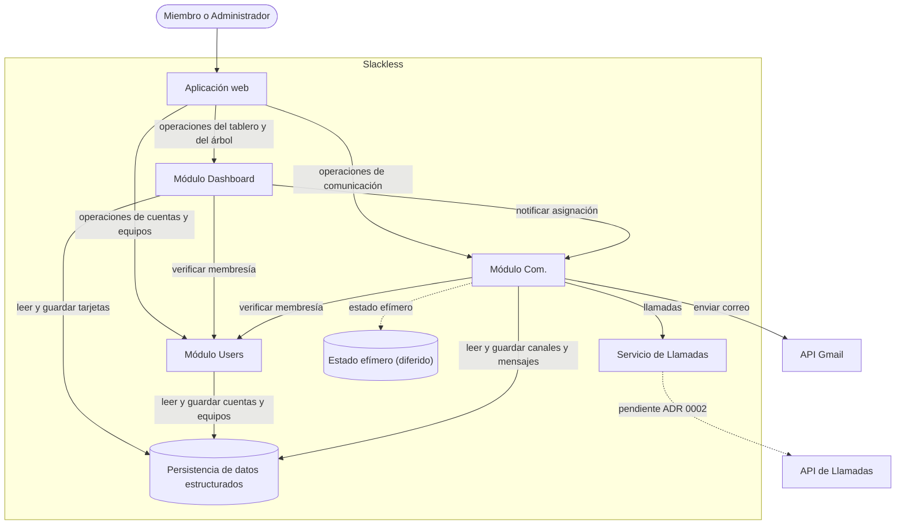
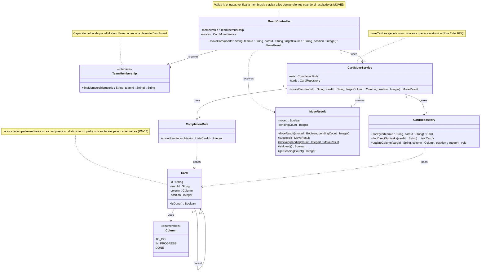

<!--
HOW TO USE THIS TEMPLATE
------------------------
1. Copy this file to docs/design/01_Architectural_and_Detailed_Design.md in your team repository.
2. This is v1.0 of work you already started: your Class 11 "Architectural Hypothesis v0.1"
   and your Class 12 "Detailed Design v0.1". Extend them to your whole system. Do not restart.
3. Use YOUR project. Generic examples (e-commerce, food delivery, banking, library) are
   only reference material and cannot be submitted as project artifacts.
4. Fill in every section. If something genuinely does not apply, write "N/A: reason".
   Never invent content to fill a blank.
5. Every diagram needs the table or argument that explains it. A diagram records design
   decisions. It does not create them.
6. Diagrams: Mermaid is preferred because it renders on GitHub. PlantUML or another tool is
   accepted if the exported image is committed and embedded in this file.
   Optionally, also add a JPG of each diagram in docs/design/diagrams/ (the Markdown prevails if they differ).
7. Read Design_Deliverable_1_Example.md for the expected level of detail. Do not copy it.
-->

# [Slackless] — Architectural & Detailed Design v1.0

| | |
|---|---|
| **Team** |Grupo 2 |
| **Members** |David Esteban Raigosa Socha, Deisy Viviana Lara Sisa, Hare Zeiyiukuin Atehortua Rincon, Fredy Humberto Garzon Salgado, Silvana Ramirez Ardila |
| **Status** | Ready for review |
| **Date** |2026-10-09 |
| **Inputs** | `docs/requirements/`, Architectural Hypothesis v0.1 (Class 11), Detailed Design v0.1 (Class 12), cambios derivados de `02_Interaction_and_Data_Design.md` |

---

## 1. System Overview & Design Drivers

**System purpose** 
> Slackless es una aplicación web para equipos pequeños que integra chat por canales, un tablero kanban con árbol de tareas, notificaciones y votaciones. Ayuda a sus integrantes a coordinar el trabajo en un mismo espacio y permite que sus líderes consulten el avance de las tareas.

**Requirements that shape the structure** *(the ones that most influence the design, not all of them)*

| Requirement / Use Case ID | Why it shapes the structure | Quality attribute, constraint or business rule involved |
|---|---|---|
| RF-ARB-07 / Mover una tarea a Hecho | El servidor debe comprobar las subtareas directas antes de guardar el cambio de columna. | RN-12, RNF-SEG-02 |
| RF-KAN-04 / Mover tarjetas | El sistema debe procesar el movimiento de una tarjeta y actualizar el tablero. | RNF-REN-01, RNF-REN-02 |
| RF-KAN-05 / Actualización del tablero en tiempo real | Los cambios deben llegar a los demás clientes sin recargar la página. | RNF-REN-01, RNF-REN-02 |
| RF-CHA-04 / Entrega de mensajes en tiempo real | Un mensaje enviado a un canal debe llegar a quienes lo tienen abierto sin recargar. Define quién entrega eventos en tiempo real (WebSocket) y quién guarda el mensaje. | RNF-REN-01 |
| RN-01 / Membresía del equipo | Las operaciones deben comprobar que el usuario pertenece al equipo propietario del recurso. | RNF-SEG-02 |

---

## 2. Architectural Design

*(Outward-facing: what are the major parts, what is each responsible for, how do they interact?)*

### 2.1 System Context & Boundary

| Outside the system | Type (actor / external system / hardware) | How the system interacts with it |
|---|---|---|
| Miembro (User) | Actor | Usa la aplicación web para chatear, mover tarjetas y consultar el avance. |
| Administrador (Admin) | Actor | Usa la misma aplicación web con permisos de administración del equipo. |
| API Gmail | External system | El Módulo Com. le envía los correos de notificación. |
| API de Llamadas | External system | El Servicio de Llamadas se apoya en ella; el proveedor está pendiente del ADR 0002. |

### 2.2 Components, Responsibilities & Capabilities



*El diagrama de tres capas del equipo no dibuja flechas entre módulos (limpieza pedida por el profesor); aquí sí aparecen porque las dependencias de capacidad entre módulos se documentan en las columnas «Required capabilities» y «Main dependencies» de la tabla.*

| Component | Main responsibility | Requirements / use cases supported | Provided capabilities | Required capabilities | Main dependencies |
|---|---|---|---|---|---|
| Aplicación web | Mostrar el tablero, los canales y las cuentas, y pedir las operaciones a los módulos del servidor. | RF-KAN-04, RF-KAN-05, RF-CHA-04, RNF-REN-01, RNF-REN-02 | Interfaz de usuario | Operaciones de Dashboard, Users y Com.; recepción de eventos en tiempo real | Módulo Dashboard, Módulo Users, Módulo Com. |
| Módulo Dashboard | Gestionar el tablero kanban y el árbol de tareas, incluidas las reglas de cierre y de jerarquía. | RF-KAN-*, RF-ARB-* (entre ellos RF-ARB-07), CU-19 | Operaciones del tablero y del árbol a la aplicación web (por ejemplo `moveCard`) | Persistencia de datos estructurados; **obtener la membresía de un usuario en un equipo** (Módulo Users); notificar (Módulo Com.) | Persistencia de datos estructurados, Módulo Users, Módulo Com. |
| Módulo Users | Gestionar cuentas, equipos y membresías, y devolver la membresía de un usuario en un equipo, si existe. | RF-CUE-*, RN-01, RN-02 | Operaciones de cuentas y equipos a la aplicación web; **`findMembership(userId, teamId)`** a Dashboard y a Com. | Persistencia de datos estructurados | Persistencia de datos estructurados |
| Módulo Com. (Comunicaciones) | **Gestionar los canales y mensajes del equipo y su entrega en tiempo real**, y apoyarse en el Servicio de Llamadas y en el envío de correo. *(Por confirmar por el equipo: A-1 de D2.)* | RF-CHA-*, CU-10 a CU-13, CU-12; RF-NOT-06 *(por confirmar)* | Operaciones de comunicación a la aplicación web (por ejemplo `sendMessage`); capacidad de notificar a Dashboard | Servicio de Llamadas; envío de correo (API Gmail); persistencia; **obtener la membresía** (Módulo Users) | Servicio de Llamadas, API Gmail, persistencia de datos estructurados, Módulo Users |
| Servicio de Llamadas | Atender las llamadas del equipo. | N/A en esta entrega (sin requisito en §1) | Llamadas (WebRTC) a la aplicación web | API de Llamadas (pendiente ADR 0002) | API de Llamadas |
| Persistencia de datos estructurados | Guardar y devolver usuarios, equipos, canales, mensajes y tarjetas (PostgreSQL, ADR 0001). | RNF-CON-02 | Leer y guardar datos estructurados | — | — |
| Estado efímero (diferido) | Guardar presencia y estado «escribiendo» cuando haya varias instancias del servidor (Redis, ADR 0001). | N/A: diferido | Leer y guardar datos de corta vida | — | — |

*Las filas de Aplicación web, Servicio de Llamadas, Persistencia y Estado efímero se redactaron a partir del diagrama de tres capas y de D2; compárelas con la versión v2 del equipo antes de entregar.*

---

## 3. Detailed Design

### 3.1 Components selected (at least two)

| Component | Why it was selected (risk, complexity, centrality to the drivers) |
|---|---|
| Módulo Dashboard | Contiene el requerimiento final, RF-ARB-07, que el equipo documentó como el más importante y complejo: cruza el movimiento de tarjetas (RF-KAN-04), la jerarquía de subtareas (RF-ARB-01, RF-ARB-02) y la propagación en tiempo real (RF-KAN-05), y protege la regla RN-12, que RNF-MAN-02 exige cubrir con pruebas automatizadas. |

> El diseño detallado de esta entrega se concentra en RF-ARB-07. La arquitectura general representa el alcance principal de Slackless; el análisis interno de clases y comportamiento se desarrolla aquí para el componente Dashboard, responsable de esta regla.

### 3.2 Class Diagram(s)



*`CardRepository` es el uso que hace Dashboard de la persistencia de datos estructurados (tier 3). `TeamMembership` no pertenece a Dashboard: es la capacidad `findMembership` que ofrece el Módulo Users y devuelve el identificador de la membresía o nada si el usuario no es miembro. `BoardController` la requiere y `CardMoveService` no la conoce, de modo que la regla de cierre sigue sin depender de cuentas ni de equipos. `Card` muestra solo los atributos que intervienen en este requerimiento: `teamId` porque toda lectura de tarjetas se filtra por equipo (RN-01, RN-06) y `position` porque el movimiento guarda columna y posición (CU-26); una tarjeta también tiene título, labels, responsable, fecha límite y color (RF-ARB-01, RF-ARB-13), que se omiten a propósito. Los errores `INVALID_INPUT`, `ACCESS_DENIED` y `CARD_NOT_FOUND` se expresan como fallos de la operación y no como `MoveResult`, que sigue informando solo si se movió y cuántas subtareas faltan. Las firmas son independientes del lenguaje: en TypeScript las operaciones que tocan la base de datos serían asíncronas.*

**Por qué la relación padre-subtarea es una asociación y no una composición:** al eliminar una tarjeta con subtareas, estas se conservan y pasan a ser tareas raíz (RN-14, RF-ARB-12). Una subtarea no pierde su existencia con su padre, así que no cumple la condición de la composición. La multiplicidad refleja que una tarjeta tiene como máximo un padre (RN-11, sin ciclos) y puede tener cero o más subtareas directas.

### Relaciones y su justificación

| Relación | Tipo | Dirección (quién conoce a quién) | Por qué |
|---|---|---|---|
| `BoardController` → `TeamMembership` | Asociación (atributo `membership`) | El controlador conoce la capacidad; el Módulo Users no conoce al controlador | La membresía es dato de Users; Dashboard la pide y no la lee (D2 §2.3). |
| `BoardController` → `CardMoveService` | Asociación (atributo `moves`) | El controlador conoce al servicio, no al revés | El servicio no sabe quién lo llama ni cómo se avisa a los demás clientes. |
| `BoardController` ⇢ `MoveResult` | Dependencia | El controlador recibe el resultado y decide qué enviar | No lo guarda como atributo. |
| `CardMoveService` → `CompletionRule` | Asociación (atributo `rule`) | El servicio conoce a la regla; la regla no conoce al servicio | El servicio mantiene la regla como colaborador durante toda su vida (inyección de dependencias de NestJS, ADR 0001). |
| `CardMoveService` → `CardRepository` | Asociación (atributo `cards`) | El servicio conoce al repositorio; el repositorio no conoce al servicio | Igual que la anterior: el repositorio es la única vía a la persistencia. |
| `CardMoveService` ⇢ `MoveResult` | Dependencia | Solo el servicio lo crea y lo devuelve | No lo guarda como atributo; existe solo durante la llamada. |
| `CompletionRule` ⇢ `Card` | Dependencia | La regla lee tarjetas; `Card` no conoce la regla | Recibe las subtareas como parámetro y solo pregunta `isDone()`. |
| `CardRepository` ⇢ `Card` | Dependencia | El repositorio construye y devuelve tarjetas; `Card` no conoce al repositorio | Evita que el dominio dependa de la persistencia. |
| `Card` → `Card` (`parent`, 0..* a 0..1) | Asociación reflexiva | La subtarea conoce a su padre | **No es composición** (ver arriba). Una tarjeta tiene como máximo un padre y puede tener cero o más subtareas (RN-11, sin ciclos). |
| `Card` ⇢ `Column` | Dependencia | `Card` usa la enumeración como tipo de su atributo | `Column` es un valor fijo (RF-KAN-01), no una entidad con vida propia. |

No se usa generalización: una subtarea es una `Card` completa (RF-ARB-01), no un subtipo con comportamiento distinto. Todas las flechas apuntan en un solo sentido y ninguna regresa a `BoardController` ni a `CardMoveService`, de modo que el grafo de dependencias no tiene ciclos.

### 3.3 Class Responsibilities

| Clase | Componente | Responsabilidad | Conoce a | Es conocida por | Requisitos |
|---|---|---|---|---|---|
| `BoardController` | Módulo Dashboard | Punto de entrada del tablero: validar los datos de entrada, verificar la membresía con el Módulo Users, llamar al servicio y avisar a los demás clientes cuando el resultado es `MOVED`. | `TeamMembership`, `CardMoveService`, `MoveResult` | La aplicación web | RNF-SEG-02, RNF-SEG-03, RN-01, RF-KAN-05, RNF-REN-02 |
| `TeamMembership` (interfaz) | Módulo Users | Devolver la membresía de un usuario en un equipo, o nada si no es miembro. | — | `BoardController` | RN-01, RN-02 |
| `CardMoveService` | Módulo Dashboard | Atender la solicitud explícita de mover una tarjeta **del equipo indicado**; aplicar la regla de cierre cuando el destino es *Hecho* y guardar el movimiento solo si se cumple. | `CompletionRule`, `CardRepository`, `MoveResult` (la crea) | `BoardController` | RF-ARB-07, RF-ARB-08, RF-KAN-04, RN-13 |
| `CompletionRule` | Módulo Dashboard | Decidir cuántas subtareas directas impiden cerrar una tarjeta. No consulta la base de datos: recibe las subtareas y devuelve un número. | `Card` | `CardMoveService` | RN-12, RNF-MAN-02 |
| `CardRepository` | Módulo Dashboard | Único acceso del módulo a la persistencia de tarjetas: buscar una tarjeta de un equipo, leer sus subtareas directas y cambiar su columna y posición. | `Card` | `CardMoveService` | RNF-CON-02, RN-01, RN-06 |
| `Card` | Módulo Dashboard | Representar una tarjeta del tablero, el equipo al que pertenece y su posición, y responder si está terminada, sin exponer cómo se representa *Hecho*. | `Column`, `Card` (su padre) | `CompletionRule`, `CardRepository` | RF-KAN-01, RN-11, RN-14 |
| `Column` | Módulo Dashboard | Enumerar las tres columnas fijas del tablero. | — | `Card` | RF-KAN-01 |
| `MoveResult` | Módulo Dashboard | Informar el resultado: si se movió y cuántas subtareas están pendientes. Solo se crea con `success()` o `blocked(n)`, para que no exista un resultado contradictorio. El texto del mensaje lo arma la interfaz. | — | `CardMoveService` (la crea), `BoardController` | RF-ARB-07, RNF-USA-04 |

### 3.4 Behavior of one key operation

`BoardController.moveCard(userId, teamId, cardId, targetColumn, position)` y `CardMoveService.moveCard(teamId, cardId, targetColumn, position)`: caso de uso "Mover una tarea a *Hecho*".

```text
BoardController.moveCard(userId, teamId, cardId, targetColumn, position) -> MoveResult
 1  IF teamId, cardId, targetColumn or position are not valid   RAISE INVALID_INPUT   # RNF-SEG-03
 2  IF membership.findMembership(userId, teamId) IS ABSENT      RAISE ACCESS_DENIED   # RN-01, RNF-SEG-02
 3  result = moves.moveCard(teamId, cardId, targetColumn, position)   # may RAISE CARD_NOT_FOUND
 4  IF result.isMoved()                                         # a rejected move is not announced
 5      announce "card moved" to the other clients of the team  # RF-KAN-05
 6  RETURN result

CardMoveService.moveCard(teamId, cardId, targetColumn, position) -> MoveResult
 1  card = cards.findById(teamId, cardId)                       # team-scoped lookup (RN-01, RN-06)
 2  IF card IS ABSENT                                           RAISE CARD_NOT_FOUND
 3  IF targetColumn IS NOT DONE
 4      cards.updateColumn(cardId, targetColumn, position)      # RF-KAN-04: the rule applies only to DONE
 5      RETURN MoveResult.success()
 6  # steps 7-11 must run as one atomic operation (Risk 2 of the REQ)
 7  subtasks = cards.findDirectSubtasks(cardId)
 8  pending  = rule.countPending(subtasks)                      # 0 if the card has no subtasks
 9  IF pending > 0                                              # non-happy path (RN-12)
10      RETURN MoveResult.blocked(pending)                      # nothing is saved
11  cards.updateColumn(cardId, DONE, position)
12  RETURN MoveResult.success()
```

**Supuestos de este diseño**
1. La verificación de membresía la hace `BoardController` con la capacidad `findMembership` del Módulo Users; no ocurre «antes de llegar al servicio» fuera del diagrama. `CardMoveService` no sabe de cuentas ni de equipos más allá del `teamId` que filtra sus consultas.
2. Un movimiento rechazado (`blocked`) no se avisa a los demás clientes: quien invoca el servicio avisa solo cuando `moved = true`. El cliente que arrastró devuelve la tarjeta a su columna al recibir la respuesta.
3. Qué posiciones son válidas y cómo se reacomodan las demás tarjetas de la columna no está definido (OQ-5 de D2).

## 4. Design Quality — Cohesion, Coupling, Information Hiding
 
| Question | Your answer, with evidence from your design |
|---|---|
| **Cohesion:** do the responsibilities inside each class or component belong together? | Sí, cada clase hace una sola cosa. `CompletionRule` solo decide cuántas subtareas faltan por terminar (RN-12). Si cambia qué cuenta como "pendiente" (Open Question 3 del REQ), solo hay que tocar esta clase. `CardRepository` solo lee y guarda tarjetas. `CardMoveService` solo decide si la tarjeta se mueve o no; no tiene la regla ni el acceso a los datos. |
| **Coupling:** how far does a change in one element spread? Where are the strongest dependencies? | Las clases que más dependen de otras son `BoardController` (usa a `TeamMembership` y a `CardMoveService`) y `CardMoveService` (usa a `CompletionRule` y a `CardRepository`). `CardMoveService` no conoce a `TeamMembership`, así que un cambio en cómo Users verifica la membresía se queda en el controlador. `CompletionRule` solo conoce a `Card`, así que un cambio en cómo se guardan los datos no la afecta. Ese cambio se queda dentro de `CardRepository`. Además, todas las flechas van en un solo sentido y ninguna regresa a `CardMoveService`, así que no hay dependencias en círculo. |
| **Information hiding:** what did you keep private or internal, and why? | Los atributos de `Card` y `MoveResult` son privados, `TeamMembership` solo expone si existe la membresía y no cómo se guarda, y también las clases que usa `CardMoveService`. El constructor de `MoveResult` también es privado: solo se puede crear con `success()` o `blocked(n)`, así que no puede existir un resultado contradictorio (por ejemplo, "movido" y con subtareas pendientes). `Card.isDone()` esconde cómo se representa *Hecho* (RF-KAN-01), así que `CompletionRule` no tiene que comparar columnas. `CardRepository` esconde cómo se guardan los datos. `MoveResult` solo entrega números (si se movió y cuántas subtareas faltan); el texto del mensaje lo arma la interfaz (RNF-USA-02, RNF-USA-04). |
 
**At least one real finding** (a problem you found in your own design) **and what you changed or would change:**
> **Hallazgo 1 (pendiente de resolver).** Todavía no está definido cómo se asegura que leer las subtareas y guardar el movimiento pasen "de una sola vez", sin que otro miembro cambie algo en medio (Risk 2 del REQ). Por ejemplo, si alguien devuelve una subtarea a *En progreso* justo mientras se mueve el padre a *Hecho*, el padre podría quedar en *Hecho* con una hija abierta. En el diagrama solo lo dejamos anotado en una nota sobre `CardMoveService`, porque todavía no sabemos cómo se logra.
> **Lo que cambiaríamos:** que `CardRepository` haga la lectura y el guardado dentro de una sola transacción de PostgreSQL, de modo que si algo cambia en medio, el movimiento no se guarde. Esto ya aparece como riesgo de atomicidad en el ADR 0003; el mecanismo exacto se decide cuando se implemente.
>
> **Hallazgo 2 (resuelto al hacer D2).** El diseño daba por hecho que alguien verificaba la membresía «antes de llegar al servicio», pero ninguna clase ni componente lo hacía y la membresía es dato del Módulo Users. **Lo que cambiamos:** se agregó `BoardController`, que la verifica, y la capacidad `findMembership` de Users, que `TeamMembership` representa en las clases (§3.2).
 
---
 
## 5. Design Decisions & Decision Record
 
### Decision A — Architectural
 
| | |
|---|---|
| **Context** (requirement, constraint or problem that motivated it) | RF-ARB-07 y RN-12 dicen que una tarjeta con subtareas pendientes no puede quedar en *Hecho*. El Risk 1 del REQ y el escenario AC-ARB-07.4 muestran que, si la regla solo está en la interfaz, alguien puede saltarla enviando la petición directo al servidor. RNF-SEG-02 pide revisar todo en el servidor. |
| **Decision** | La regla de cierre se aplica en el servidor, en el módulo Dashboard, antes de guardar el movimiento. La interfaz solo pide el movimiento y muestra lo que responde el servidor. |
| **Rationale** (why it is reasonable here) | Si la regla estuviera solo en el cliente, una petición enviada sin pasar por la interfaz dejaría el tablero con un padre en *Hecho* y subtareas abiertas, que es justo lo que RF-ARB-07 quiere evitar. En el servidor, todas las peticiones pasan por la misma revisión. Además, el ADR 0001 eligió NestJS justamente para manejar permisos con *guards* y validar los datos que llegan con *DTOs*, o sea, para revisar las peticiones en el servidor. |
| **Trade-off accepted** | La interfaz no sabe si el movimiento es válido hasta que el servidor responde, así que tiene que devolver la tarjeta a su columna si lo rechaza. Eso puede verse como un "salto" y choca con el objetivo del ADR 0001 de actualizar el tablero sin parpadeos de pantalla (la estimación del REQ ya lo marca como una razón para la confianza *Medium*). |
 
### Decision B — Detailed design
 
| | |
|---|---|
| **Context** | RNF-MAN-02 exige pruebas automáticas para RN-12. RF-ARB-08 y RN-13 dicen que el padre nunca se mueve solo. Las Open Questions 1 y 2 del REQ muestran que otros casos (crear una subtarea, cambiar el padre, reabrir una hija) podrían necesitar esta misma regla más adelante. |
| **Decision** | Separar la regla de cierre en una clase propia, `CompletionRule`, que solo recibe una lista de subtareas y devuelve cuántas están pendientes. La clase `CardMoveService` solo atiende la petición de mover una tarjeta. |
| **Rationale** | `CompletionRule` se puede probar sin base de datos, que es lo que pide RNF-MAN-02. Qué cuenta como "pendiente" queda en un solo lugar (Open Question 3). Y `CardMoveService` solo se ejecuta cuando un miembro lo pide, sin ningún camino automático (RN-13). |
| **Trade-off accepted** | Se agrega una clase más, y `CardMoveService` depende de ella, para una regla que hoy se usa en una sola operación. Pensamos dejar la regla dentro de `CardMoveService` (menos clases), pero entonces para probar RN-12 habría que simular la base de datos. |
 
### ADR
 
**ADR file:** `docs/adr/0003_Validacion_Cierre_En_Servidor.md` — records Decision A. *(Se numera 0003 porque el diagrama de tres capas reserva el ADR 0002 para el proveedor de llamadas. Sigue la estructura del ADR 0001.)*
 
---

## 6. Traceability

| Requirement ID | Use Case | Component(s) | Class(es) |
|---|---|---|---|
| RF-ARB-07 | CU-19 · Mover una tarjeta con subtareas a *Hecho* | Módulo Dashboard | `BoardController`, `CardMoveService`, `CompletionRule`, `CardRepository`, `Card`, `Column`, `MoveResult` |
| RF-KAN-04 | CU-26 · Mover una tarjeta entre columnas | Módulo Dashboard | `BoardController`, `CardMoveService`, `CardRepository`, `Card`, `Column` |
| RF-KAN-05, RNF-REN-02 | CU-19, CU-26 | Módulo Dashboard, Aplicación web | `BoardController` (aviso a los demás clientes) |
| RN-01, RNF-SEG-02 | CU-19, CU-12 | Módulo Users (`findMembership`), Módulo Dashboard, Módulo Com. | `BoardController`, `TeamMembership` |
| RNF-SEG-03 | CU-19, CU-12 | Módulo Dashboard, Módulo Com. | `BoardController` (validación de la entrada) |
| RF-CHA-03, RF-CHA-04, RNF-REN-01 | CU-12 · Enviar mensaje en un canal | Módulo Com. | No se detalla en clases en esta entrega (A-1 de D2) |
| RNF-CON-02 | CU-12, CU-19 | Persistencia de datos estructurados | `CardRepository` |

*(Every requirement in Section 1 must appear. Every component and class should appear at least once. If an element traces to nothing, ask why it exists.)*

---

## 7. Optional — AI-Assisted Design Reflection

> One design recommendation generated by AI that the team accepted, modified or rejected, and why.

---

## 8. Consistency Checklist

- [ ] Every component in the diagram appears in the responsibilities table, and the other way around.
- [ ] Every class belongs to an identifiable component.
- [ ] Components are named by responsibility, not technology.
- [ ] Nothing inside the system boundary is something you do not control.
- [ ] Provided and required capabilities match across components (what one requires, another provides).
- [ ] Both decisions name a real cost or limitation, and at least one has an ADR.
- [ ] The traceability table has no empty rows and no orphan components or classes.
- [ ] Diagrams render correctly on GitHub (or the exported images are embedded).
