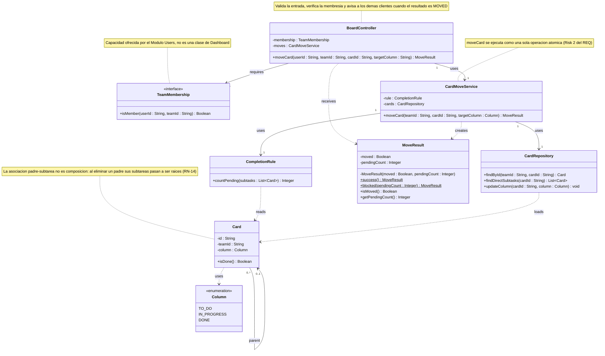

# Cambios para Deliverable 1 (derivados de Deliverable 2)

Fragmentos listos para pegar en `docs/design/01_Architectural_and_Detailed_Design.md`. Cada cambio está numerado como en la Sección 4 de `02_Interaction_and_Data_Design.md` (C1 a C6).

> **Antes de pegar.** El archivo `01_Architectural_and_Detailed_Design.md` que se subió para esta revisión tiene las secciones 2.1, 2.2 y 6 con el texto de la plantilla sin completar (tablas vacías y el diagrama de ejemplo), y el checklist de la sección 8 sin marcar. La versión `01_Architectural_and_Detailed_Design_v2.md` sí las tenía completas (aunque con un marcador `PEGAR AQUÍ` en la 2.2). Conviene que el archivo que quede en el repositorio y en Classroom tenga esas secciones llenas; los fragmentos de abajo parten de la v2 para §2.2.

---

## §2.2 — Filas de la tabla de componentes que cambian (C4, C5)

La nota que sigue a la tabla también cambia: *el diagrama de tres capas no dibuja flechas entre módulos (limpieza pedida por el profesor), por eso las dependencias de capacidad entre módulos se documentan en las columnas «Required capabilities» y «Main dependencies».*

| Component | Main responsibility | Requirements / use cases supported | Provided capabilities | Required capabilities | Main dependencies |
|---|---|---|---|---|---|
| Módulo Dashboard | Gestionar el tablero kanban y el árbol de tareas, incluidas las reglas de cierre y de jerarquía. | RF-KAN-*, RF-ARB-* (entre ellos RF-ARB-07), CU-19 | Operaciones del tablero y del árbol a la aplicación web (por ejemplo `moveCard`) | Persistencia de datos estructurados; **verificar si un usuario es miembro de un equipo** (Módulo Users) | Persistencia de datos estructurados, Módulo Users |
| Módulo Users | Gestionar cuentas, equipos y membresías, y responder si un usuario es miembro de un equipo. | RF-CUE-*, RN-01, RN-02 | Operaciones de cuentas y equipos a la aplicación web; **`isMember(userId, teamId)`** a Dashboard y a Com. | Persistencia de datos estructurados | Persistencia de datos estructurados |
| Módulo Com. (Comunicaciones) | **Gestionar los canales y mensajes del equipo y su entrega en tiempo real**, y apoyarse en el Servicio de Llamadas y en el envío de correo. *(Por confirmar por el equipo: A-1 de D2.)* | RF-CHA-*, CU-10 a CU-13, CU-12; RF-NOT-06 *(por confirmar)* | Operaciones de comunicación a la aplicación web (por ejemplo `sendMessage`) | Servicio de Llamadas; envío de correo (API Gmail); persistencia; **verificar si un usuario es miembro de un equipo** (Módulo Users) | Servicio de Llamadas, API Gmail, persistencia de datos estructurados, Módulo Users |

---

## §3.2 — Diagrama de clases del Módulo Dashboard (C1, C2, C3, C4)



Añadir debajo del diagrama: *`TeamMembership` no pertenece a Dashboard: es la capacidad `isMember` que ofrece el Módulo Users. `BoardController` la requiere y `CardMoveService` no la conoce, de modo que la regla de cierre sigue sin depender de cuentas ni de equipos. `Card` gana `teamId` porque toda lectura de tarjetas se filtra por equipo (RN-01, RN-06). Los errores `INVALID_INPUT`, `ACCESS_DENIED` y `CARD_NOT_FOUND` se expresan como fallos de la operación y no como `MoveResult`, que sigue informando solo si se movió y cuántas subtareas faltan.*

Filas nuevas o modificadas en la tabla «Relaciones y su justificación»:

| Relación | Tipo | Dirección (quién conoce a quién) | Por qué |
|---|---|---|---|
| `BoardController` → `TeamMembership` | Asociación (atributo `membership`) | El controlador conoce la capacidad; el Módulo Users no conoce al controlador | La membresía es dato de Users; Dashboard la pide y no la lee (D2 §2.3). |
| `BoardController` → `CardMoveService` | Asociación (atributo `moves`) | El controlador conoce al servicio, no al revés | El servicio no sabe quién lo llama ni cómo se avisa a los demás clientes. |
| `BoardController` ⇢ `MoveResult` | Dependencia | El controlador recibe el resultado y decide qué enviar | No lo guarda como atributo. |

---

## §3.3 — Filas de la tabla de responsabilidades de clases (C1, C2, C3)

| Clase | Responsabilidad | Conoce a | Es conocida por | Requisitos |
|---|---|---|---|---|
| `BoardController` *(nueva)* | Punto de entrada del tablero: validar los datos de entrada, verificar la membresía con el Módulo Users, llamar al servicio y avisar a los demás clientes cuando el resultado es `MOVED`. | `TeamMembership`, `CardMoveService`, `MoveResult` | La aplicación web | RNF-SEG-02, RNF-SEG-03, RN-01, RF-KAN-05, RNF-REN-02 |
| `TeamMembership` *(nueva, interfaz del Módulo Users)* | Responder si un usuario es miembro de un equipo. | — | `BoardController` | RN-01, RN-02 |
| `CardMoveService` *(cambia la firma)* | Atender la solicitud explícita de mover una tarjeta **del equipo indicado**; aplicar la regla de cierre cuando el destino es *Hecho* y guardar el movimiento solo si se cumple. | `CompletionRule`, `CardRepository`, `MoveResult` (la crea) | `BoardController` | RF-ARB-07, RF-ARB-08, RF-KAN-04, RN-13 |
| `CardRepository` *(operación nueva)* | Único acceso del módulo a la persistencia de tarjetas: buscar una tarjeta de un equipo, leer sus subtareas directas y cambiar su columna. | `Card` | `CardMoveService` | RNF-CON-02, RN-01, RN-06 |
| `Card` *(atributo nuevo)* | Representar una tarjeta del tablero, el equipo al que pertenece, y responder si está terminada. | `Column`, `Card` (su padre) | `CompletionRule`, `CardRepository` | RF-KAN-01, RN-11, RN-14 |

---

## §3.4 — Comportamiento de la operación (C1, C2, C3)

`BoardController.moveCard(userId, teamId, cardId, targetColumn)` y `CardMoveService.moveCard(teamId, cardId, targetColumn)`: caso de uso «Mover una tarea a *Hecho*».

```text
BoardController.moveCard(userId, teamId, cardId, targetColumn) -> MoveResult
 1  IF teamId, cardId or targetColumn are not valid           RAISE INVALID_INPUT   # RNF-SEG-03
 2  IF NOT membership.isMember(userId, teamId)                RAISE ACCESS_DENIED   # RN-01, RNF-SEG-02
 3  result = moves.moveCard(teamId, cardId, targetColumn)     # may RAISE CARD_NOT_FOUND
 4  IF result.isMoved()                                       # a rejected move is not announced
 5      announce "card moved" to the other clients of the team   # RF-KAN-05
 6  RETURN result

CardMoveService.moveCard(teamId, cardId, targetColumn) -> MoveResult
 1  card = cards.findById(teamId, cardId)                     # team-scoped lookup (RN-01, RN-06)
 2  IF card IS ABSENT                                         RAISE CARD_NOT_FOUND
 3  IF targetColumn IS NOT DONE
 4      cards.updateColumn(cardId, targetColumn)              # RF-KAN-04: the rule applies only to DONE
 5      RETURN MoveResult.success()
 6  # steps 7-11 must run as one atomic operation (Risk 2 of the REQ)
 7  subtasks = cards.findDirectSubtasks(cardId)
 8  pending  = rule.countPending(subtasks)                    # 0 if the card has no subtasks
 9  IF pending > 0                                            # non-happy path (RN-12)
10      RETURN MoveResult.blocked(pending)                    # nothing is saved
11  cards.updateColumn(cardId, DONE)
12  RETURN MoveResult.success()
```

*La verificación de membresía deja de estar «antes de llegar al servicio» como un supuesto: la hace `BoardController` y está dibujada en el diagrama de secuencia 1.1 de D2. Sigue siendo cierto que quien invoca el servicio avisa a los demás clientes solo cuando `moved = true`.*

---

## §6 — Filas de trazabilidad que se agregan (C6)

| Requirement ID | Use Case | Component(s) | Class(es) |
|---|---|---|---|
| RF-ARB-07 | CU-19 · Mover una tarjeta con subtareas a *Hecho* | Módulo Dashboard | `BoardController`, `CardMoveService`, `CompletionRule`, `CardRepository`, `Card`, `Column`, `MoveResult` |
| RN-01, RNF-SEG-02 | CU-19, CU-12 | Módulo Users (`isMember`), Módulo Dashboard, Módulo Com. | `BoardController`, `TeamMembership` |
| RNF-SEG-03 | CU-19, CU-12 | Módulo Dashboard, Módulo Com. | `BoardController` (validación de la entrada) |
| RF-KAN-05, RNF-REN-02 | CU-19 | Módulo Dashboard | `BoardController` (aviso a los demás clientes) |
| RF-CHA-03, RF-CHA-04, RNF-REN-01 | CU-12 · Enviar mensaje en un canal | Módulo Com. | No se detalla en clases en esta entrega (A-1 de D2) |
