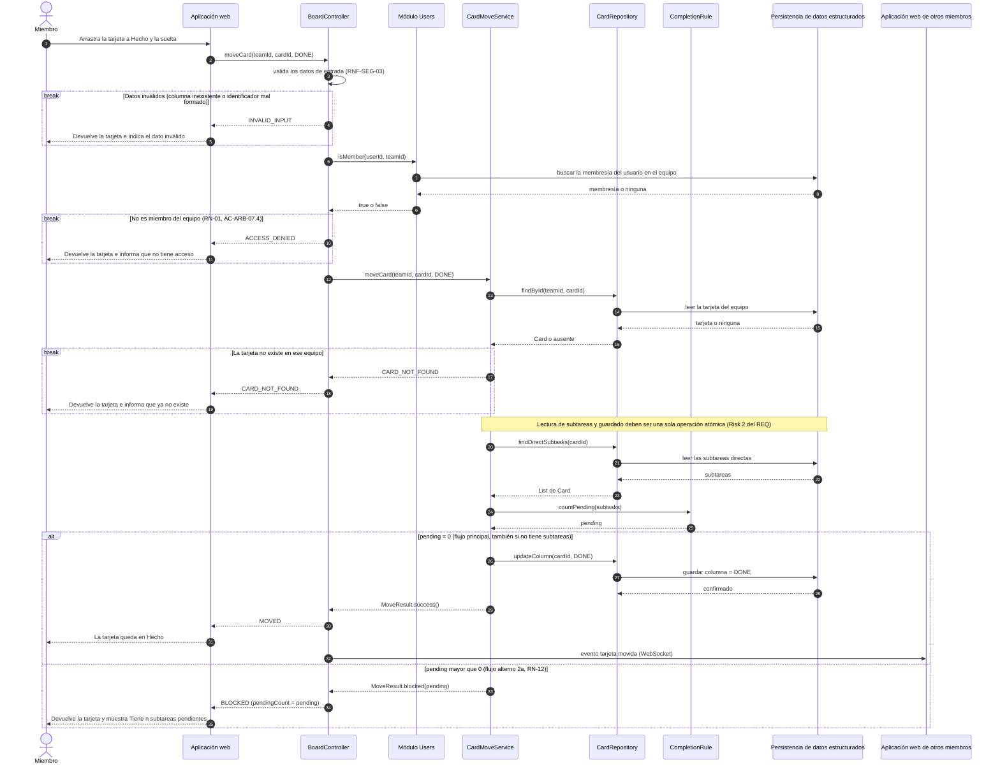
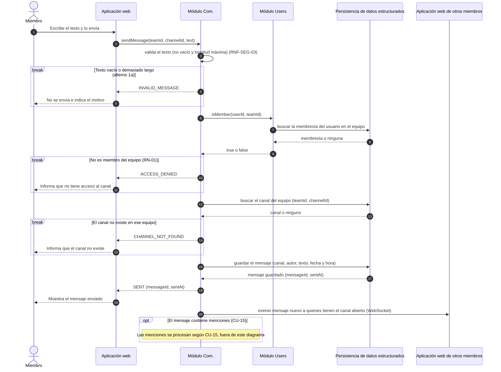
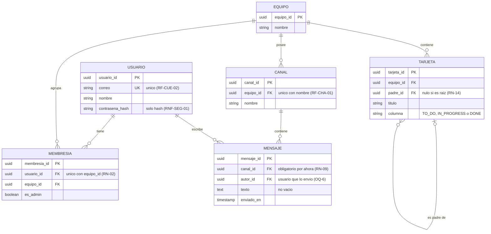

# Slackless — Interaction & Data Design v1.0

|             |                                                                                                                                              |
|-------------|----------------------------------------------------------------------------------------------------------------------------------------------|
| **Team**    | Grupo 2                                                                                                                                      |
| **Members** | David Esteban Raigosa Socha, Deisy Viviana Lara Sisa, Hare Zeiyiukuin Atehortua Rincon, Fredy Humberto Garzon Salgado, Silvana Ramirez Ardila |
| **Status**  | Ready for review                                                                                                                             |
| **Date**    | 2026-10-25                                                                                                                                   |
| **Inputs**  | `docs/design/01_Architectural_and_Detailed_Design.md` (Deliverable 1), Use Cases CU-12 y CU-19 de `docs/requirements/` (casos-de-uso.md) y el Use Case detallado de `RF-ARB-07.md`, Interaction & Contracts Design v0.1 (Class 13) |

*Convenciones: las entidades de datos se escriben en español y en mayúsculas (`TARJETA`) y las clases de Deliverable 1 en inglés (`Card`). Los identificadores `A-n` son supuestos (Sección 5) y `OQ-n` son preguntas abiertas (Sección 5).*

---

## 1. Behavior — Selected Use Cases

Se eligieron dos casos de uso que cruzan módulos distintos de la arquitectura: **CU-19 «Mover una tarjeta con subtareas a *Hecho*»** (requerimiento final del equipo, RF-ARB-07, Módulo Dashboard) y **CU-12 «Enviar mensaje en un canal»** (RF-CHA-03 y RF-CHA-04, Módulo Com.). Juntos recorren los tres módulos del servidor (Dashboard, Users y Com.), la persistencia de datos estructurados y la entrega en tiempo real, que es lo que permite revisar de quién es cada dato.

### 1.1 Mover una tarjeta con subtareas a *Hecho* (CU-19) — from requirement RF-ARB-07

Trazabilidad: `casos-de-uso.md` CU-19 (flujo principal 1–3, alternos 2a y 3a) y el Use Case «Mover una tarea a *Hecho*» de `RF-ARB-07.md` §4.3 (flujo principal 1–5 y flujo alternativo de subtareas pendientes). Reglas: RN-12, RN-13, RN-01.

| Use Case step or flow | Message(s) in the diagram | Information exchanged | Operation defined in (Deliverable 1) |
|---|---|---|---|
| Main flow, step 1 (CU-19 paso 1; RF-ARB-07 paso 1) | `moveCard(teamId, cardId, DONE)` de la aplicación web a `BoardController` | `teamId`, `cardId`, columna destino `DONE`; el usuario se toma de la sesión | `BoardController.moveCard`: **nueva** (Cambio C1) |
| Precondición (RF-ARB-07: sesión, pertenencia al equipo y la tarjeta existe) | `isMember(userId, teamId)` con su consulta de membresía; `findById(teamId, cardId)` | `userId`, `teamId` → verdadero o falso; `cardId` → tarjeta | `TeamMembership.isMember`: **nueva**, capacidad del Módulo Users (Cambio C4); D1 §3.4 la suponía en un *guard* de NestJS. `CardRepository.findById`: **nueva** (Cambio C3) |
| Main flow, step 2 (verifica las subtareas directas; RF-ARB-07 pasos 2 y 3) | `findDirectSubtasks`, `countPending` | `cardId` → subtareas con su columna; subtareas → `pending` (0 si no tiene subtareas, RF-ARB-07 paso 3) | `CardRepository.findDirectSubtasks`, `CompletionRule.countPending` (D1 §3.2) |
| Main flow, step 3 (mueve y guarda; RF-ARB-07 pasos 4 y 5: mover y mostrar a los demás) | `updateColumn`, `MoveResult.success()`, `MOVED`, evento a otros clientes | `cardId`, `DONE` → confirmación; evento `tarjeta movida` | `CardRepository.updateColumn`, `MoveResult.success()` (D1 §3.2); el aviso lo hace quien invoca el servicio (D1 §3.4, supuesto 2) |
| Alternative flow 2a (hay subtareas pendientes; RN-12; Alternative Flow de RF-ARB-07) | rama `pending mayor que 0`: `MoveResult.blocked(pending)` y `BLOCKED` | `pendingCount` (número de subtareas directas fuera de *Hecho*) | `MoveResult.blocked` (D1 §3.2). El texto «Tiene n subtareas pendientes» lo arma la interfaz |
| Alternative flow 3a (terminar la última subtarea no mueve al padre; RN-13) | Ningún mensaje: el padre solo cambia con una solicitud `moveCard` explícita | — | `CardMoveService` solo actúa ante solicitud de un miembro (D1 §3.4 y Decision B de D1 §5; RN-13) |
| Exception (petición sin permiso: escenario AC-ARB-07.4 y RNF-SEG-02; el Use Case de RF-ARB-07 declara su Exception como N/A) | primer `break`: `ACCESS_DENIED` | resultado de `isMember` | `TeamMembership.isMember` (Cambio C4) |
| Exception (entrada inválida, RNF-SEG-03) | `break` de datos inválidos: `INVALID_INPUT` | columna o identificadores mal formados | Validación en `BoardController` (Cambio C1) |
| Exception derivada (la precondición «la tarjeta existe» no se cumple) | `break` de tarjeta ausente: `CARD_NOT_FOUND` | resultado de `findById` | `CardRepository.findById` (Cambio C3). **El caso de uso no la describe**: ver A-4 y OQ-2 |

### 1.2 Enviar mensaje en un canal (CU-12) — from requirement RF-CHA-03 and RF-CHA-04

Trazabilidad: `casos-de-uso.md` CU-12 (flujo principal 1–4, alterno 1a) y `RNF-REN-01`. Reglas: RN-01, RN-09. El Módulo Com. solo está definido a nivel de componente en D1 (no hay diseño de clases para él), por eso el diagrama usa el componente como participante (ver A-1).

| Use Case step or flow | Message(s) in the diagram | Information exchanged | Operation defined in (Deliverable 1) |
|---|---|---|---|
| Main flow, step 1 (escribe el texto y lo envía) | `sendMessage(teamId, channelId, text)` de la aplicación web a `Módulo Com.` | `teamId`, `channelId`, `text`; el autor se toma de la sesión | Capacidad «operaciones de comunicación» del Módulo Com. (D1 §2.2). `sendMessage`: **nueva** (Cambio C5) |
| Alternative flow 1a (mensaje vacío: no se envía) | primer `break`: `INVALID_MESSAGE` | texto vacío o demasiado largo | Validación del Módulo Com. (RNF-SEG-03) (Cambio C5) |
| Precondición (tiene un canal del equipo abierto; RN-01) | `isMember(userId, teamId)` y su consulta | `userId`, `teamId` → verdadero o falso | `TeamMembership.isMember` (Cambio C4) |
| Main flow, step 2 (almacena con autor, fecha y hora; RN-09) | búsqueda del canal y guardado del mensaje; `SENT` | `channelId`, autor, texto → `messageId`, `sentAt` | Capacidad «persistencia de datos estructurados» requerida por Com. (D1 §2.2) |
| Main flow, step 3 (entrega a quienes tienen el canal abierto, RNF-REN-01) | evento `mensaje nuevo` a otros clientes | mensaje con autor y hora | Entrega en tiempo real por WebSocket (D1 §1, driver RF-CHA-04; ADR 0001) |
| Main flow, step 4 (menciones) | `opt` con nota | — | CU-15, fuera del alcance de este diagrama |
| Exception (sin permiso, RNF-SEG-02) | segundo `break`: `ACCESS_DENIED` | resultado de `isMember` | `TeamMembership.isMember` (Cambio C4) |
| Exception derivada (canal inexistente en el equipo) | tercer `break`: `CHANNEL_NOT_FOUND` | resultado de la búsqueda del canal | Persistencia (D1 §2.2). **CU-12 no la describe**: ver A-4 |
| Alternos 3a y 3b (canal cerrado al llegar el mensaje, reconexión) | — | — | No se dibujan: son comportamiento del cliente (RNF-CON-01), no una interacción con el servidor de este envío |

### Decisión de interacción — verificación de equipo en cada operación

| | |
|---|---|
| **Because** (context) | RN-01 y RNF-SEG-02 exigen comprobar en el servidor que el usuario pertenece al equipo dueño del recurso. Si el servidor confiara solo en el `teamId` que manda el cliente, un miembro del equipo A podría enviar la petición con un `cardId` del equipo B. |
| **We chose** (decision) | Toda operación de Dashboard y de Com. recibe `teamId`, verifica con el Módulo Users (`isMember`) **antes** de ejecutarse, y las consultas de datos filtran siempre por `teamId` y por el identificador del recurso. Una tarjeta o un canal de otro equipo se responde como «no existe». |
| **Accepting** (trade-off) | Una llamada y una consulta adicionales por operación, el cliente debe enviar `teamId` en cada solicitud, y los módulos Dashboard y Com. quedan dependiendo de una capacidad del Módulo Users (el diagrama de tres capas ya no dibuja flechas entre módulos, así que esa dependencia queda documentada en la tabla de D1 §2.2). |

---

## 2. Data Design

### 2.1 Principal information the system needs

| Information | Needed by (use cases) | Persisted? | Why (or why not) |
|---|---|---|---|
| Cuenta de usuario (correo, nombre, hash de contraseña) | CU-12, CU-19 (identificar al autor o solicitante) | Yes | Debe sobrevivir a un reinicio (RNF-CON-02); la contraseña se guarda solo como hash (RNF-SEG-01). |
| Equipo | CU-12, CU-19 (alcance de todo recurso) | Yes | Es el dueño de canales y tarjetas (RN-01). |
| Membresía (usuario en equipo, si es administrador) | CU-12, CU-19 (verificación de acceso) | Yes | Un usuario tiene como máximo una por equipo (RN-02) y de ella depende cada permiso. |
| Canal | CU-12 | Yes | Un mensaje pertenece a un canal del equipo (RN-09). |
| Mensaje | CU-12 | Yes | Debe conservarse con autor, fecha y hora (RF-CHA-03) y poder consultarse luego (RF-CHA-05). |
| Tarjeta, con su columna y su tarea padre | CU-19 | Yes | Es el estado del tablero (RF-KAN-04) y la base del árbol de subtareas (RN-14). |
| Columnas del tablero | CU-19 | No | Son tres valores fijos (RF-KAN-01), no información que cambie. Se representan con la enumeración `Column` y con una restricción de valores en `TARJETA.columna`. |
| Progreso «hechas/total» y subtareas pendientes | CU-19 | No | Se deriva del estado actual de las subtareas (RF-ARB-05, CU-18 alterno 2b). Guardarlo podría dejarlo desactualizado. |
| Resultado del movimiento (`MoveResult`) | CU-19 | No | Es la respuesta de una operación y no tiene vida después de ella. |
| Miembros que tienen un canal o el tablero abierto | CU-12, CU-19 (a quién enviar el evento) | No | Es estado de conexión, efímero. Con un solo servidor (A-3) lo mantiene en memoria el canal de eventos en tiempo real; el Estado efímero (diferido) de D1 solo entraría con varias instancias. |
| Sesión del usuario | CU-12, CU-19 (autenticación) | Pending | Debe poder invalidarse al cerrar sesión y expirar a los 7 días (RNF-SEG-04), pero D1 no define dónde se guarda (OQ-1). |

*Fuera de esta entrega, y por eso sin modelar: labels, roles y habilidades, votaciones, notificaciones, conversaciones directas y colores. Ni D1 los asigna a un módulo ni existen casos de uso escritos para ellos (OQ-8).*

### 2.2 Data model

**Representación elegida: relacional (PostgreSQL).** Los datos de estas dos operaciones son entidades con relaciones estrictas (usuarios, equipos, canales, mensajes, tarjetas) y reglas que se expresan bien como restricciones. Es la elección del ADR 0001.

*Cardinalidad: `||` exactamente uno, `|o` cero o uno, `o{` cero o muchos. `TARJETA` se relaciona consigo misma: una tarjeta tiene cero o un padre y cero o más subtareas, igual que la asociación `parent` del diagrama de clases de D1. De `TARJETA` solo se modelan los atributos que usa CU-19 (descripción, labels, responsable, fecha límite, color y posición en la columna se omiten a propósito, como en D1; ver OQ-5).*

| Entity / document type | Meaning in the system | Identifier | Constraints (required, unique, allowed values) |
|---|---|---|---|
| `USUARIO` | Persona con cuenta | `usuario_id` | `correo` obligatorio y único; `contrasena_hash` obligatorio (nunca la contraseña en claro) |
| `EQUIPO` | Espacio de trabajo dueño de canales y tarjetas | `equipo_id` | `nombre` obligatorio |
| `MEMBRESIA` | Pertenencia de un usuario a un equipo | `membresia_id` | `usuario_id` y `equipo_id` obligatorios; la pareja (`usuario_id`, `equipo_id`) es única (RN-02); `es_admin` obligatorio |
| `CANAL` | Conversación pública del equipo | `canal_id` | `equipo_id` obligatorio; la pareja (`equipo_id`, `nombre`) es única |
| `MENSAJE` | Texto enviado por un usuario en un canal | `mensaje_id` | `canal_id` y `autor_id` obligatorios; `texto` no vacío; `enviado_en` lo asigna el servidor |
| `TARJETA` | Unidad de trabajo del tablero | `tarjeta_id` | `equipo_id` y `titulo` obligatorios; `columna` solo admite `TO_DO`, `IN_PROGRESS` o `DONE`; `padre_id` es nulo o apunta a otra tarjeta del mismo equipo; al borrar el padre, `padre_id` pasa a nulo |

| Decisión de almacenamiento | |
|---|---|
| **Because** (context) | El ADR 0001 eligió PostgreSQL porque los mensajes y tareas necesitan relaciones y permisos estrictos con usuarios y canales. Además, RN-02, RN-14 y las tres columnas fijas se pueden expresar como restricciones (`UNIQUE`, `ON DELETE SET NULL`, `CHECK`). |
| **We chose** (decision) | Un modelo relacional con una tabla por entidad de esta sección, y el árbol de subtareas como una relación de `TARJETA` consigo misma (`padre_id`). |
| **Accepting** (trade-off) | Obtener todo el árbol de una tarjeta (esquema, RF-ARB-09) o comprobar ciclos (RN-11) pedirá consultas recursivas, más complejas que leer un documento anidado. Con árboles pequeños (SRS §2.5, equipos de 3 a 8 personas) lo aceptamos. |

### 2.3 Data Ownership

| Information | Authoritative owner (component responsible for maintaining it) | Consumed by (uses it without owning it) | Access through |
|---|---|---|---|
| Cuenta de usuario | Módulo Users | Módulo Dashboard, Módulo Com. (solo el `userId` de la sesión verificada) | Verificación de sesión del Módulo Users (A-2) |
| Equipo | Módulo Users | Módulo Dashboard, Módulo Com. (solo el identificador `teamId`) | `isMember(userId, teamId)`: un equipo inexistente o ajeno se rechaza igual |
| Membresía | Módulo Users | Módulo Dashboard, Módulo Com. | `isMember(userId, teamId)` |
| Canal | Módulo Com. | Aplicación web | Operaciones de comunicación del Módulo Com. (CU-10, CU-11) |
| Mensaje | Módulo Com. | Aplicación web; Módulo Dashboard cuando una tarea nace de un mensaje (CU-16, fuera de esta entrega) | `sendMessage` y consulta de historial del Módulo Com. (CU-12, CU-13) |
| Tarjeta, su columna y su padre | Módulo Dashboard | Aplicación web; Módulo Com. cuando crea una tarea desde un mensaje (CU-16, fuera de esta entrega) | `moveCard` y demás operaciones del tablero del Módulo Dashboard |
| Progreso y subtareas pendientes (derivados) | Módulo Dashboard | Aplicación web | Se calculan a partir de las tarjetas cada vez; no se guardan |
| Sesión del usuario | Módulo Users *(propuesto)* | Módulo Dashboard, Módulo Com. | Pendiente (OQ-1) |

*Hay un solo PostgreSQL compartido, pero cada tabla tiene un único módulo dueño y ningún módulo lee ni escribe las tablas de otro: Dashboard no consulta `MEMBRESIA` y Com. no consulta `TARJETA`; piden el resultado a través de la capacidad del dueño (diagramas 1.1 y 1.2). La única clave que cruza esa frontera es `equipo_id` en `CANAL` y `TARJETA`, que apunta a `EQUIPO` (Users).*

| Decisión de propiedad de datos | |
|---|---|
| **Because** (context) | El ADR 0001 fija un solo PostgreSQL, el SRS §2.5 prevé un despliegue en un único servidor, y no hace falta una base de datos por módulo para que cada dato tenga un solo responsable. |
| **We chose** (decision) | Un solo PostgreSQL en el que cada tabla pertenece a un módulo (Users: `USUARIO`, `EQUIPO`, `MEMBRESIA`; Com.: `CANAL`, `MENSAJE`; Dashboard: `TARJETA`). Entre módulos solo se piden resultados mediante capacidades (por ejemplo `isMember`), nunca se leen tablas ajenas. |
| **Accepting** (trade-off) | Las claves foráneas cruzan fronteras de propiedad (`TARJETA.equipo_id` → `EQUIPO`), de modo que separar un módulo en un servicio propio obligaría a reemplazarlas por referencias verificadas con la capacidad del dueño. Y Dashboard y Com. dependen de Users en cada operación. |

### 2.4 Business rules and invariants enforced in data

| Business rule or invariant | Where it is enforced (component logic / data constraint / both) | How |
|---|---|---|
| RN-01 Acceso por membresía | Component logic | `isMember` antes de ejecutar la operación, y consultas de tarjetas y canales filtradas por `teamId` (decisión de interacción, Sección 1) |
| RN-02 Una membresía por usuario y equipo | Both | Restricción `UNIQUE (usuario_id, equipo_id)`; el Módulo Users informa el error al unirse (CU-06, alterno 2b) |
| RN-06 La tarea padre pertenece al mismo equipo | Component logic | `CardRepository` solo busca por (`teamId`, `cardId`); al asignar o cambiar el padre se compara el equipo de ambas tarjetas. Podría reforzarse con una clave foránea compuesta (`padre_id`, `equipo_id`) |
| RN-09 Un mensaje, un lugar | Data constraint | `MENSAJE.canal_id` obligatorio. Cuando existan conversaciones directas (CU-14) se agregará su identificador y la regla pasará a «exactamente uno de los dos» (OQ-8) |
| RN-11 Sin ciclos en el árbol | Component logic | Comprobación al cambiar el padre (CU-21). Este diseño no la ejercita; no se puede expresar con una restricción simple |
| RN-12 Un padre no está terminado antes que sus hijas | Component logic | `CompletionRule` cuenta las subtareas directas fuera de *Hecho* y `CardMoveService` guarda solo si son cero. No puede ser una restricción de columna porque depende de otras filas (OQ-3, OQ-4) |
| RN-13 El padre nunca se mueve solo | Component logic | Solo `moveCard`, ante una solicitud explícita, cambia `TARJETA.columna`. No existen disparadores en la base de datos que muevan al padre |
| RN-14 Eliminar un padre libera a sus hijas | Both | `TARJETA.padre_id` con `ON DELETE SET NULL` conserva las subtareas como raíces; el servicio de eliminación cuenta las subtareas para el aviso de confirmación (CU-22) |
| Columnas fijas (RF-KAN-01) | Both | `CHECK` sobre `TARJETA.columna` con tres valores; la enumeración `Column` en el código |
| Correo único (RF-CUE-02) | Data constraint | `UNIQUE` sobre `USUARIO.correo` |
| Nombre de canal único por equipo (RF-CHA-01) | Data constraint | `UNIQUE (equipo_id, nombre)` en `CANAL` |
| El mensaje no está vacío (CU-12, alterno 1a) | Both | El Módulo Com. lo valida antes de guardar; `CHECK` de longitud mayor que cero como segunda barrera |

---

## 3. Interface Contract

**Interaction chosen** (from diagram 1.1, message `moveCard(teamId, cardId, DONE)`): acuerdo entre la **aplicación web** y el **Módulo Dashboard** para mover una tarjeta de columna. Es la operación que concreta el requerimiento final RF-ARB-07.

| Element | Specification |
|---|---|
| **Operation and purpose** | `moveCard`, ofrecida por el Módulo Dashboard (`BoardController`). Mueve una tarjeta del tablero del equipo a otra columna; cuando el destino es *Hecho*, aplica antes la regla RN-12 (RF-ARB-07). |
| **Input** (parameters and types) | `teamId : String`; `cardId : String`; `targetColumn : Column` (`TO_DO`, `IN_PROGRESS` o `DONE`). La identidad del solicitante (`userId`) la toma el servidor de la sesión; el cliente no la envía. |
| **Output** (successful result and data structure) | Respuesta con `outcome : MOVED o BLOCKED` y `pendingCount : Integer` (0 si `MOVED`; 1 o más si `BLOCKED`). Corresponde a `MoveResult.isMoved()` y `MoveResult.getPendingCount()` de D1. El texto del mensaje lo arma la interfaz. |
| **Preconditions** (what the caller must satisfy before invoking) | Hay sesión activa. `teamId` y `cardId` tienen formato válido y `targetColumn` es uno de los tres valores. La tarjeta no está ya en `targetColumn` (CU-19; qué pasa si lo está es OQ-2). *El caller no necesita demostrar que es miembro: la operación lo verifica; si no lo es, falla con `ACCESS_DENIED`.* |
| **Postconditions** (what is guaranteed on successful completion) | **Si `MOVED`:** la tarjeta está en `targetColumn` y el cambio persiste (RNF-CON-02). Si `targetColumn` es `DONE`, ninguna de sus subtareas directas estaba fuera de *Hecho* cuando se evaluó. Los demás miembros del equipo que tienen el tablero abierto reciben el evento `tarjeta movida` en máximo 1 s (RNF-REN-02). **Si `BLOCKED`:** la tarjeta sigue en su columna original, no se modificó ningún dato, `pendingCount` es el número de subtareas directas fuera de *Hecho* y no se envió ningún evento. |
| **Failure outcomes** (each failure, and what state is left after it) | `INVALID_INPUT`: columna inexistente o identificador mal formado; no se ejecuta ninguna operación, estado intacto (RNF-SEG-03). `ACCESS_DENIED`: el usuario no es miembro del equipo `teamId`; estado intacto y no se revela si la tarjeta existe (RN-01, AC-ARB-07.4). `CARD_NOT_FOUND`: no existe una tarjeta `cardId` en el equipo `teamId` (incluye tarjetas de otros equipos); estado intacto. |
| **Invariants and side effects** (what must stay true, what may change) | **Invariantes.** I-1 (RN-12): la operación nunca deja en *Hecho* una tarjeta con subtareas directas fuera de *Hecho* en el momento de evaluarla. I-2 (RN-13): lo único que cambia es la columna de `cardId`; ninguna otra tarjeta, y en particular ningún padre, cambia de columna. I-3 (RNF-SEG-03): no hay operaciones parciales; la lectura de las subtareas y el guardado forman una sola unidad (mecanismo: OQ-4). I-4 (RN-01, RN-06): toda lectura y escritura de tarjetas filtra por `teamId`. **Efectos secundarios.** Solo uno: el evento `tarjeta movida` hacia los demás clientes del equipo, y únicamente cuando el resultado es `MOVED`. |

**Testable examples**

| Case | Before | Request | Expected |
|---|---|---|---|
| Padre con todas las subtareas terminadas | Tarjeta P en `IN_PROGRESS` con subtareas S1 y S2, ambas en `DONE` | `moveCard(equipoA, P, DONE)` por un miembro de A | `MOVED`, `pendingCount = 0`; P en `DONE`; evento enviado |
| Padre sin subtareas | Tarjeta Q en `TO_DO` sin subtareas | `moveCard(equipoA, Q, DONE)` por un miembro de A | `MOVED`, `pendingCount = 0`; Q en `DONE` |
| Una subtarea pendiente (AC-ARB-07.1) | P en `IN_PROGRESS` con S1 en `DONE` y S2 en `IN_PROGRESS` | `moveCard(equipoA, P, DONE)` | `BLOCKED`, `pendingCount = 1`; P sigue en `IN_PROGRESS`; sin evento |
| Varias pendientes (AC-ARB-07.3) | P con 5 subtareas: 3 en `DONE`, 1 en `TO_DO` y 1 en `IN_PROGRESS` | `moveCard(equipoA, P, DONE)` | `BLOCKED`, `pendingCount = 2`; P no cambia |
| Terminar la última subtarea no mueve al padre (RN-13) | P en `IN_PROGRESS` con una sola subtarea S en `IN_PROGRESS` | `moveCard(equipoA, S, DONE)` | `MOVED` para S; P sigue en `IN_PROGRESS` |
| Destino distinto de *Hecho* | P con S1 en `TO_DO`, P en `TO_DO` | `moveCard(equipoA, P, IN_PROGRESS)` | `MOVED`; la regla RN-12 no se aplica |
| Petición directa sin permiso (AC-ARB-07.4) | Un usuario que no es miembro del equipo A | `moveCard(equipoA, P, DONE)` | `ACCESS_DENIED`; P no cambia |
| Tarjeta de otro equipo | Usuario miembro de A; la tarjeta X es del equipo B | `moveCard(equipoA, X, DONE)` | `CARD_NOT_FOUND`; X no cambia |
| Columna inexistente | Cualquier tarjeta | `moveCard(equipoA, P, "ARCHIVADA")` | `INVALID_INPUT`; P no cambia |

---

## 4. Cross-Consistency & Changes to Deliverable 1

| Check | Result |
|---|---|
| Every participant in a sequence diagram is an actor, a component, a class or an external system from Deliverable 1 | **Sí, con una incorporación.** *Miembro* (actor *User* de D1), *Aplicación web*, *Módulo Users*, *Módulo Com.* y *Persistencia de datos estructurados* son componentes de D1 §2.2; `CardMoveService`, `CardRepository` y `CompletionRule` son clases de D1 §3.2; *Aplicación web de otros miembros* es otra instancia del mismo componente. `BoardController` no existía como clase: se agrega a D1 (Cambio C1). Que Com. cubra el chat es un supuesto por confirmar (A-1, Cambio C5). |
| Every message corresponds to a capability, operation or contract | **Sí.** Las operaciones de D1 se reutilizan sin cambio de nombre: `findDirectSubtasks`, `countPending`, `updateColumn`, `MoveResult.success/blocked`. Las nuevas (`moveCard` del controlador, `findById`, `isMember`, `sendMessage`) están dadas de alta en los Cambios C1 a C5 y la primera es la del contrato de la Sección 3. |
| Every entity or document type is reflected in the class diagrams, or the reason it is not is stated | **Sí.** `TARJETA` ↔ `Card` (con `teamId` y `columna` ↔ `column : Column`), `padre_id` ↔ la asociación `parent`. `USUARIO`, `EQUIPO`, `MEMBRESIA` (Módulo Users) y `CANAL`, `MENSAJE` (Módulo Com.) no aparecen en D1 porque la Actividad 1 detalla solo el Módulo Dashboard, por indicación del profesor; sus clases no se han diseñado. |
| Every persisted information element has exactly one authoritative owner | **Sí, con una excepción declarada.** Cada tabla tiene un solo módulo dueño (Sección 2.3). La sesión (2.1) aún no tiene dueño ni almacén decididos (OQ-1). |
| The contract agrees with the sequence diagram and with the data model (same behavior in all three views) | **Sí.** El contrato de `moveCard` tiene los mismos tres fallos y los dos resultados que el diagrama 1.1 (`INVALID_INPUT`, `ACCESS_DENIED`, `CARD_NOT_FOUND`, `MOVED`, `BLOCKED`); el filtro por `teamId` y la columna de tres valores coinciden con `TARJETA` en la Sección 2.2; la regla de pendientes cuenta subtareas por `padre_id` y `columna`, que son atributos del modelo. |

**Changes made to Deliverable 1 because of this deliverable**

| # | Change | Where in Deliverable 1 | Why (evidence from this deliverable) |
|---|---|---|---|
| C1 | Agregar la clase `BoardController` (punto de entrada del Módulo Dashboard): valida la entrada, verifica la membresía, llama a `CardMoveService` y avisa a los demás clientes cuando el resultado es `MOVED`. | §3.2 diagrama de clases, §3.3 tabla de clases | D1 §3.4 hablaba de «quien invoca el servicio». Para dibujar el diagrama 1.1 ese rol necesita un nombre y una responsabilidad. |
| C2 | `CardMoveService.moveCard(cardId, targetColumn)` pasa a `moveCard(teamId, cardId, targetColumn)`. | §3.2, §3.3, §3.4 | La búsqueda de la tarjeta debe filtrar por equipo (decisión de interacción, RN-01 y RN-06). |
| C3 | Agregar `CardRepository.findById(teamId, cardId) Card` y el atributo `teamId` en `Card`; el pseudocódigo comienza con esa búsqueda y falla con `CARD_NOT_FOUND`. | §3.2, §3.4 | Sin ella no hay forma de saber de qué equipo es la tarjeta ni de rechazar una tarjeta inexistente o ajena. |
| C4 | Nueva capacidad **provista** por el Módulo Users, `isMember(userId, teamId)`, y **requerida** por Dashboard y Com. En el diagrama de clases aparece como la interfaz `TeamMembership`. | §2.2 tabla de componentes (filas Users, Dashboard y Com.), §3.2 | D1 §3.4 suponía un *guard* sin decir quién le da la información. La membresía es dato del Módulo Users (Sección 2.3), así que debe pedirse a Users. El diagrama de tres capas no cambia (sin flechas entre módulos, como pidió el profesor); la dependencia queda en la tabla. |
| C5 | El Módulo Com. pasa de «llamadas y envío de correo (confirmar si incluye chat)» a **chat (canales y mensajes) y envío de correo**, con la capacidad `sendMessage`. Requiere persistencia y `isMember`. **Por confirmar por el equipo (A-1).** | §2.2 tabla de componentes (fila Com.) | CU-12 necesita un dueño para `CANAL` y `MENSAJE`, y Com. es el único módulo cuyo nombre lo permite. |
| C6 | La tabla de trazabilidad (§6, hoy vacía en el archivo) gana filas para CU-12 y para los requisitos RN-01, RNF-SEG-02 y RF-KAN-05 (aviso a otros clientes por `BoardController`). | §6 | Todo elemento nuevo debe trazarse a un requerimiento. |
| C7 | Sin cambio: D1 §3.4 (supuesto 2) dice que un movimiento rechazado no se avisa a los demás clientes; se mantiene (A-5). | — | El diagrama 1.1 es coherente con eso. |

*Los fragmentos actualizados de D1 (diagrama de clases, tabla de clases, pseudocódigo y filas de tablas) están en `01_cambios_para_deliverable_1.md`, listos para pegar.*

---

## 5. Open Questions

**Supuestos adoptados en este documento**

- **A-1.** El Módulo Com. incluye canales y mensajes (CU-10 a CU-13) además de las llamadas y el correo. D1 lo dejaba «por confirmar».
- **A-2.** Cuando una operación llega al servidor, la sesión ya fue verificada y se conoce el `userId`; la verificación de sesión (CU-02, CU-03) es capacidad del Módulo Users y no se detalla aquí.
- **A-3.** El servidor se ejecuta como una sola instancia (SRS §2.5), por lo que las conexiones por canal y por tablero viven en la memoria del canal de eventos (Socket.IO) y no necesitan Redis.
- **A-4.** Los fallos `CARD_NOT_FOUND` y `CHANNEL_NOT_FOUND` no están en los casos de uso; se derivan de RN-01 y RNF-SEG-02 (no operar sobre recursos de otro equipo) y de que un identificador puede ser inexistente.
- **A-5.** Mientras espera la respuesta, la aplicación web solo mueve la tarjeta de forma visual en el cliente que arrastró; los demás clientes cambian solamente al recibir el evento del servidor. Por eso un movimiento rechazado no necesita avisarse a los demás.
- **A-6.** Los identificadores se modelan como `uuid` en la base de datos y como `String` en las clases (decisión de modelado; no hay ADR al respecto).

**Preguntas abiertas**

- **OQ-1. Sesión:** ¿dónde se guarda y cómo se invalida al cerrar sesión o a los 7 días (RNF-SEG-04)? ¿En PostgreSQL o en el Estado efímero (diferido)? Define quién es su dueño.
- **OQ-2. Mover a la columna donde ya está:** CU-19 exige que la tarjeta esté en otra columna, pero no dice qué hacer si no lo está (por ejemplo, una tarjeta ya en *Hecho*). El pseudocódigo de D1 volvería a evaluar las subtareas.
- **OQ-3. Padre ya en *Hecho* que recibe una subtarea o ve reabrir una (preguntas abiertas 1 y 2 de RF-ARB-07):** el invariante I-1 se cumple al mover, pero otras operaciones pueden dejar un padre en *Hecho* con una hija pendiente. Hace falta decidir si se bloquea esa operación, o si el padre se marca de otra forma.
- **OQ-4. Atomicidad:** D1 deja abierto cómo se logra (Hallazgo de D1 §4). Propuesta a evaluar al implementar: una transacción de PostgreSQL que bloquee las subtareas leídas hasta guardar el movimiento. Ojo: eso protege solo el momento de la evaluación y no resuelve OQ-3.
- **OQ-5. Posición dentro de la columna (RF-KAN-04):** no está modelada ni en el contrato porque aún no hay casos de uso del tablero kanban escritos.
- **OQ-6. Autor de un mensaje tras salir del equipo (CU-09):** se modeló `autor_id` hacia `USUARIO` para conservar los mensajes. ¿Es lo que el equipo quiere?
- **OQ-7. Límites de longitud:** el texto del mensaje y el título de la tarjeta tienen límite (RNF-SEG-03), pero no hay valor definido.
- **OQ-8. Fuera de este modelo:** conversaciones directas (RN-09 y RN-10), notificaciones, labels, roles y habilidades, votaciones y color de ramas. D1 no los asigna a ningún módulo y sus casos de uso no están escritos.

---

## 6. Optional — AI-Assisted Design Reflection

> **[A completar por el equipo, solo si usó IA para este diseño.]** Describa una recomendación de IA que aceptó, modificó o rechazó, y por qué. Una candidata, tal como surgió en la redacción de este borrador: *la IA sugirió que `moveCard` recibiera `teamId` y que el repositorio filtrara siempre por equipo (decisión de interacción de la Sección 1)*. El equipo debe indicar si la aceptó, la modificó o la rechazó y con qué razón.

---

## 7. Consistency Checklist

- [x] Two use cases from the project, each traceable to a Use Case written in the requirements (CU-19 y CU-12).
- [x] Each sequence diagram shows the main flow and at least one alternative or exception flow.
- [x] No business behavior is invented: anything unspecified is marked as an assumption or Open Question (A-1 a A-6, OQ-1 a OQ-8).
- [x] Section 2.1 explains what is NOT persisted as well as what is.
- [x] The data model has identifiers, relationships and constraints, not only boxes.
- [x] Every piece of principal information has one authoritative owner, and consumers are listed (Section 2.3); la sesión queda como excepción declarada (OQ-1).
- [x] The contract defines input, output, preconditions, postconditions and failure outcomes.
- [x] Sequence, data model and contract describe the same behavior.
- [ ] Diagrams render correctly on GitHub (or the exported images are embedded). *Verificar en la vista previa de GitHub antes de entregar.*
