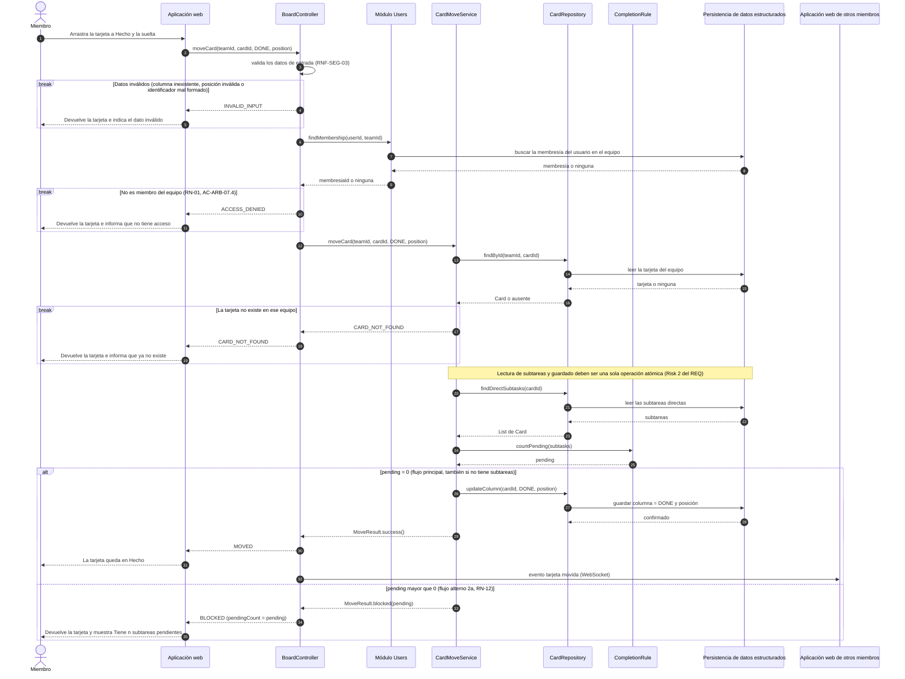
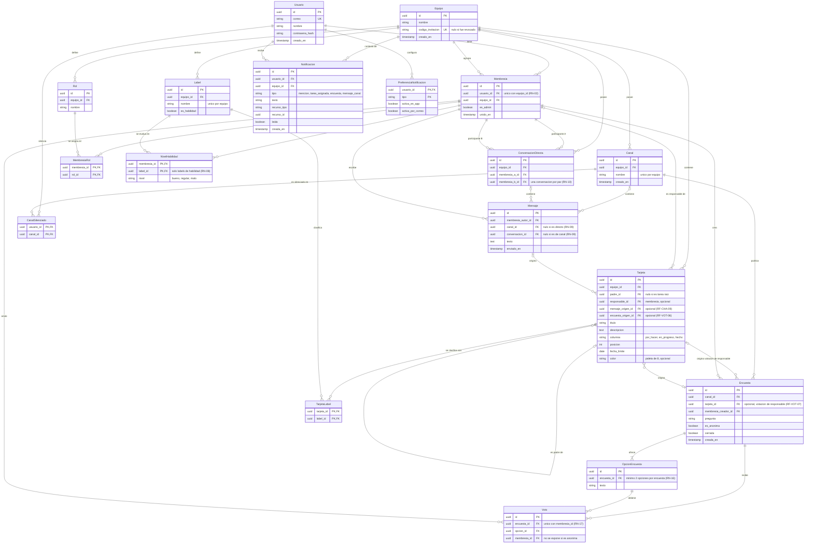

# Slackless — Interaction & Data Design v1.0

|             |                                                                                                                                              |
|-------------|----------------------------------------------------------------------------------------------------------------------------------------------|
| **Team**    | Grupo 2                                                                                                                                      |
| **Members** | David Esteban Raigosa Socha, Deisy Viviana Lara Sisa, Hare Zeiyiukuin Atehortua Rincon, Fredy Humberto Garzon Salgado, Silvana Ramirez Ardila |
| **Status**  | Ready for review                                                                                                                             |
| **Date**    | 2026-10-25                                                                                                                                   |
| **Inputs**  | `docs/design/01_Architectural_and_Detailed_Design.md` (Deliverable 1), Use Cases CU-12 y CU-19 de `docs/requirements/` (casos-de-uso.md) y el Use Case detallado de `RF-ARB-07.md`, modelo entidad-relación del equipo (`02-modelo-entidad-relacion.mmd`), Interaction & Contracts Design v0.1 (Class 13) |

*Convenciones: las entidades de datos usan los nombres del modelo entidad-relación del equipo (`Tarjeta`) y las clases de Deliverable 1 van en inglés (`Card`). Los identificadores `A-n` son supuestos (Sección 5) y `OQ-n` son preguntas abiertas (Sección 5).*

---

## 1. Behavior — Selected Use Cases

Se eligieron dos casos de uso que cruzan módulos distintos de la arquitectura: **CU-19 «Mover una tarjeta con subtareas a *Hecho*»** (requerimiento final del equipo, RF-ARB-07, Módulo Dashboard) y **CU-12 «Enviar mensaje en un canal»** (RF-CHA-03 y RF-CHA-04, Módulo Com.). Juntos recorren los tres módulos del servidor (Dashboard, Users y Com.), la persistencia de datos estructurados y la entrega en tiempo real, que es lo que permite revisar de quién es cada dato.

### 1.1 Mover una tarjeta con subtareas a *Hecho* (CU-19) — from requirement RF-ARB-07

Trazabilidad: `casos-de-uso.md` CU-19 (flujo principal 1–3, alternos 2a y 3a) y el Use Case «Mover una tarea a *Hecho*» de `RF-ARB-07.md` §4.3 (flujo principal 1–5 y flujo alternativo de subtareas pendientes). Reglas: RN-12, RN-13, RN-01.

| Use Case step or flow | Message(s) in the diagram | Information exchanged | Operation defined in (Deliverable 1) |
|---|---|---|---|
| Main flow, step 1 (CU-19 paso 1; RF-ARB-07 paso 1) | `moveCard(teamId, cardId, DONE, position)` de la aplicación web a `BoardController` | `teamId`, `cardId`, columna destino `DONE` y posición (CU-26); el usuario se toma de la sesión | `BoardController.moveCard`: **nueva** (Cambio C1) |
| Precondición (RF-ARB-07: sesión, pertenencia al equipo y la tarjeta existe) | `findMembership(userId, teamId)` con su consulta de membresía; `findById(teamId, cardId)` | `userId`, `teamId` → `membresiaId` o ninguna; `cardId` → tarjeta | `TeamMembership.findMembership`: **nueva**, capacidad del Módulo Users (Cambio C4); D1 §3.4 la suponía en un *guard* de NestJS. `CardRepository.findById`: **nueva** (Cambio C3) |
| Main flow, step 2 (verifica las subtareas directas; RF-ARB-07 pasos 2 y 3) | `findDirectSubtasks`, `countPending` | `cardId` → subtareas con su columna; subtareas → `pending` (0 si no tiene subtareas, RF-ARB-07 paso 3) | `CardRepository.findDirectSubtasks`, `CompletionRule.countPending` (D1 §3.2) |
| Main flow, step 3 (mueve y guarda; RF-ARB-07 pasos 4 y 5: mover y mostrar a los demás) | `updateColumn`, `MoveResult.success()`, `MOVED`, evento a otros clientes | `cardId`, `DONE`, `position` → confirmación; evento `tarjeta movida` | `CardRepository.updateColumn`, `MoveResult.success()` (D1 §3.2); el aviso lo hace quien invoca el servicio (D1 §3.4, supuesto 2) |
| Alternative flow 2a (hay subtareas pendientes; RN-12; Alternative Flow de RF-ARB-07) | rama `pending mayor que 0`: `MoveResult.blocked(pending)` y `BLOCKED` | `pendingCount` (número de subtareas directas fuera de *Hecho*) | `MoveResult.blocked` (D1 §3.2). El texto «Tiene n subtareas pendientes» lo arma la interfaz |
| Alternative flow 3a (terminar la última subtarea no mueve al padre; RN-13) | Ningún mensaje: el padre solo cambia con una solicitud `moveCard` explícita | — | `CardMoveService` solo actúa ante solicitud de un miembro (D1 §3.4 y Decision B de D1 §5; RN-13) |
| Exception (petición sin permiso: escenario AC-ARB-07.4 y RNF-SEG-02; el Use Case de RF-ARB-07 declara su Exception como N/A) | primer `break`: `ACCESS_DENIED` | resultado de `findMembership` | `TeamMembership.findMembership` (Cambio C4) |
| Exception (entrada inválida, RNF-SEG-03) | `break` de datos inválidos: `INVALID_INPUT` | columna, posición o identificadores mal formados | Validación en `BoardController` (Cambio C1) |
| Exception derivada (la precondición «la tarjeta existe» no se cumple) | `break` de tarjeta ausente: `CARD_NOT_FOUND` | resultado de `findById` | `CardRepository.findById` (Cambio C3). **El caso de uso no la describe**: ver A-4 |

### 1.2 Enviar mensaje en un canal (CU-12) — from requirement RF-CHA-03 and RF-CHA-04

Trazabilidad: `casos-de-uso.md` CU-12 (flujo principal 1–4, alterno 1a) y `RNF-REN-01`. Reglas: RN-01, RN-09. El Módulo Com. solo está definido a nivel de componente en D1 (no hay diseño de clases para él), por eso el diagrama usa el componente como participante (ver A-1).

| Use Case step or flow | Message(s) in the diagram | Information exchanged | Operation defined in (Deliverable 1) |
|---|---|---|---|
| Main flow, step 1 (escribe el texto y lo envía) | `sendMessage(teamId, channelId, text)` de la aplicación web a `Módulo Com.` | `teamId`, `channelId`, `text`; el autor se toma de la sesión | Capacidad «operaciones de comunicación» del Módulo Com. (D1 §2.2). `sendMessage`: **nueva** (Cambio C5) |
| Alternative flow 1a (mensaje vacío: no se envía) | primer `break`: `INVALID_MESSAGE` | texto vacío o demasiado largo | Validación del Módulo Com. (RNF-SEG-03) (Cambio C5) |
| Precondición (tiene un canal del equipo abierto; RN-01) | `findMembership(userId, teamId)` y su consulta | `userId`, `teamId` → `membresiaId` o ninguna | `TeamMembership.findMembership` (Cambio C4) |
| Main flow, step 2 (almacena con autor, fecha y hora; RN-09) | búsqueda del canal y guardado del mensaje; `SENT` | `channelId`, autor, texto → `messageId`, `sentAt` | Capacidad «persistencia de datos estructurados» requerida por Com. (D1 §2.2) |
| Main flow, step 3 (entrega a quienes tienen el canal abierto, RNF-REN-01) | evento `mensaje nuevo` a otros clientes | mensaje con autor y hora | Entrega en tiempo real por WebSocket (D1 §1, driver RF-CHA-04; ADR 0001) |
| Main flow, step 4 (menciones) | `opt` con nota | — | CU-15, fuera del alcance de este diagrama |
| Exception (sin permiso, RNF-SEG-02) | segundo `break`: `ACCESS_DENIED` | resultado de `findMembership` | `TeamMembership.findMembership` (Cambio C4) |
| Exception derivada (canal inexistente en el equipo) | tercer `break`: `CHANNEL_NOT_FOUND` | resultado de la búsqueda del canal | Persistencia (D1 §2.2). **CU-12 no la describe**: ver A-4 |
| Alternos 3a y 3b (canal cerrado al llegar el mensaje, reconexión) | — | — | No se dibujan: son comportamiento del cliente (RNF-CON-01), no una interacción con el servidor de este envío |

### Decisión de interacción — verificación de equipo en cada operación

| | |
|---|---|
| **Because** (context) | RN-01 y RNF-SEG-02 exigen comprobar en el servidor que el usuario pertenece al equipo dueño del recurso. Si el servidor confiara solo en el `teamId` que manda el cliente, un miembro del equipo A podría enviar la petición con un `cardId` del equipo B. |
| **We chose** (decision) | Toda operación de Dashboard y de Com. recibe `teamId`, verifica con el Módulo Users (`findMembership`) **antes** de ejecutarse, y las consultas de datos filtran siempre por `teamId` y por el identificador del recurso. Una tarjeta o un canal de otro equipo se responde como «no existe». |
| **Accepting** (trade-off) | Una llamada y una consulta adicionales por operación, el cliente debe enviar `teamId` en cada solicitud, y los módulos Dashboard y Com. quedan dependiendo de una capacidad del Módulo Users (el diagrama de tres capas ya no dibuja flechas entre módulos, así que esa dependencia queda documentada en la tabla de D1 §2.2). |

---

## 2. Data Design

### 2.1 Principal information the system needs

| Information | Needed by (use cases) | Persisted? | Why (or why not) |
|---|---|---|---|
| Cuentas de usuario (correo, nombre, contraseña como hash) | CU-01, CU-02, CU-03 | Yes | La identidad debe sobrevivir entre sesiones; el correo identifica la cuenta (RF-CUE-02) y la contraseña se guarda solo como hash (RNF-SEG-01). |
| Equipos, membresías y código de invitación | CU-04 a CU-09 | Yes | Definen quién puede ver qué (RN-01) y deben conservarse (RNF-CON-02). El código vive en el equipo y es nulo si fue revocado. |
| Canales, conversaciones directas y mensajes | CU-10 a CU-16 | Yes | El historial se consulta de a 50 y por bloques anteriores (CU-13); un mensaje confirmado no puede perderse (RNF-CON-02). |
| Tarjetas del tablero y su árbol (padre, columna, posición, color, fecha, responsable) | CU-17 a CU-29 | Yes | Son el estado del tablero. La relación padre-hija y la columna son la base de RN-11, RN-12 y RN-14. |
| Labels, roles y niveles de habilidad | CU-30 a CU-33 | Yes | Vocabulario del equipo y declaraciones de cada miembro; las usa la asignación informada. |
| Encuestas, opciones y votos | CU-37 a CU-40 | Yes | Un voto por miembro y un resultado fijo al cerrar (RN-17, RN-18) requieren guardarlos. |
| Notificaciones, preferencias y canales silenciados | CU-34 a CU-36 | Yes | La campana muestra notificaciones pasadas y las preferencias son por usuario (RN-19). |
| Progreso del padre ("3/5"), cuenta de subtareas pendientes y color efectivo de una tarjeta | CU-18, CU-19, CU-24 | No | Se calculan cada vez a partir de las subtareas y los colores propios (RF-ARB-05, RN-15). Guardarlos podría dejarlos desactualizados. |
| Columna actual de cada tarjeta (Tarjeta.columna) | CU-19, CU-26 | Yes | Se persiste porque indica en qué columna está la tarjeta y cambia cuando se mueve. Solo admite los valores definidos por RF-KAN-01: por_hacer, en_progreso y hecho. |
| Resultado del movimiento (`MoveResult`) | CU-19 | No | Es la respuesta de una operación y no tiene vida después de ella. |
| Entrega de los correos de notificación | CU-36 | No | La entrega la hace el proveedor externo (API Gmail); solo se guarda la preferencia `activa_por_correo`. |
| Sesión del usuario | CU-02, CU-03 | Pending | El modelo de datos no tiene una entidad de sesión; el ADR 0001 menciona la caché de sesión en el almacén efímero, que está diferido (OQ-1). |

### 2.2 Data model

**Representación elegida: relacional (PostgreSQL), es decir, la Option A de la plantilla.** La información tiene relaciones estrictas entre usuarios, equipos, canales, tarjetas y mensajes, y cada recurso depende de la membresía del equipo (RN-01). Es lo que decidió el ADR 0001 al descartar MongoDB (Option B), porque en un modelo de documentos habría que duplicar datos para respetar esas relaciones. Aceptamos que las reglas que recorren el árbol hacia arriba (RN-11 y RN-15) se resuelvan en la lógica del módulo con `padre_id` y no con una estructura propia de árbol.

**Option A — Relational (modelo entidad-relación del equipo)**

| Entity / document type | Meaning in the system | Identifier | Constraints (required, unique, allowed values) |
|---|---|---|---|
| `Usuario` | Persona con cuenta | `id` | `correo` único (RF-CUE-02) |
| `Equipo` | Espacio de trabajo | `id` | `codigo_invitacion` único, nulo si fue revocado (RF-CUE-08) |
| `Membresia` | Pertenencia de un usuario a un equipo; guarda si es administrador | `id` | `usuario_id` y `equipo_id` obligatorios; un usuario tiene una sola membresía por equipo (RN-02) |
| `Rol` | Etiqueta informativa del equipo | `id` | `equipo_id` obligatorio; no otorga permisos (RN-04) |
| `MembresiaRol` | Rol asignado a una membresía | (`membresia_id`, `rol_id`) | Ambos obligatorios; sin repetidos |
| `Canal` | Conversación pública del equipo | `id` | `nombre` único por equipo (RF-CHA-01) |
| `ConversacionDirecta` | Conversación privada entre dos miembros | `id` | Dos participantes del mismo equipo; una por par (RN-10) |
| `Mensaje` | Texto enviado por una membresía | `id` | Pertenece a exactamente un canal o una conversación directa (RN-09) |
| `Tarjeta` | Unidad de trabajo del tablero; puede tener padre | `id` | `equipo_id` obligatorio; `padre_id` nulo si es raíz; `columna` en `por_hacer`, `en_progreso` o `hecho`; `color` opcional de la paleta de 8; responsable opcional y miembro del mismo equipo (RN-07) |
| `Label` | Etiqueta del vocabulario del equipo | `id` | `nombre` único por equipo; `es_habilidad` marca si aparece en la encuesta |
| `TarjetaLabel` | Label asignado a una tarjeta | (`tarjeta_id`, `label_id`) | Ambos del mismo equipo (RN-06) |
| `NivelHabilidad` | Nivel de un miembro en un label de habilidad | (`membresia_id`, `label_id`) | `nivel` en `bueno`, `regular` o `malo`; solo labels con `es_habilidad` (RN-08) |
| `Encuesta` | Votación publicada en un canal | `id` | `canal_id` obligatorio; `tarjeta_id` opcional; `es_anonima` y `cerrada` |
| `OpcionEncuesta` | Opción de una encuesta | `id` | Mínimo 2 por encuesta (RN-16) |
| `Voto` | Voto de una membresía en una encuesta | `id` | Un voto por membresía y encuesta (RN-17); la membresía no se expone si es anónima |
| `Notificacion` | Aviso para un usuario en un equipo | `id` | `tipo` en `mencion`, `tarea_asignada`, `encuesta`, `mensaje_canal`; `leida` |
| `PreferenciaNotificacion` | Preferencia de un usuario por tipo de evento | (`usuario_id`, `tipo`) | `activa_en_app` y `activa_por_correo` |
| `CanalSilenciado` | Canal silenciado por un usuario | (`usuario_id`, `canal_id`) | Ambos obligatorios; sin repetidos |

*Los valores de `Tarjeta.columna` (`por_hacer`, `en_progreso`, `hecho`) corresponden a la enumeración `Column` de D1 (`TO_DO`, `IN_PROGRESS`, `DONE`). `Tarjeta.posicion` corresponde a `Card.position` (Cambio C3).*

| Decisión de almacenamiento | |
|---|---|
| **Because** (context) | El ADR 0001 eligió PostgreSQL porque los mensajes y tareas necesitan relaciones y permisos estrictos con usuarios y canales. RN-02, RN-14 y las tres columnas fijas se pueden expresar como restricciones (`UNIQUE`, `ON DELETE SET NULL`, `CHECK`). |
| **We chose** (decision) | Un modelo relacional con una tabla por entidad y el árbol de subtareas como una relación de `Tarjeta` consigo misma (`padre_id`). |
| **Accepting** (trade-off) | Obtener todo el árbol de una tarjeta (esquema, RF-ARB-09) o comprobar ciclos (RN-11) pedirá consultas recursivas, más complejas que leer un documento anidado. Con árboles pequeños (equipos de 3 a 8 personas) lo aceptamos. |

### 2.3 Data Ownership

Hay una sola base PostgreSQL (ADR 0001), pero la propiedad es lógica: cada módulo lee y escribe solo las entidades que le pertenecen. Las claves foráneas entre entidades de distinto dueño (por ejemplo `Tarjeta.responsable_id` hacia `Membresia`) son referencias de integridad y no autorizan leer ni escribir datos ajenos. El reparto sigue la responsabilidad de cada componente en Deliverable 1 (§2.2).

| Information | Authoritative owner (component responsible for maintaining it) | Consumed by (uses it without owning it) | Access through |
|---|---|---|---|
| `Usuario` | Módulo Users | Módulo Com. (destinatario de notificaciones y sus preferencias) | Capacidad de equipos y cuentas del módulo Users |
| `Equipo`, `Membresia` | Módulo Users | Módulo Dashboard (verifica membresía y que el responsable sea miembro, RN-01 y RN-07), Módulo Com. (verifica membresía y participantes de directos, RN-01 y RN-10) | Capacidad de equipos del módulo Users |
| `Tarjeta`, `TarjetaLabel` | Módulo Dashboard | Módulo Com. (solo por referencia: `Encuesta.tarjeta_id`) | Operaciones del módulo Dashboard |
| `Label`, `NivelHabilidad`, `Rol`, `MembresiaRol` | Módulo Dashboard *(por el reparto de `RF-LAB-*` en Deliverable 1; ver OQ-8)* | Aplicación web (muestra niveles y roles) | Operaciones del módulo Dashboard hacia la aplicación web |
| `Canal`, `ConversacionDirecta`, `Mensaje` | Módulo Com. | Módulo Dashboard (solo por referencia: `Tarjeta.mensaje_origen_id`) | Operaciones del módulo Com. |
| `Encuesta`, `OpcionEncuesta`, `Voto` | Módulo Com. | Módulo Dashboard (solo por referencia: `Tarjeta.encuesta_origen_id`) | Operaciones del módulo Com. |
| `Notificacion`, `PreferenciaNotificacion`, `CanalSilenciado` | Módulo Com. | Módulo Dashboard (genera el evento de tarea asignada) | Capacidad de notificar del módulo Com. |

| Decisión de propiedad de datos | |
|---|---|
| **Because** (context) | El ADR 0001 fija un solo PostgreSQL y el despliegue es un único servidor (A-3). No hace falta una base de datos por módulo para que cada dato tenga un solo responsable. |
| **We chose** (decision) | Un solo PostgreSQL en el que cada tabla pertenece a un módulo. Entre módulos solo se piden resultados mediante capacidades (por ejemplo `findMembership`) y nunca se leen tablas ajenas. |
| **Accepting** (trade-off) | Las claves foráneas cruzan fronteras de propiedad (`Tarjeta.equipo_id` → `Equipo`, `Mensaje.membresia_autor_id` → `Membresia`). Separar un módulo en un servicio propio obligaría a reemplazarlas por referencias verificadas con la capacidad del dueño (OQ-9). Además, Dashboard y Com. dependen de Users en cada operación. |

### 2.4 Business rules and invariants enforced in data

El ER del equipo no define restricciones más allá de las claves y las notas de columna. Cuando el mecanismo es una propuesta de este diseño, se indica y queda en OQ-10.

| Business rule or invariant | Where it is enforced (component logic / data constraint / both) | How |
|---|---|---|
| RN-01 acceso por membresía | Component logic | `findMembership` antes de ejecutar la operación y consultas de tarjetas y canales filtradas por `teamId` (decisión de interacción, Sección 1; RNF-SEG-02) |
| RN-02 una membresía por usuario y equipo | Both | Restricción única sobre (`usuario_id`, `equipo_id`); el módulo Users rechaza con mensaje (CU-06) |
| RN-03 siempre hay un administrador | Component logic | Módulo Users comprueba antes de renunciar o salir (CU-08, CU-09); una restricción simple no lo expresa |
| RN-06 y RN-07 coherencia de equipo | Component logic | El módulo Dashboard valida que padre, labels y responsable pertenecen al equipo de la tarjeta; `CardRepository` solo busca por (`teamId`, `cardId`). Podría reforzarse con una clave foránea compuesta (OQ-10) |
| RN-08 niveles solo para labels de habilidad | Component logic | El módulo Dashboard valida `es_habilidad` y elimina los niveles al quitar la marca o eliminar el label |
| RN-09 un mensaje, un lugar | Both | Columnas anulables en el ER; propuesta: restricción que exige exactamente una de `canal_id` y `conversacion_id` |
| RN-10 una conversación directa por par | Both | Restricción única sobre el par de membresías (propuesta: guardarlo en orden canónico); el módulo Com. valida que ambas sean del mismo equipo |
| RN-11 sin ciclos | Component logic | El módulo Dashboard rechaza el cambio de padre que cree un ciclo (CU-21) |
| RN-12 un padre no se termina antes que sus hijas | Component logic | `CompletionRule` cuenta las subtareas directas fuera de *Hecho* y `CardMoveService` guarda solo si son cero, en una operación atómica (OQ-4). No puede ser una restricción de columna porque depende de otras filas |
| RN-13 el padre nunca se mueve solo | Component logic | No existe ninguna ruta automática; solo la solicitud explícita de un miembro cambia `columna` |
| RN-14 eliminar un padre libera a sus hijas | Both | `padre_id` anulable; propuesta: al eliminar el padre, `padre_id` de sus hijas pasa a nulo; el módulo informa cuántas serán raíces |
| RN-15 color efectivo | Component logic | Se calcula al mostrar y no se guarda en las descendientes |
| RN-16 mínimo dos opciones | Component logic | La notación `||--|{` del ER no expresa "dos"; el módulo Com. valida al publicar |
| RN-17 un voto por miembro | Both | Restricción única sobre (`encuesta_id`, `membresia_id`); votar de nuevo reemplaza el voto |
| RN-18 encuesta cerrada, resultado fijo | Component logic | El módulo Com. rechaza votos cuando `cerrada` es verdadero |
| RN-19 notificar solo si la persona quiere | Component logic | El módulo Com. consulta preferencias y canales silenciados antes de crear la `Notificacion` |
| Correo único (RF-CUE-02) y nombre de canal único por equipo (RF-CHA-01) | Data constraint | `UNIQUE` sobre `Usuario.correo` y sobre (`equipo_id`, `nombre`) en `Canal` |
| El mensaje no está vacío (CU-12, alterno 1a) | Both | El Módulo Com. lo valida antes de guardar; un `CHECK` de longitud mayor que cero como segunda barrera |
| Valores permitidos de `columna`, `nivel` y `tipo` | Both | Lista de valores en el modelo y validación en el servidor (RNF-SEG-03) |

---

## 3. Interface Contract

**Interaction chosen** (from diagram 1.1, message `moveCard(teamId, cardId, DONE, position)`): acuerdo entre la **aplicación web** y el **Módulo Dashboard** para mover una tarjeta de columna. Es la operación que concreta el requerimiento final RF-ARB-07.

| Element | Specification |
|---|---|
| **Operation and purpose** | `moveCard`, ofrecida por el Módulo Dashboard (`BoardController`). Mueve una tarjeta del tablero del equipo a otra columna; cuando el destino es *Hecho*, aplica antes la regla RN-12 (RF-ARB-07). |
| **Input** (parameters and types) | `teamId : String`; `cardId : String`; `targetColumn : Column` (`TO_DO`, `IN_PROGRESS` o `DONE`; en la base se guardan como `por_hacer`, `en_progreso`, `hecho`); `position : Integer` (posición dentro de la columna; valores válidos en OQ-5). La identidad del solicitante (`userId`) la toma el servidor de la sesión; el cliente no la envía. |
| **Output** (successful result and data structure) | Respuesta con `outcome : MOVED o BLOCKED` y `pendingCount : Integer` (0 si `MOVED`; 1 o más si `BLOCKED`). Corresponde a `MoveResult.isMoved()` y `MoveResult.getPendingCount()` de D1. El texto del mensaje lo arma la interfaz. |
| **Preconditions** (what the caller must satisfy before invoking) | Hay sesión activa. `teamId` y `cardId` tienen formato válido, `targetColumn` es uno de los tres valores y `position` es válida (RNF-SEG-03). La tarjeta no está ya en `targetColumn` (CU-19; qué pasa si lo está es OQ-2). *El caller no necesita demostrar que es miembro: la operación lo verifica; si no lo es, falla con `ACCESS_DENIED`.* |
| **Postconditions** (what is guaranteed on successful completion) | **Si `MOVED`:** la tarjeta está en `targetColumn` y `position`, y el cambio persiste (RNF-CON-02). Si `targetColumn` es `DONE`, ninguna de sus subtareas directas estaba fuera de *Hecho* cuando se evaluó. Los demás miembros del equipo que tienen el tablero abierto reciben el evento `tarjeta movida` en máximo 1 s (RNF-REN-02). **Si `BLOCKED`:** la tarjeta sigue en su columna original, no se modificó ningún dato, `pendingCount` es el número de subtareas directas fuera de *Hecho* y no se envió ningún evento. |
| **Failure outcomes** (each failure, and what state is left after it) | `INVALID_INPUT`: columna inexistente, posición inválida o identificador mal formado (CU-26, alterno 2b); no se ejecuta ninguna operación, estado intacto (RNF-SEG-03). `ACCESS_DENIED`: el usuario no es miembro del equipo `teamId`; estado intacto y no se revela si la tarjeta existe (RN-01, AC-ARB-07.4). `CARD_NOT_FOUND`: no existe una tarjeta `cardId` en el equipo `teamId` (incluye tarjetas de otros equipos); estado intacto. |
| **Invariants and side effects** (what must stay true, what may change) | **Invariantes.** I-1 (RN-12): la operación nunca deja en *Hecho* una tarjeta con subtareas directas fuera de *Hecho* en el momento de evaluarla. I-2 (RN-13): lo único que cambia es la columna y la posición de `cardId`; ninguna otra tarjeta, y en particular ningún padre, cambia de columna (el posible reacomodo de posiciones es OQ-5). I-3 (RNF-SEG-03): no hay operaciones parciales; la lectura de las subtareas y el guardado forman una sola unidad (mecanismo: OQ-4). I-4 (RN-01, RN-06): toda lectura y escritura de tarjetas filtra por `teamId`. **Efectos secundarios.** Solo uno: el evento `tarjeta movida` hacia los demás clientes del equipo, y únicamente cuando el resultado es `MOVED`. |

**Testable examples**

| Case | Before | Request | Expected |
|---|---|---|---|
| Padre con todas las subtareas terminadas | Tarjeta P en `IN_PROGRESS` con subtareas S1 y S2, ambas en `DONE` | `moveCard(equipoA, P, DONE, 1)` por un miembro de A | `MOVED`, `pendingCount = 0`; P en `DONE`; evento enviado |
| Padre sin subtareas | Tarjeta Q en `TO_DO` sin subtareas | `moveCard(equipoA, Q, DONE, 1)` por un miembro de A | `MOVED`, `pendingCount = 0`; Q en `DONE` |
| Una subtarea pendiente (AC-ARB-07.1) | P en `IN_PROGRESS` con S1 en `DONE` y S2 en `IN_PROGRESS` | `moveCard(equipoA, P, DONE, 1)` | `BLOCKED`, `pendingCount = 1`; P sigue en `IN_PROGRESS`; sin evento |
| Varias pendientes (AC-ARB-07.3) | P con 5 subtareas: 3 en `DONE`, 1 en `TO_DO` y 1 en `IN_PROGRESS` | `moveCard(equipoA, P, DONE, 1)` | `BLOCKED`, `pendingCount = 2`; P no cambia |
| Terminar la última subtarea no mueve al padre (RN-13) | P en `IN_PROGRESS` con una sola subtarea S en `IN_PROGRESS` | `moveCard(equipoA, S, DONE, 1)` | `MOVED` para S; P sigue en `IN_PROGRESS` |
| Destino distinto de *Hecho* | P con S1 en `TO_DO`, P en `TO_DO` | `moveCard(equipoA, P, IN_PROGRESS, 1)` | `MOVED`; la regla RN-12 no se aplica |
| Petición directa sin permiso (AC-ARB-07.4) | Un usuario que no es miembro del equipo A | `moveCard(equipoA, P, DONE, 1)` | `ACCESS_DENIED`; P no cambia |
| Tarjeta de otro equipo | Usuario miembro de A; la tarjeta X es del equipo B | `moveCard(equipoA, X, DONE, 1)` | `CARD_NOT_FOUND`; X no cambia |
| Columna inexistente | Cualquier tarjeta | `moveCard(equipoA, P, "ARCHIVADA", 1)` | `INVALID_INPUT`; P no cambia |

---

## 4. Cross-Consistency & Changes to Deliverable 1

| Check | Result |
|---|---|
| Every participant in a sequence diagram is an actor, a component, a class or an external system from Deliverable 1 | **Sí, con una incorporación.** *Miembro* (actor *User* de D1), *Aplicación web*, *Módulo Users*, *Módulo Com.* y *Persistencia de datos estructurados* son componentes de D1 §2.2; `CardMoveService`, `CardRepository` y `CompletionRule` son clases de D1 §3.2; *Aplicación web de otros miembros* es otra instancia del mismo componente. `BoardController` no existía como clase: se agrega a D1 (Cambio C1). Que Com. cubra el chat es un supuesto por confirmar (A-1, Cambio C5). |
| Every message corresponds to a capability, operation or contract | **Sí.** Las operaciones de D1 se reutilizan sin cambio de nombre (a `moveCard` y `updateColumn` solo se les agrega `position`, C2 y C3): `findDirectSubtasks`, `countPending`, `updateColumn`, `MoveResult.success/blocked`. Las nuevas (`moveCard` del controlador, `findById`, `findMembership`, `sendMessage`) están dadas de alta en los Cambios C1 a C5 y la primera es la del contrato de la Sección 3. |
| Every entity or document type is reflected in the class diagrams, or the reason it is not is stated | **Parcial, con razón.** `Tarjeta` ↔ `Card` (`padre_id` ↔ asociación `parent`, `columna` ↔ `column : Column`, `equipo_id` ↔ `teamId`, `posicion` ↔ `position`; los atributos nuevos entran por C3). Las otras 17 entidades no aparecen en clases porque D1 detalla un solo componente, el Módulo Dashboard, por indicación del profesor; las clases de Users y Com. no se han diseñado. |
| Every persisted information element has exactly one authoritative owner | **Sí, con dos pendientes declarados.** Cada tabla tiene un solo módulo dueño (Sección 2.3). La sesión (2.1) aún no tiene dueño ni almacén (OQ-1) y falta confirmar el dueño de `Rol` y `MembresiaRol` (OQ-8). |
| The contract agrees with the sequence diagram and with the data model (same behavior in all three views) | **Sí.** El contrato de `moveCard` tiene los mismos tres fallos y los dos resultados que el diagrama 1.1 (`INVALID_INPUT`, `ACCESS_DENIED`, `CARD_NOT_FOUND`, `MOVED`, `BLOCKED`); el filtro por `teamId` y la columna de tres valores coinciden con `Tarjeta` en la Sección 2.2; la regla de pendientes cuenta subtareas por `padre_id` y `columna`, que son atributos del modelo, y `position` es `Tarjeta.posicion`. La membresía que devuelve `findMembership` es la que se guarda como `Mensaje.membresia_autor_id`. |

**Changes made to Deliverable 1 because of this deliverable**

| # | Change | Where in Deliverable 1 | Why (evidence from this deliverable) |
|---|---|---|---|
| C1 | Agregar la clase `BoardController` (punto de entrada del Módulo Dashboard): valida la entrada, verifica la membresía, llama a `CardMoveService` y avisa a los demás clientes cuando el resultado es `MOVED`. | §3.2 diagrama de clases, §3.3 tabla de clases | D1 §3.4 hablaba de «quien invoca el servicio». Para dibujar el diagrama 1.1 ese rol necesita un nombre y una responsabilidad. |
| C2 | `CardMoveService.moveCard(cardId, targetColumn)` pasa a `moveCard(teamId, cardId, targetColumn, position)`. | §3.2, §3.3, §3.4 | La búsqueda de la tarjeta debe filtrar por equipo (decisión de interacción, RN-01 y RN-06), y CU-26 guarda columna y posición (`Tarjeta.posicion` del modelo de datos). |
| C3 | Agregar `CardRepository.findById(teamId, cardId) Card` el atributo `teamId` y el atributo `position` en `Card`, y el parámetro `position` en `CardRepository.updateColumn(cardId, column, position)`; el pseudocódigo comienza con esa búsqueda y falla con `CARD_NOT_FOUND`. | §3.2, §3.4 | Sin ella no hay forma de saber de qué equipo es la tarjeta ni de rechazar una tarjeta inexistente o ajena. |
| C4 | Nueva capacidad **provista** por el Módulo Users, `findMembership(userId, teamId)`, y **requerida** por Dashboard y Com. Devuelve la membresía (no solo verdadero o falso) porque `Mensaje.membresia_autor_id` la necesita. En el diagrama de clases aparece como la interfaz `TeamMembership`. | §2.2 tabla de componentes (filas Users, Dashboard y Com.), §3.2 | D1 §3.4 suponía un *guard* sin decir quién le da la información. La membresía es dato del Módulo Users (Sección 2.3), así que debe pedirse a Users. El diagrama de tres capas no cambia (sin flechas entre módulos, como pidió el profesor); la dependencia queda en la tabla. |
| C5 | El Módulo Com. pasa de «llamadas y envío de correo (confirmar si incluye chat)» a **chat (canales y mensajes) y envío de correo**, con la capacidad `sendMessage`. Requiere persistencia y `findMembership`. **Por confirmar por el equipo (A-1).** | §2.2 tabla de componentes (fila Com.) | CU-12 necesita un dueño para `Canal` y `Mensaje`, y Com. es el único módulo cuyo nombre lo permite. |
| C6 | Se actualizó la tabla de trazabilidad de D1 §6 para incluir CU-12 y los requisitos RN-01, RNF-SEG-02 y RF-KAN-05 (notificación del movimiento a los demás clientes). | D1 §6 | La secuencia de CU-12 y la operación BoardController deben quedar trazadas a sus requisito
| C7 | Sin cambio: D1 §3.4 (supuesto 2) dice que un movimiento rechazado no se avisa a los demás clientes; se mantiene (A-5). | — | El diagrama 1.1 es coherente con eso. |

---

## 5. Open Questions

**Supuestos adoptados en este documento**

- **A-1.** El Módulo Com. incluye canales y mensajes (CU-10 a CU-13) además de las llamadas y el correo. D1 lo dejaba «por confirmar».
- **A-2.** Cuando una operación llega al servidor, la sesión ya fue verificada y se conoce el `userId`; la verificación de sesión (CU-02, CU-03) es capacidad del Módulo Users y no se detalla aquí.
- **A-3.** El servidor se ejecuta como una sola instancia (SRS §2.5), por lo que las conexiones por canal y por tablero viven en la memoria del canal de eventos (Socket.IO) y no necesitan Redis.
- **A-4.** Los fallos `CARD_NOT_FOUND` y `CHANNEL_NOT_FOUND` no están en los casos de uso; se derivan de RN-01 y RNF-SEG-02 (no operar sobre recursos de otro equipo) y de que un identificador puede ser inexistente.
- **A-5.** Mientras espera la respuesta, la aplicación web solo mueve la tarjeta de forma visual en el cliente que arrastró; los demás clientes cambian solamente al recibir el evento del servidor. Por eso un movimiento rechazado no necesita avisarse a los demás.
- **A-6.** Los identificadores se modelan como `uuid` en la base de datos y como `String` en las clases.

**Preguntas abiertas**

- **OQ-1. Sesión:** ¿dónde se guarda y cómo se invalida al cerrar sesión o a los 7 días (RNF-SEG-04)? ¿En PostgreSQL o en el Estado efímero (diferido)? Define quién es su dueño.
- **OQ-2. Mover a la columna donde ya está:** CU-19 exige que la tarjeta esté en otra columna, pero no dice qué hacer si no lo está (por ejemplo, una tarjeta ya en *Hecho*). El pseudocódigo de D1 volvería a evaluar las subtareas.
- **OQ-3. Padre ya en *Hecho* que recibe una subtarea o ve reabrir una (preguntas abiertas 1 y 2 de RF-ARB-07):** el invariante I-1 se cumple al mover, pero otras operaciones pueden dejar un padre en *Hecho* con una hija pendiente. Hace falta decidir si se bloquea esa operación, o si el padre se marca de otra forma.
- **OQ-4. Atomicidad:** D1 deja abierto cómo se logra (Hallazgo de D1 §4). Propuesta a evaluar al implementar: una transacción de PostgreSQL que bloquee las subtareas leídas hasta guardar el movimiento, aunque esto protege solo el momento de la evaluación y no resuelve OQ-3.
- **OQ-5. Posición dentro de la columna (CU-26):** no está definido qué valores de `position` son válidos ni cómo cambian las posiciones de las demás tarjetas de la columna.
- **OQ-6. Autor de un mensaje tras salir del equipo (CU-09):** el modelo del equipo liga el mensaje a la membresía (`membresia_autor_id`). Si salir del equipo borra la membresía, la clave foránea queda rota o los mensajes se pierden. Hay que decidir si la membresía se marca como inactiva o si el autor pasa a ser el usuario.
- **OQ-7. Límites de longitud:** el texto del mensaje y el título de la tarjeta tienen límite (RNF-SEG-03), pero no hay valor definido.
- **OQ-8. Dueño de `Rol` y `MembresiaRol`:** se asignaron al Módulo Dashboard por el reparto de `RF-LAB-*`, pero asignan una pieza de la membresía, que pertenece a Users.
- **OQ-9. Referencias entre dueños:** `Tarjeta.mensaje_origen_id`, `Tarjeta.encuesta_origen_id` y `Encuesta.tarjeta_id` cruzan módulos; no está definido cómo se valida que existan sin leer datos ajenos.
- **OQ-10. Mecanismos propuestos en 2.4** (exclusividad de `canal_id` y `conversacion_id` para RN-09, orden canónico del par para RN-10, `padre_id` a nulo para RN-14, clave foránea compuesta para RN-06): el modelo del equipo no los define y el equipo debe aprobarlos.

---

## 6. Optional — AI-Assisted Design Reflection

> Describa una recomendación de IA que aceptó, modificó o rechazó, y por qué. Una candidata, tal como surgió en la redacción de este borrador: *la IA sugirió que `moveCard` recibiera `teamId` y que el repositorio filtrara siempre por equipo (decisión de interacción de la Sección 1)*. 

---

## 7. Consistency Checklist

- [x] Two use cases from the project, each traceable to a Use Case written in the requirements (CU-19 y CU-12).
- [x] Each sequence diagram shows the main flow and at least one alternative or exception flow.
- [x] No business behavior is invented: anything unspecified is marked as an assumption or Open Question (A-1 a A-6, OQ-1 a OQ-8).
- [x] Section 2.1 explains what is NOT persisted as well as what is.
- [x] The data model has identifiers, relationships and constraints, not only boxes.
- [x] Every piece of principal information has one authoritative owner, and consumers are listed (Section 2.3); la sesión y el dueño de `Rol` y `MembresiaRol` quedan como pendientes declarados (OQ-1, OQ-8).
- [x] The contract defines input, output, preconditions, postconditions and failure outcomes.
- [x] Sequence, data model and contract describe the same behavior.
- [x] Diagrams render correctly on GitHub (or the exported images are embedded).
