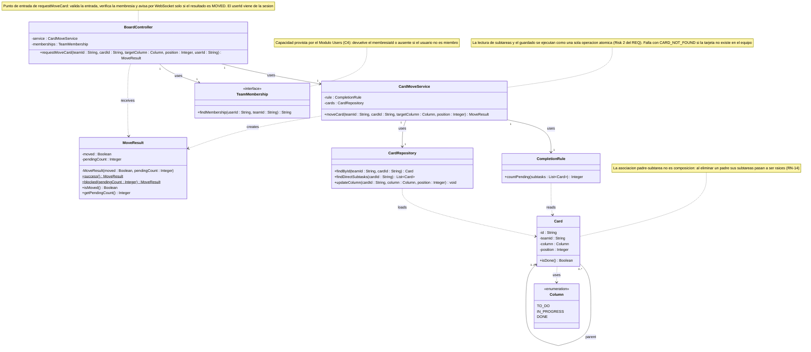

# Módulo Dashboard — diseño detallado de RF-ARB-07 (texto listo para las secciones 3.2, 3.3 y 3.4)

*Extracto de docs/design/01_Architectural_and_Detailed_Design.md (§3.2 a §3.4), actualizado el 2026-11-09 (Cambio C8). Ese archivo es la fuente de verdad: si difieren, prevalece Deliverable 1.*

## 3.2 Class Diagram(s)


*`CardRepository` es el uso que hace Dashboard de la persistencia de datos estructurados (tier 3). `TeamMembership` es la única pieza de otro módulo que aparece: es la interfaz de la capacidad `findMembership` que provee el Módulo Users (Cambio C4); su implementación pertenece a Users y no se detalla en esta entrega. `Card` muestra solo los atributos que intervienen en este requerimiento (`id`, `teamId`, `column`, `position`); una tarjeta también tiene título, labels, responsable, fecha límite y color (RF-ARB-01, RF-ARB-13), que se omiten a propósito. `teamId` y `position` corresponden a `Tarjeta.equipo_id` y `Tarjeta.posicion` del modelo de datos (Deliverable 2, §2.2).*

*`BoardController.requestMoveCard` devuelve el `MoveResult` que recibe del servicio, y de él se arma la respuesta del contrato (Deliverable 2, §3): `outcome` es `MOVED` si `isMoved()` y `BLOCKED` si no, y `pendingCount` es `getPendingCount()`. Los fallos `INVALID_INPUT`, `ACCESS_DENIED` y `CARD_NOT_FOUND` no son un `MoveResult`: son errores que cortan la operación sin guardar nada, así `MoveResult` conserva solo dos resultados posibles (`success()` y `blocked(n)`). Las firmas son independientes del lenguaje: en TypeScript las operaciones que tocan la base de datos (y `findMembership`) serían asíncronas.*

**Por qué la relación padre-subtarea es una asociación y no una composición:** al eliminar una tarjeta con subtareas, estas se conservan y pasan a ser tareas raíz (RN-14, RF-ARB-12). Una subtarea no pierde su existencia con su padre, así que no cumple la condición de la composición. La multiplicidad refleja que una tarjeta tiene como máximo un padre (RN-11, sin ciclos) y puede tener cero o más subtareas directas.

### Relaciones y su justificación

| Relación | Tipo | Dirección (quién conoce a quién) | Por qué |
|---|---|---|---|
| `BoardController` → `CardMoveService` | Asociación (atributo `service`) | El controlador conoce al servicio; el servicio no conoce al controlador | El controlador mantiene el servicio como colaborador durante toda su vida (inyección de dependencias de NestJS, ADR 0001). El servicio no sabe nada de HTTP ni de WebSocket. |
| `BoardController` → `TeamMembership` | Asociación (atributo `memberships`) | El controlador conoce la interfaz; el Módulo Users no conoce al controlador | Dashboard depende de la capacidad `findMembership`, no de las tablas `Usuario` y `Membresia`, que son del Módulo Users (Deliverable 2, §2.3). |
| `BoardController` ⇢ `MoveResult` | Dependencia | El controlador recibe el resultado y lo traduce a la respuesta; `MoveResult` no lo conoce | No lo guarda como atributo; existe solo durante la llamada. |
| `CardMoveService` → `CompletionRule` | Asociación (atributo `rule`) | El servicio conoce a la regla; la regla no conoce al servicio | El servicio mantiene la regla como colaborador durante toda su vida (inyección de dependencias de NestJS, ADR 0001). |
| `CardMoveService` → `CardRepository` | Asociación (atributo `cards`) | El servicio conoce al repositorio; el repositorio no conoce al servicio | Igual que la anterior: el repositorio es la única vía a la persistencia. |
| `CardMoveService` ⇢ `MoveResult` | Dependencia | Solo el servicio lo crea y lo devuelve a `BoardController` | No lo guarda como atributo; existe solo durante la llamada. |
| `CompletionRule` ⇢ `Card` | Dependencia | La regla lee tarjetas; `Card` no conoce la regla | Recibe las subtareas como parámetro y solo pregunta `isDone()`. |
| `CardRepository` ⇢ `Card` | Dependencia | El repositorio construye y devuelve tarjetas (`findById`, `findDirectSubtasks`); `Card` no conoce al repositorio | Evita que el dominio dependa de la persistencia. |
| `Card` → `Card` (`parent`, 0..* a 0..1) | Asociación reflexiva | La subtarea conoce a su padre | **No es composición**: al eliminar una tarjeta sus subtareas pasan a ser raíces (RN-14, RF-ARB-12), así que no mueren con el padre. Una tarjeta tiene como máximo un padre y puede tener cero o más subtareas (RN-11, sin ciclos). |
| `Card` ⇢ `Column` | Dependencia | `Card` usa la enumeración como tipo de su atributo | `Column` es un valor fijo (RF-KAN-01), no una entidad con vida propia. |

No se usa generalización: una subtarea es una `Card` completa (RF-ARB-01), no un subtipo con comportamiento distinto. Todas las flechas apuntan en un solo sentido y ninguna regresa a `BoardController` ni a `CardMoveService`, de modo que el grafo de dependencias no tiene ciclos.

## 3.3 Class Responsibilities

| Clase | Responsabilidad | Conoce a | Es conocida por | Requisitos |
|---|---|---|---|---|
| `BoardController` | Punto de entrada del Módulo Dashboard para mover una tarjeta (`requestMoveCard`, que recibe los mismos parámetros que `CardMoveService.moveCard` más el `userId` del solicitante). Hace la verificación inicial: valida los datos de entrada (`INVALID_INPUT`), comprueba con `TeamMembership` que el solicitante es miembro del equipo (`ACCESS_DENIED`), llama a `CardMoveService.moveCard`, arma la respuesta (`MOVED`, `BLOCKED` o `CARD_NOT_FOUND`) y, solo cuando el resultado es `MOVED`, avisa a los demás clientes del equipo por WebSocket. No contiene la regla de cierre ni accede a los datos. | `CardMoveService`, `TeamMembership`, `MoveResult` (lo recibe) | La aplicación web (fuera de este diagrama, por HTTP/JSON) | RF-ARB-07, RF-KAN-04, RF-KAN-05, RN-01, RNF-SEG-02, RNF-SEG-03, RNF-REN-02 |
| `CardMoveService` | Atender la solicitud explícita de un miembro de mover una tarjeta, que le pasa `BoardController`: buscar la tarjeta en el equipo (falla con `CARD_NOT_FOUND` si no existe), aplicar la regla de cierre cuando el destino es *Hecho* y guardar columna y posición solo si se cumple. No valida la entrada, no comprueba la membresía ni avisa a otros clientes. | `CompletionRule`, `CardRepository`, `MoveResult` (la crea) | `BoardController` | RF-ARB-07, RF-ARB-08, RF-KAN-04, RN-01, RN-13 |
| `CompletionRule` | Decidir cuántas subtareas directas impiden cerrar una tarjeta. No consulta la base de datos: recibe las subtareas y devuelve un número. | `Card` | `CardMoveService` | RN-12, RNF-MAN-02 |
| `CardRepository` | Único acceso del módulo a la persistencia de tarjetas: buscar una tarjeta por equipo e identificador, leer las subtareas directas y cambiar la columna y la posición. Solo `findById` recibe `teamId`; las otras dos operaciones actúan sobre una tarjeta que `findById` ya comprobó que es del equipo. | `Card` | `CardMoveService` | RNF-CON-02, RN-01, RN-06 |
| `Card` | Representar una tarjeta del tablero (de qué equipo es y en qué columna y posición está) y responder si está terminada, sin exponer cómo se representa *Hecho*. | `Column`, `Card` (su padre) | `CompletionRule`, `CardRepository` | RF-KAN-01, RF-KAN-04, RN-11, RN-14 |
| `Column` | Enumerar las tres columnas fijas del tablero. | — | `Card` | RF-KAN-01 |
| `MoveResult` | Informar el resultado: si se movió y cuántas subtareas están pendientes. Solo se crea con `success()` o `blocked(n)`, para que no exista un resultado contradictorio. Los fallos (`INVALID_INPUT`, `ACCESS_DENIED`, `CARD_NOT_FOUND`) no pasan por esta clase. El texto del mensaje lo arma la interfaz. | — | `CardMoveService` (la crea) y `BoardController` (la recibe) | RF-ARB-07, RNF-USA-04 |
| `TeamMembership` (interfaz del Módulo Users) | Ofrecer la capacidad `findMembership(userId, teamId)`: devolver el `membresiaId` del usuario en el equipo, o ausente si no es miembro. Devuelve la membresía y no solo verdadero o falso porque otros casos de uso la necesitan (por ejemplo, el autor de un mensaje en CU-12). Pertenece al Módulo Users; aquí solo se muestra la interfaz que Dashboard requiere. | — | `BoardController` (y el Módulo Com., fuera de este diagrama) | RN-01, RNF-SEG-02 |

## 3.4 Behavior of one key operation

Caso de uso "Mover una tarea a *Hecho*". Lo atienden dos operaciones en cadena: `BoardController.requestMoveCard` (verificación inicial) y `CardMoveService.moveCard` (regla de cierre y guardado).

`BoardController.requestMoveCard(teamId, cardId, targetColumn, position, userId)`:

```text
requestMoveCard(teamId, cardId, targetColumn, position, userId) -> MoveResult
 1  IF teamId, cardId, targetColumn, position OR userId IS INVALID
 2      FAIL INVALID_INPUT                                 # RNF-SEG-03; nothing is saved
 3  membershipId = memberships.findMembership(userId, teamId)
 4  IF membershipId IS ABSENT
 5      FAIL ACCESS_DENIED                                 # RN-01; does not reveal whether the card exists
 6  result = service.moveCard(teamId, cardId, targetColumn, position)   # may FAIL CARD_NOT_FOUND
 7  IF result.isMoved()
 8      notify the other clients of the team (WebSocket)   # RF-KAN-05, RNF-REN-02
 9  RETURN result                                          # BLOCKED and failures are not notified (A-5)
```

`CardMoveService.moveCard(teamId, cardId, targetColumn, position)`:

```text
moveCard(teamId, cardId, targetColumn, position) -> MoveResult
 1  card = cards.findById(teamId, cardId)                  # filters by team (RN-01, RN-06)
 2  IF card IS ABSENT
 3      FAIL CARD_NOT_FOUND                                # nothing is saved
 4  IF targetColumn IS NOT DONE
 5      cards.updateColumn(cardId, targetColumn, position) # RF-KAN-04: the rule applies only to DONE
 6      RETURN MoveResult.success()
 7  # steps 8-12 must run as one atomic operation (Risk 2 of the REQ)
 8  subtasks = cards.findDirectSubtasks(cardId)
 9  pending  = rule.countPending(subtasks)                 # 0 if the card has no subtasks
10  IF pending > 0                                         # non-happy path (RN-12)
11      RETURN MoveResult.blocked(pending)                 # nothing is saved
12  cards.updateColumn(cardId, DONE, position)
13  RETURN MoveResult.success()
```

*Supuestos: (1) antes de llegar a este servicio, `BoardController.requestMoveCard` valida la entrada (falla con `INVALID_INPUT`, RNF-SEG-03) y comprueba la membresía con `TeamMembership.findMembership(userId, teamId)` (falla con `ACCESS_DENIED`, RN-01, RNF-SEG-02); el `userId` que recibe `requestMoveCard` lo fija el servidor a partir de la sesión (A-2 de Deliverable 2) y nunca se acepta del cuerpo de la petición del cliente. Como la membresía se comprueba antes de buscar la tarjeta, `ACCESS_DENIED` no revela si la tarjeta existe. (2) `BoardController` avisa a los demás clientes por WebSocket cuando `isMoved() = true` (RF-KAN-05, RNF-REN-02); el servicio no emite eventos, y un movimiento rechazado (`BLOCKED` o un fallo) no se avisa a otros clientes (A-5 de Deliverable 2). (3) `findById` filtra por `teamId`, así que una tarjeta de otro equipo no se distingue de una inexistente y también responde `CARD_NOT_FOUND`. La operación solo se ejecuta cuando un miembro la solicita; ningún cambio en las subtareas dispara el movimiento del padre (RF-ARB-08, RN-13).*
