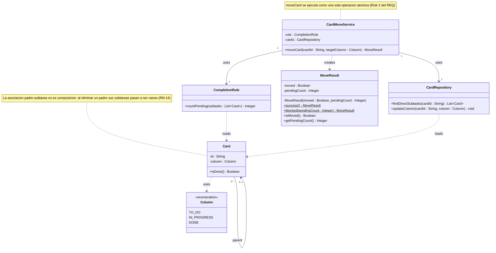

# Módulo Dashboard — diseño detallado de RF-ARB-07 (texto listo para las secciones 3.2, 3.3 y 3.4)

## 3.2 Class Diagram



*`CardRepository` es el uso que hace Dashboard de la persistencia de datos estructurados (tier 3). `Card` muestra solo los atributos que intervienen en este requerimiento; una tarjeta también tiene título, labels, responsable, fecha límite y color (RF-ARB-01, RF-ARB-13), que se omiten a propósito. Las firmas son independientes del lenguaje: en TypeScript las operaciones que tocan la base de datos serían asíncronas.*

### Relaciones y su justificación

| Relación | Tipo | Dirección (quién conoce a quién) | Por qué |
|---|---|---|---|
| `CardMoveService` → `CompletionRule` | Asociación (atributo `rule`) | El servicio conoce a la regla; la regla no conoce al servicio | El servicio mantiene la regla como colaborador durante toda su vida (inyección de dependencias de NestJS, ADR 0001). |
| `CardMoveService` → `CardRepository` | Asociación (atributo `cards`) | El servicio conoce al repositorio; el repositorio no conoce al servicio | Igual que la anterior: el repositorio es la única vía a la persistencia. |
| `CardMoveService` ⇢ `MoveResult` | Dependencia | Solo el servicio lo crea y lo devuelve | No lo guarda como atributo; existe solo durante la llamada. |
| `CompletionRule` ⇢ `Card` | Dependencia | La regla lee tarjetas; `Card` no conoce la regla | Recibe las subtareas como parámetro y solo pregunta `isDone()`. |
| `CardRepository` ⇢ `Card` | Dependencia | El repositorio construye y devuelve tarjetas; `Card` no conoce al repositorio | Evita que el dominio dependa de la persistencia. |
| `Card` → `Card` (`parent`, 0..* a 0..1) | Asociación reflexiva | La subtarea conoce a su padre | **No es composición**: al eliminar una tarjeta sus subtareas pasan a ser raíces (RN-14, RF-ARB-12), así que no mueren con el padre. Una tarjeta tiene como máximo un padre y puede tener cero o más subtareas (RN-11, sin ciclos). |
| `Card` ⇢ `Column` | Dependencia | `Card` usa la enumeración como tipo de su atributo | `Column` es un valor fijo (RF-KAN-01), no una entidad con vida propia. |

No se usa generalización: una subtarea es una `Card` completa (RF-ARB-01), no un subtipo con comportamiento distinto. Todas las flechas apuntan en un solo sentido y ninguna regresa a `CardMoveService`, de modo que el grafo de dependencias no tiene ciclos.

## 3.3 Class Responsibilities

| Clase | Responsabilidad | Conoce a | Es conocida por | Requisitos |
|---|---|---|---|---|
| `CardMoveService` | Atender la solicitud explícita de un miembro de mover una tarjeta; aplicar la regla de cierre cuando el destino es *Hecho* y guardar el movimiento solo si se cumple. | `CompletionRule`, `CardRepository`, `MoveResult` (la crea) | Quien invoca el servicio (controlador/gateway, fuera de este diagrama) | RF-ARB-07, RF-ARB-08, RF-KAN-04, RN-13 |
| `CompletionRule` | Decidir cuántas subtareas directas impiden cerrar una tarjeta. No consulta la base de datos: recibe las subtareas y devuelve un número. | `Card` | `CardMoveService` | RN-12, RNF-MAN-02 |
| `CardRepository` | Único acceso del módulo a la persistencia de tarjetas: leer las subtareas directas y cambiar la columna. | `Card` | `CardMoveService` | RNF-CON-02 |
| `Card` | Representar una tarjeta del tablero y responder si está terminada, sin exponer cómo se representa *Hecho*. | `Column`, `Card` (su padre) | `CompletionRule`, `CardRepository` | RF-KAN-01, RN-11, RN-14 |
| `Column` | Enumerar las tres columnas fijas del tablero. | — | `Card` | RF-KAN-01 |
| `MoveResult` | Informar el resultado: si se movió y cuántas subtareas están pendientes. Solo se crea con `success()` o `blocked(n)`, para que no exista un resultado contradictorio. El texto del mensaje lo arma la interfaz. | — | `CardMoveService` (la crea) y quien lo recibe | RF-ARB-07, RNF-USA-04 |

## 3.4 Behavior of one key operation

`CardMoveService.moveCard(cardId, targetColumn)`: caso de uso "Mover una tarea a *Hecho*".

```text
moveCard(cardId, targetColumn) -> MoveResult
 1  IF targetColumn IS NOT DONE
 2      cards.updateColumn(cardId, targetColumn)           # RF-KAN-04: the rule applies only to DONE
 3      RETURN MoveResult.success()
 4  # steps 5-9 must run as one atomic operation (Risk 2 of the REQ)
 5  subtasks = cards.findDirectSubtasks(cardId)
 6  pending  = rule.countPending(subtasks)                 # 0 if the card has no subtasks
 7  IF pending > 0                                         # non-happy path (RN-12)
 8      RETURN MoveResult.blocked(pending)                 # nothing is saved
 9  cards.updateColumn(cardId, DONE)
10  RETURN MoveResult.success()
```
