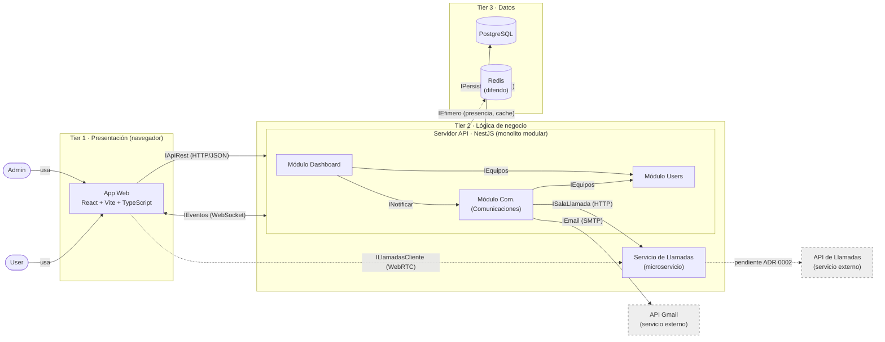
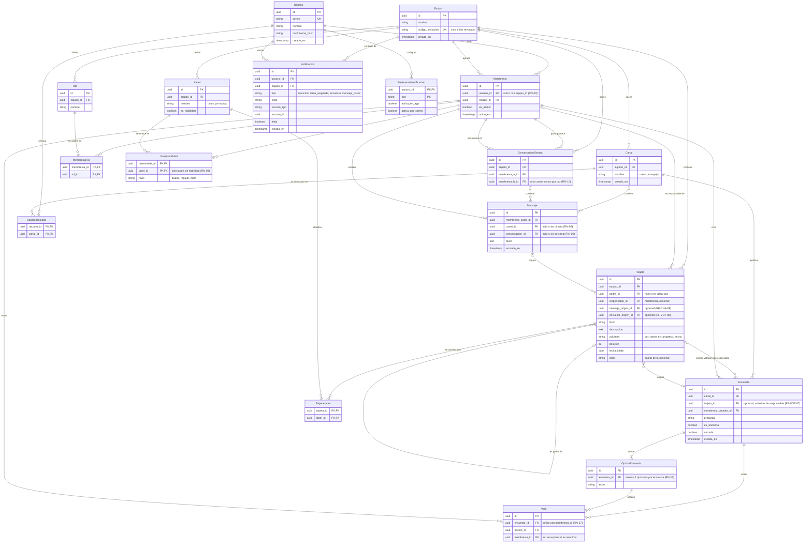
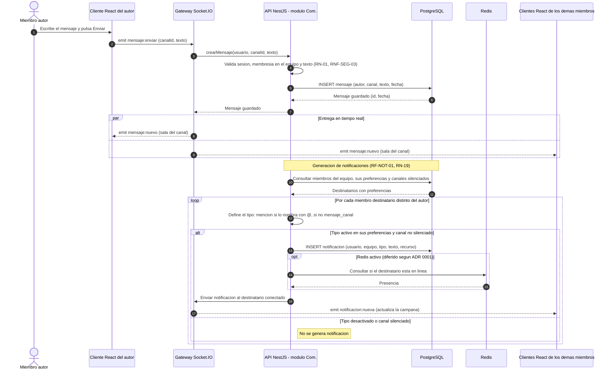
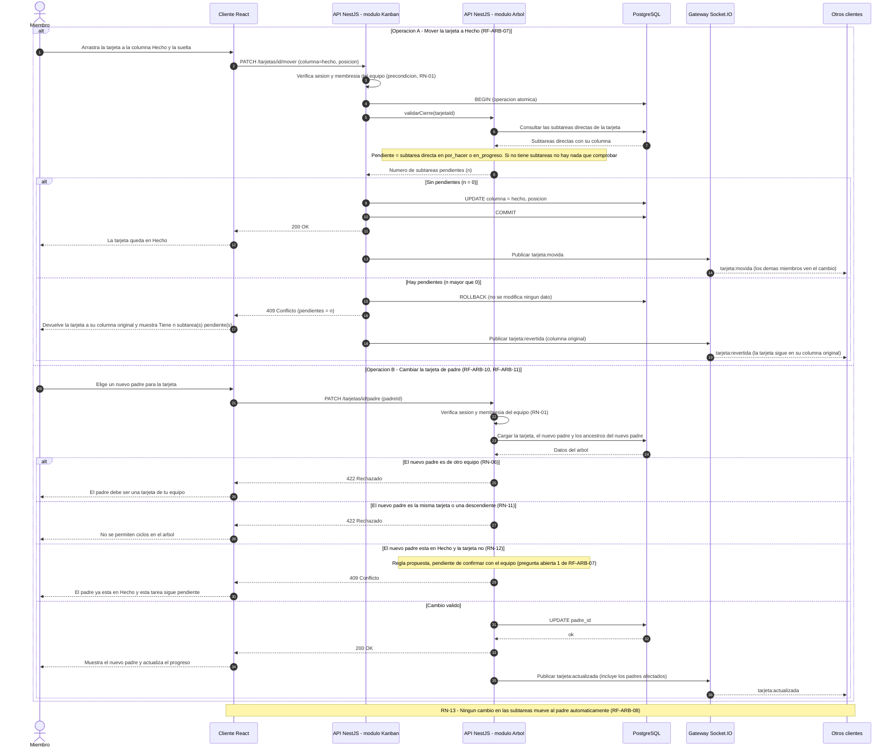
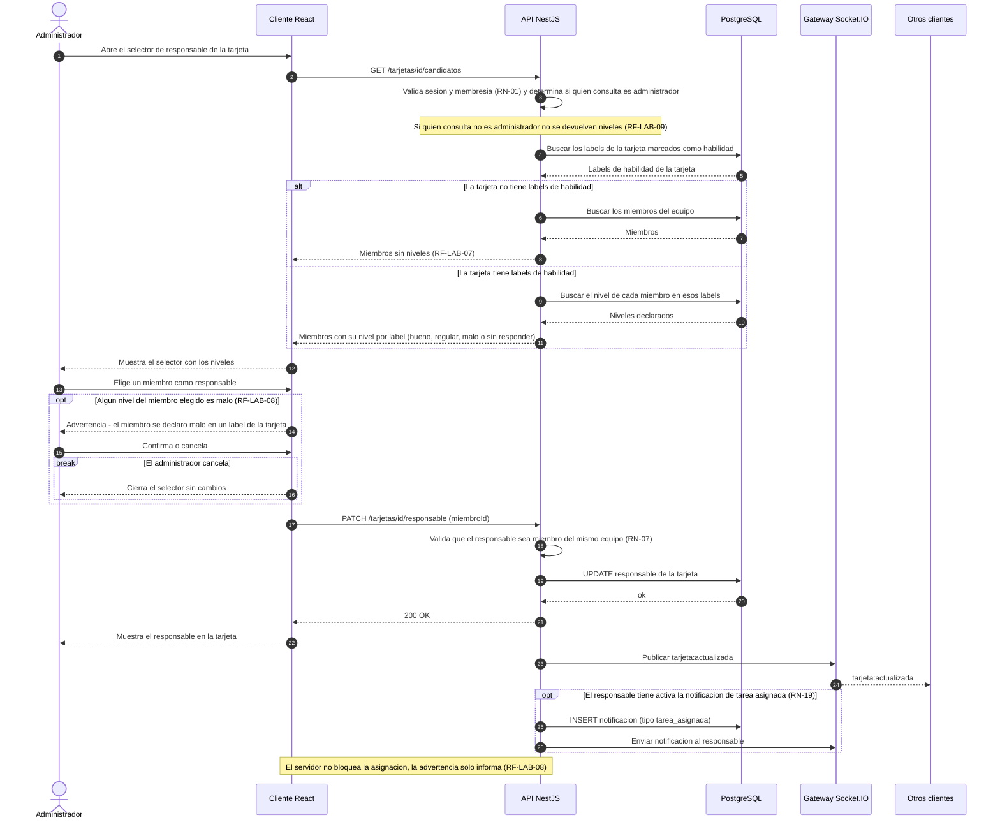
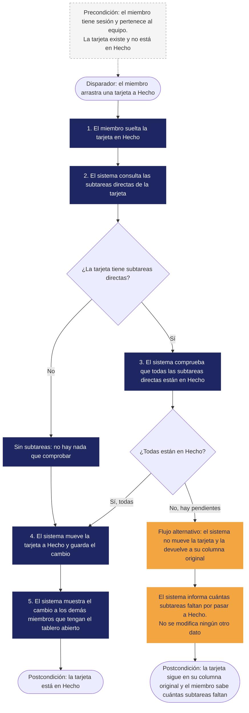
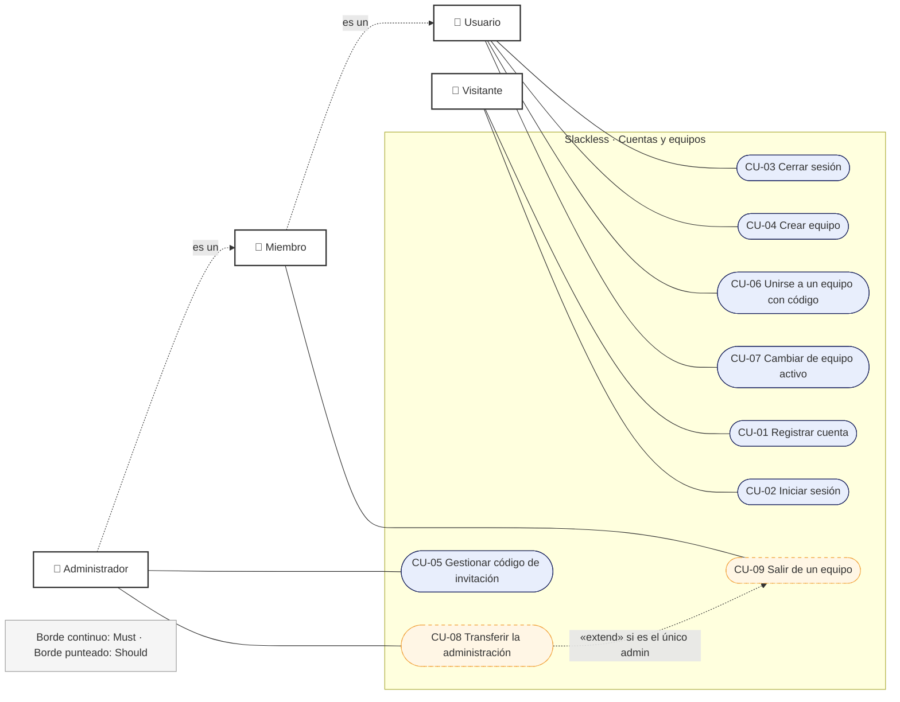
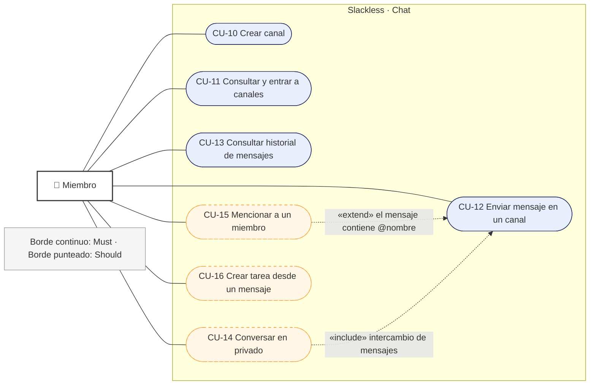
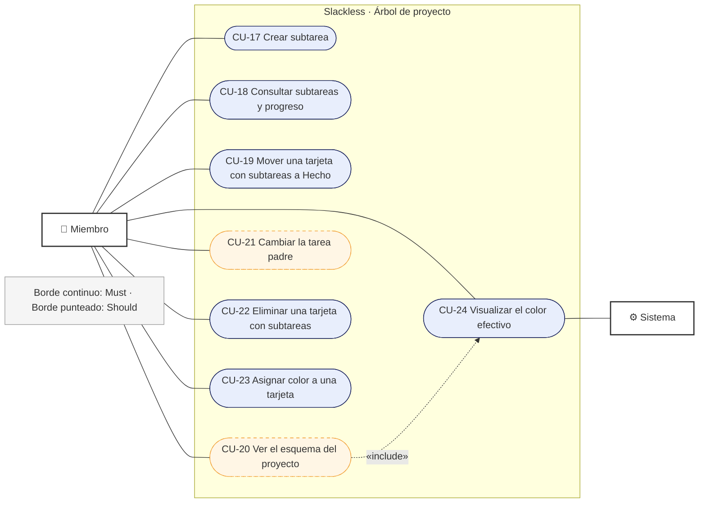

# Slackless — Diagramas Mermaid

Pega cada bloque en https://mermaid.live para verlo renderizado.

## 1. Arquitectura de tres capas y módulos

## 2. Modelo entidad-relación

## 3. Secuencia: mensaje en tiempo real y notificación

## 4. Secuencia: restricción de cierre del padre (RN-12 / RN-13)

## 5. Secuencia: asignación con niveles de habilidad

## 6. Caso de uso RF-ARB-07: Mover una tarea a Hecho (flujo)

## 7. Casos de uso: Cuentas y equipos (CU-01 a CU-09)

## 8. Casos de uso: Chat (CU-10 a CU-16)

## 9. Casos de uso: Árbol de proyecto (CU-17 a CU-24)

