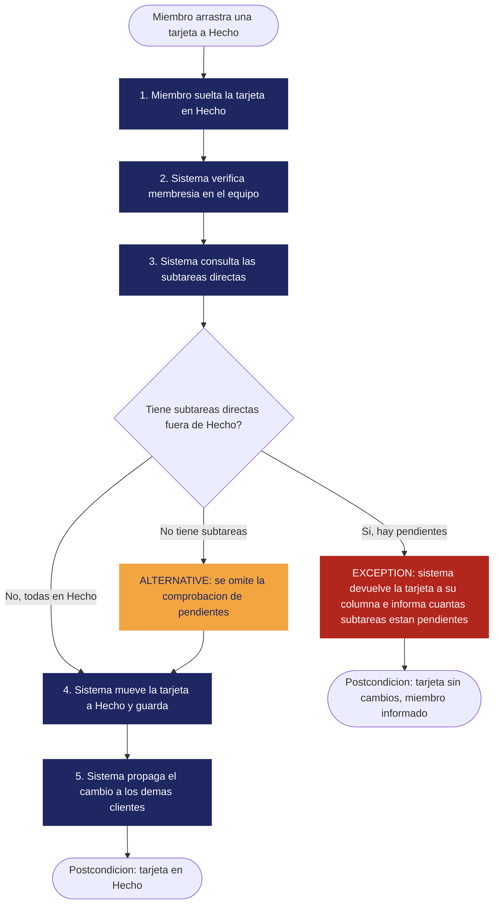

# RF-ARB-07 — Bloqueo de cierre con subtareas pendientes

| | |
|---|---|
| **Status** | Draft (con Open Questions pendientes, ver Sección 2) |
| **Team / Author(s)** | Grupo 2 — David Esteban Raigosa Socha, Deisy Viviana Lara Sisa, Hare Zeiyiukuin Atehortua Rincon, Fredy Humberto Garzon Salgado, Silvana Ramirez Ardila |
| **Date** | 2026-10-12 |
| **Linked User Story / AC** | HU-31 (El padre no se cierra con hijas pendientes), RN-12; criterios de aceptación AC-ARB-07.1 a AC-ARB-07.4 (Sección 4.2) |

---

## 1. Overview

**Requirement Statement**
> El sistema debe rechazar mover a *Hecho* una tarjeta que tenga al menos una subtarea directa fuera de *Hecho*, devolviendo la tarjeta a su columna e informando cuántas subtareas están pendientes.

**Type:** Functional
*(Filtro de la Tecnología Perfecta: con un computador infinitamente rápido, sin fallas y sin costo, el tablero seguiría necesitando una regla que impida declarar "terminada" una tarea con partes sin terminar. La regla no desaparece al quitar las limitaciones tecnológicas → Funcional.)*

**Source / Evidence**
> La regla surgió de la decisión del equipo en la sesión del **2026-09-29**, cuando se acordó la épica *Árbol de proyecto*; quedó registrada como HU-31 (historias de usuario v0.2), como la regla de negocio RN-12 y como este requerimiento en el SRS. No proviene de una entrada de la Discovery Sheet de la clase 8: el equipo no cuenta con una hoja donde esté registrada, por lo que no se cita ningún ID de evidencia para no inventarlo. Es coherente con la expectativa del perfil "Líder o administrador del equipo" (SRS §2.3): *que el tablero no mienta*.

**Need**
> Poder confiar en que una tarea marcada como *Hecho* realmente está terminada, incluidas todas sus partes. (La necesidad no es "un bloqueo al arrastrar"; es que el estado del tablero sea veraz. El bloqueo es la solución elegida.)

**Value / Rationale**
> El tablero no debe poder decir "terminado" sobre algo que tiene partes sin terminar; así el equipo y su líder ven el avance real sin tener que revisar tarea por tarea.

---

## 2. Context — A Requirement Rarely Stands Alone

**Business Rule(s)**
> **RN-12 — Un padre no está terminado antes que sus hijas:** una tarjeta no puede estar en *Hecho* mientras alguna de sus subtareas directas no lo esté (fuente: equipo 2026-09-29). Regla de dominio: "terminado" para un trabajo dividido significa que todas sus partes están terminadas.
> Reglas relacionadas: RN-13 (el padre nunca se mueve solo; contrapunto de esta regla, ver `RF-ARB-08`) y RN-11 (el árbol no admite ciclos, lo que garantiza que recorrer las subtareas sea siempre finito, ver `RF-ARB-11`).
> Nota: RN-12 es una regla de negocio, no un requerimiento de software; este requerimiento es la parte de la regla que el sistema debe hacer cumplir. `RNF-MAN-02` exige además que RN-12 tenga prueba automatizada.

**Constraint(s)**
> - El tablero tiene exactamente tres columnas fijas y *Hecho* es la única que significa "terminado" (`RF-KAN-01`); la regla depende de esa definición.
> - La verificación debe hacerse en el servidor, no solo en la interfaz (`RNF-SEG-02`), y un rechazo no debe dejar operaciones parciales (`RNF-SEG-03`).
> - Debe implementarse con el stack fijado en el ADR 0001 (`RES-01`).

**Assumption(s)**
> - Solo se evalúan las subtareas **directas**; se asume que el efecto se propaga a los niveles inferiores porque cada nivel aplica la misma regla al cerrarse. *(No verificado para casos en que el árbol cambia después de cerrar un nivel; ver Open Questions.)*
> - Una "subtarea pendiente" es cualquier subtarea directa en *Por hacer* o *En progreso*.
> - Los equipos son de 3 a 8 personas y los árboles son pequeños, por lo que contar subtareas directas no representa un problema de rendimiento.

**Dependenc(ies)**
> - `RF-KAN-04`: el movimiento de tarjetas por arrastrar y soltar es el punto donde se aplica la regla.
> - `RF-ARB-01` y `RF-ARB-02`: existencia de subtareas y de la relación padre-hija.
> - `RF-KAN-05` y `RNF-REN-02`: la devolución de la tarjeta a su columna debe verse en los demás clientes.
> - `RF-ARB-08`: define el contrapunto (el padre nunca se mueve solo).

**Risk(s)**

| Risk | Likelihood | Impact | Mitigation (optional) |
|---|---|---|---|
| Se valida solo en la interfaz y una petición directa al servidor salta la regla | Medium | High (el tablero vuelve a "mentir") | Validar en el servidor (`RNF-SEG-02`) y probarlo con una petición sin interfaz (AC-ARB-07.3) |
| Dos miembros actúan a la vez: uno mueve el padre a *Hecho* mientras otro devuelve una subtarea a *En progreso* | Low–Medium | Medium (estado inconsistente) | Evaluar y aplicar el movimiento en una sola operación atómica en el servidor |
| El miembro no entiende por qué la tarjeta "vuelve" | Medium | Medium (frustración, percepción de error) | Mensaje accionable con el número de pendientes (`RNF-USA-04`) |
| La tarjeta rechazada queda visualmente en *Hecho* en otros clientes | Low | Medium | Propagar el rechazo según `RNF-REN-02` / `RF-KAN-05` |

**Open Questions**
> 1. **Padre ya en *Hecho* que recibe una subtarea pendiente.** El requerimiento solo actúa al *mover* un padre a *Hecho*. Si el padre ya está en *Hecho* y luego se crea una subtarea nueva (`RF-ARB-01`), o se reasigna una subtarea pendiente a él (`RF-ARB-10`), ¿qué debe pasar? `RF-ARB-08` impide moverlo solo. Aún no está decidido con el equipo; se deja abierto en lugar de inventar una respuesta.
> 2. **Subtarea hecha que se reabre** estando el padre en *Hecho*: misma situación que la anterior.
> 3. **Alcance de "pendiente"**: ¿la regla evalúa solo hijas directas (como dice el requerimiento) o conviene verificar toda la descendencia? Por ahora se mantiene lo escrito en el SRS.
> 4. **Profundidad del árbol:** las historias v0.2 preguntan si convendría limitar la profundidad por legibilidad de la interfaz. Si se limitara, no cambiaría esta regla (que solo mira subtareas directas), pero se deja anotado.

---

## 3. Priority & Estimation

**Priority model used:** MoSCoW

**Priority assigned:**
> Porque la regla es lo que hace que el estado *Hecho* sea confiable (el equipo definió que el tablero "no debe mentir" para el perfil de líder), y porque otras funciones del árbol (indicador de progreso `RF-ARB-05`, esquema `RF-ARB-09`) solo tienen sentido si *Hecho* significa terminado de verdad, asignamos **Must have**, aceptando el trade-off de dedicar tiempo a la validación en el servidor y a su comportamiento en tiempo real, tiempo que no se invertirá en requerimientos *Should* como la vista de esquema o el cambio de padre. Consideramos **Should have** y no lo usamos porque, sin esta regla, el MVP permitiría estados contradictorios (padre *Hecho* con hijas abiertas) y el indicador "3/5" contradiría la columna del padre. Es consistente con la prioridad de su historia (HU-31) y con RES-04 (todo *Must* se entrega al cierre del semestre).
> *(Nota para el equipo: sustituir o complementar este argumento con el razonamiento del taller de Professional Requirements Attributes si fue distinto.)*

**Estimate (confidence):** Medium
> La lógica de evaluar las subtareas directas y contar pendientes es sencilla. Lo que baja la confianza de High a Medium es: (a) hacer el rechazo de forma atómica en el servidor y devolver la tarjeta en la interfaz con arrastrar y soltar sin parpadeos; (b) propagar el resultado en tiempo real a los demás clientes; (c) las Open Questions 1 y 2, que podrían añadir comportamiento.

---

## 4. Representations — Requirement ≠ Representation

### 4.1 User Story

> As a **miembro del equipo**,
> I want **que una tarea no pueda pasar a *Hecho* mientras tenga subtareas sin terminar**,
> so that **el tablero nunca mienta** (el estado *Hecho* refleje trabajo realmente terminado).
*(Redactada a partir de HU-31 del documento de historias de usuario v0.2.)*

*Check: el "I want" describe un resultado (no poder cerrar con partes abiertas), no una solución concreta como un diálogo, un candado o un color.*

### 4.2 Acceptance Criteria

**Scenario 1 (AC-ARB-07.1) — Cierre bloqueado (caso normal de la regla)**
> **Given** una tarjeta padre en *En progreso* con una subtarea directa en *En progreso*
> **When** un miembro arrastra el padre a *Hecho*
> **Then** el padre vuelve a su columna original y el sistema muestra "Tiene 1 subtarea pendiente"

**Scenario 2 (AC-ARB-07.2) — Cierre permitido tras terminar las subtareas (alternativa)**
> **Given** la misma tarjeta padre cuya única subtarea directa ya está en *Hecho*
> **When** el miembro arrastra el padre a *Hecho*
> **Then** el padre se mueve a *Hecho* y queda guardado (y, como en HU-31, ningún padre cambia de columna por sí solo)

**Scenario 3 (AC-ARB-07.3) — Varias subtareas pendientes**
> **Given** un padre con 5 subtareas directas, 3 en *Hecho* y 2 fuera de *Hecho*
> **When** un miembro intenta moverlo a *Hecho*
> **Then** el padre vuelve a su columna y el mensaje indica que hay 2 subtareas pendientes

**Scenario 4 (AC-ARB-07.4) — Intento sin pasar por la interfaz (excepción)**
> **Given** un padre con una subtarea pendiente
> **When** se envía directamente al servidor la petición de mover el padre a *Hecho*
> **Then** el servidor rechaza la petición, la tarjeta no cambia de columna y ningún dato queda modificado

### 4.3 Use Case

| Field | |
|---|---|
| **Use Case name** | Mover una tarea a *Hecho* |
| **Actor** | Miembro del equipo |
| **Goal** | Marcar una tarea como terminada sin contradecir el estado de sus subtareas |
| **Trigger** | El miembro arrastra una tarjeta a la columna *Hecho* |
| **Precondition** | El miembro tiene sesión y pertenece al equipo; la tarjeta existe y no está ya en *Hecho* |

**Main Flow**
1. El miembro arrastra la tarjeta a *Hecho* y la suelta.
2. El sistema verifica la membresía del miembro en el equipo.
3. El sistema consulta las subtareas directas de la tarjeta.
4. El sistema comprueba que todas están en *Hecho* (o que no tiene subtareas).
5. El sistema mueve la tarjeta a *Hecho* y guarda el cambio.
6. El sistema muestra el cambio a los demás miembros que tengan el tablero abierto.

**Alternative Flow**
> La tarjeta no tiene subtareas → el sistema omite la comprobación de pendientes y mueve la tarjeta a *Hecho* (equivale al flujo principal desde el paso 5).

**Exception**
> Al menos una subtarea directa está fuera de *Hecho* → el sistema no mueve la tarjeta, la devuelve a su columna original e informa cuántas subtareas están pendientes. No se modifica ningún otro dato.

**Postcondition**
> La tarjeta está en *Hecho* únicamente si todas sus subtareas directas están en *Hecho*; si no, permanece en su columna original y el miembro sabe cuántas subtareas faltan.

**Flow Diagram**

*(Azul = flujo principal, ámbar = alternativo, rojo = excepción.)*

---

## 5. Traceability & Impact

**Backward — why does this requirement exist?**
> Decisión del equipo 2026-09-29 → necesidad "que el tablero no mienta sobre lo terminado" (perfil líder/administrador, SRS §2.3) → RN-12 + HU-31 → RF-ARB-07.
> *(No existe entrada de Discovery Sheet que enlazar: la fuente es la decisión del equipo, no una entrevista con un stakeholder externo.)*

**Forward — what will this affect?**
> RF-ARB-07 → diseño: una validación en el módulo *árbol* del servidor (`RNF-MAN-04`) invocada por la operación de mover tarjeta del módulo *kanban*, y un manejo en la interfaz que revierta el arrastre y muestre el mensaje → implementación → pruebas: los Scenarios 1–4 como base; RN-12 debe quedar cubierta por prueba automatizada (`RNF-MAN-02`). *(El diseño aún no existe; se actualizará al comenzar Class 11.)*

**Impact Analysis — if this requirement changes, what else might need to change?**
- [x] Business Rules
- [ ] Constraints
- [x] Dependencies
- [x] Risks
- [x] Acceptance Criteria
- [x] Estimate
- [ ] Priority
- [x] Future Design
- [x] Future Tests

> Si cambia la definición de "pendiente" (p. ej. incluir toda la descendencia) o se resuelve la Open Question 1, cambian la regla de negocio, los criterios de aceptación, el diseño de la validación y sus pruebas, y también las dependencias con `RF-ARB-01`, `RF-ARB-10` y `RF-ARB-08`. La prioridad y las restricciones (columnas fijas, validación en servidor) es poco probable que se muevan: dependen de la decisión de producto y del ADR 0001, no de cómo se defina "pendiente".

---

## 6. Validation — Quality Gate

- [x] **Valid?** Sí — proviene de una decisión explícita del equipo (2026-09-29) y de la historia HU-31, no es inventado. *(La evidencia es la decisión del equipo, no una entrevista a un stakeholder externo; ver Sección 1.)*
- [x] **Clear / Unambiguous?** Sí — "subtarea directa fuera de *Hecho*" tiene una sola lectura; los mensajes y comportamientos esperados son concretos.
- [x] **Atomic?** Sí — una sola expectativa verificable: rechazar el cierre. Que el padre no se mueva solo (`RF-ARB-08`) es un requerimiento aparte.
- [x] **Necessary?** Sí — sin él, *Hecho* deja de ser confiable y el indicador de progreso (`RF-ARB-05`) puede contradecir la columna del padre.
- [x] **Feasible?** Sí — consulta simple de subtareas directas con el stack del ADR 0001; la parte más delicada (atomicidad y tiempo real) está identificada en Estimate.
- [x] **Verifiable?** Sí — los Scenarios 1–4 dan condiciones concretas de aprobado/fallado, incluida la prueba directa al servidor.
- [x] **Consistent?** Sí con los requerimientos revisados (`RF-KAN-01`, `RF-ARB-05`, `RF-ARB-08`, `RF-ARB-12`); la posible tensión con `RF-ARB-10` está registrada en Open Questions, no como conflicto confirmado.
- [ ] **Complete enough?** No del todo — las Open Questions 1 y 2 (padre ya en *Hecho* que recibe o reabre subtareas) no tienen decisión del equipo todavía.
- [x] **Traceable?** Sí, dentro de lo que existe — cada parte se enlaza a HU-31, RN-12 y la decisión del equipo del 2026-09-29. Limitación honesta: no hay entrada de Discovery Sheet (clase 8) ni entrevista a un stakeholder externo; la evidencia es la decisión del propio equipo.

> Una casilla sin marcar: **Complete enough?** — las Open Questions 1 y 2 (padre ya en *Hecho* que recibe una subtarea nueva o ve reabrir una existente) no tienen decisión del equipo todavía; se resolverán con el equipo y, si aparece nueva evidencia, se vuelve a Class 9 para re-especificar. Además, la evidencia de origen es una decisión interna del equipo y no una entrevista con un stakeholder externo (ver Sección 1). El Status se mantiene en **Draft** hasta resolver las Open Questions.
